# Programa de aprendizaje — Proyecto Odontología

> Documento único de formación técnica, elaborado a partir del código real del repositorio.
> Objetivo: comprender el sistema de punta a punta para poder mantenerlo, modificarlo y construir funcionalidades nuevas sin depender de código generado por IA.

- **Repositorio:** `C:\Users\Axel\Desktop\ProyectoOdontologia`
- **Rama:** `pruebas-locas`
- **Último commit:** `a051ebb` — `refactor(turnos): reemplazar KeyNotFoundException por TurnoNoEncontradoException de dominio`
- **Snapshot:** working tree con cambios sin commitear (46 archivos modificados, 7 sin trackear y `DeepTutor` marcado para eliminación en el índice).
- **Fecha de análisis:** 2026-11-16
- **Estado de verificación:** build correcto (0 errores, 0 advertencias), `228` pruebas aprobadas, `secret-scan.ps1` sin secretos reales (solo placeholders).

> **Advertencia de vigencia:** este documento describe el working tree actual, no el último commit. Si se revierten los cambios pendientes, varias rutas, líneas y comportamientos pueden dejar de coincidir. La guía no modifica ni corrige el código: lo explica y, cuando corresponde, señala riesgos.

---

## 0. Cómo usar este documento

<a id="s0"></a>

### 0.1 Destinatario

Este material está pensado para una persona que:

- Sabe programar lo básico, pero no necesariamente conoce .NET, C#, APIs HTTP, SQL ni arquitectura por capas.
- Quiere entender el proyecto real, no un ejemplo idealizado.
- Necesita poder leer el código, seguirlo, detectar errores y diseñar cambios sin ayuda de una IA.

### 0.2 Convenciones

| Marca | Significado |
|---|---|
| **Código real** | Fragmento copiado del repositorio, con ruta y líneas. |
| **Ejemplo didáctico** | Código inventado solo para enseñar un concepto; no existe en el proyecto. |
| **Recomendación** | Mejora propuesta; **no** está implementada. |
| **No aplica** | El tema no existe en el estado actual del proyecto. |
| **Verificado** | Dato comprobado en el código, en Git o ejecutando comandos. |

### 0.3 Recorrido recomendado

| Etapa | Duración sugerida | Secciones | Resultado esperado |
|---|---:|---|---|
| 1. Panorama | 2 h | 1, 2, 3 | Explicar qué hace el sistema y cómo se ejecuta. |
| 2. Lenguaje y arquitectura | 4 h | 4 (módulos 2 y 3), 5 | Explicar capas, interfaces, DI y responsabilidades. |
| 3. Flujos | 6 h | 6 | Reconstruir de memoria un alta de turno y un completado. |
| 4. Código real | 8 h | 7 | Explicar línea por línea los métodos centrales. |
| 5. Persistencia | 4 h | 8 | Entender SQLite, Dapper, transacciones y mapeo. |
| 6. Seguridad y pruebas | 4 h | 9, 10 | Auditar permisos, validaciones y cobertura. |
| 7. Práctica | 10 h | 11, 12 | Resolver ejercicios y evaluaciones sin IA. |
| 8. Revisión crítica | 3 h | 13 | Distinguir hechos comprobados de recomendaciones. |

### 0.4 Regla de estudio

No avances leyendo solamente. Después de cada sección:

1. Cerrá el documento.
2. Abrí el archivo real en el editor.
3. Explicá en voz alta qué hace.
4. Escribí una predicción de qué pasaría si cambiás una línea.
5. Recién después verificá con el código o con una prueba.

### 0.5 Comandos de verificación

```powershell
dotnet build ProyectoOdontologia.slnx
dotnet test CapaPruebas\ProyectoOdontologia.Tests.csproj
powershell -ExecutionPolicy Bypass -File scripts/secret-scan.ps1
```

> **Cuidado:** `scripts/verify.ps1` ejecuta `dotnet test` sobre `ProyectoOdontologia.slnx`, pero la solución **no incluye** `CapaPruebas`. Por eso el script no corre las 228 pruebas. Para ejecutarlas hay que apuntar al `.csproj` de pruebas, como en el comando anterior.

---

## 1. Snapshot y estado del repositorio

<a id="s1"></a>

### 1.1 Estado de Git

```text
Rama: pruebas-locas
Commit: a051ebb
Modificados sin commit: 46
Sin trackear: 7 al iniciar el análisis
Eliminado en índice: DeepTutor
```

Esta guía se agrega como archivo nuevo de documentación; no forma parte de los 7 archivos sin trackear del snapshot inicial ni modifica el código.

Archivos nuevos relevantes para el estudio:

- `CapaDominio/Entidades/MovimientoStock.cs`
- `CapaDominio/Entidades/TipoMovimientoStock.cs`
- `CapaDominio/Excepciones/TurnoNoModificableException.cs`
- `CapaPruebas/Persistencia/SqlitePersistenciaIntegrationTests.cs`
- `CapaPruebas/WebApi/TurnosControllerTests.cs`
- `CapaDePresentacion/assets/css/tokens.css`
- `README.md`

`DeepTutor/` está marcado para eliminación en el índice, pero la carpeta sigue existiendo en disco. **No forma parte del sistema odontológico** y queda excluida de esta guía.

### 1.2 Línea base ejecutada

| Verificación | Resultado |
|---|---|
| `dotnet build ProyectoOdontologia.slnx` | Correcto, 0 errores, 0 advertencias. |
| `dotnet test CapaPruebas\ProyectoOdontologia.Tests.csproj` | 228 aprobadas, 0 fallidas, 0 omitidas. |
| `scripts/secret-scan.ps1` | Sin secretos reales; dos placeholders de JWT en `appsettings*.json`. |

### 1.3 Qué se puede afirmar y qué no

**Se puede afirmar:**

- El backend compila y las pruebas pasan.
- La persistencia real usa SQLite + Dapper.
- Pacientes, odontólogos, insumos, tratamientos y turnos se guardan en SQLite.
- Usuarios y refresh tokens viven en memoria.
- El frontend es estático y consume la API por HTTP.
- Hay autenticación JWT y roles.
- Hay 228 pruebas automatizadas.

**No se puede afirmar sin aclaración:**

- Que la arquitectura sea “Clean Architecture pura”. Es una separación por capas con dependencias mayormente correctas, pero con decisiones híbridas y deuda técnica.
- Que `docs/architecture.md` describa el estado actual. Está desactualizado en varios puntos.
- Que el sistema esté listo para producción. Es una demo funcional con decisiones de seguridad y consistencia pendientes.
- Que exista historia clínica, odontograma, pagos, facturación o multi-clínica. No existen.

---

## 2. Índice

<a id="s2"></a>

| Sección | Contenido |
|---|---|
| [0. Cómo usar](#s0) | Convenciones, recorrido y comandos. |
| [1. Snapshot](#s1) | Estado de Git y línea base. |
| [2. Índice](#s2) | Esta tabla. |
| [3. Análisis del proyecto](#s3) | Problema, alcance, stack, estructura, entrada, ciclo de vida y desfases. |
| [4. Temario completo](#s4) | 12 módulos progresivos con objetivos y anclajes al código. |
| [5. Arquitectura y capas](#s5) | Responsabilidades, dependencias, DI, DTOs y diagramas. |
| [6. Flujos completos](#s6) | Login, pacientes, tratamientos, turnos, stock y frontend. |
| [7. Explicación del código real](#s7) | Fragmentos reales explicados con archivo y líneas. |
| [8. Persistencia](#s8) | SQLite, Dapper, esquema, transacciones, mapeo y migraciones. |
| [9. Seguridad y validaciones](#s9) | JWT, BCrypt, roles, validación por capas y hallazgos. |
| [10. Testing y depuración](#s10) | Inventario, patrones, ejecución y diagnóstico. |
| [11. Ejercicios prácticos](#s11) | Ejercicios progresivos con criterios y soluciones. |
| [12. Evaluaciones](#s12) | 7 niveles, preguntas, desafíos y rúbrica. |
| [13. Auditoría técnica](#s13) | Hechos comprobados y recomendaciones. |
| [14. Prompt para profesor IA](#s14) | Instrucciones para que otra IA enseñe con esta guía. |
| [15. Apéndices](#s15) | Glosario, mapa de archivos y atajos. |

---

## 3. Análisis del proyecto

<a id="s3"></a>

### 3.1 Qué problema resuelve

El sistema gestiona la operación básica de una clínica odontológica:

- Registrar pacientes y odontólogos.
- Administrar un catálogo de tratamientos.
- Asociar a cada tratamiento los insumos que consume.
- Controlar stock de insumos.
- Agendar turnos por odontólogo y día, evitando solapamientos.
- Consultar huecos disponibles.
- Completar un turno, descontando automáticamente los insumos del tratamiento.
- Cancelar o reprogramar turnos.
- Autenticar usuarios con JWT y distinguir roles.

**Lo que el nombre “odontología” podría sugerir y el código no implementa:** historia clínica, odontograma, diagnósticos, recetas, pagos, facturación, obras sociales, archivos adjuntos, auditoría clínica, multi-sucursal o multi-tenant.

### 3.2 Usuarios y roles

| Rol | Valor numérico | Uso real en el código |
|---|---:|---|
| `Paciente` | 1 | Se asigna al registrarse con `POST /api/Auth/register`. No puede entrar al panel ni a los controladores clínicos. |
| `Odontologo` | 2 | Acceso a pacientes, odontólogos, insumos, tratamientos (público), turnos y completar. |
| `Recepcionista` | 3 | Acceso a pacientes y turnos; el frontend le oculta odontólogos, insumos y completar. |
| `Admin` | 4 | Acceso total, incluido `UsuariosController`. |

**Observación importante:** el rol `Paciente` existe, pero no tiene un portal propio. El frontend solo admite `Admin`, `Odontologo` y `Recepcionista`; además, `PacienteController` y `TurnosController` excluyen explícitamente al rol `Paciente`. En la práctica, un paciente registrado solo puede autenticarse y refrescar su token.

### 3.3 Stack real verificado

| Aspecto | Valor |
|---|---|
| Runtime / SDK | .NET 10 (`net10.0`) |
| Lenguaje | C# con `Nullable` e `ImplicitUsings` habilitados |
| Aplicación | ASP.NET Core Web API (`Microsoft.NET.Sdk.Web`) |
| Autenticación | JWT Bearer (`Microsoft.AspNetCore.Authentication.JwtBearer` 10.0.5) |
| Hash de contraseñas | BCrypt.Net-Next 4.0.3 |
| Documentación API | Swashbuckle.AspNetCore 10.2.1 + OpenAPI |
| Acceso a datos | Dapper 2.1.89 + Microsoft.Data.Sqlite 10.0.14 |
| Base de datos | SQLite, archivo `clinica.db` |
| Pruebas | xUnit 2.9.3 + Moq 4.20.72 + coverlet 6.0.4 |
| Frontend | HTML + CSS + JavaScript estático, sin framework ni bundler |
| Configuración | `appsettings.json`, User Secrets, variables de entorno |

### 3.4 Estructura de proyectos

```text
ProyectoOdontologia.slnx
├─ CapaDominio/                 → entidades, valores, excepciones (sin dependencias externas)
├─ CapaAplicacion/              → DTOs, interfaces, servicios de aplicación, seguridad
├─ CapaInfraestructura/         → SQLite + Dapper, UoW, BCrypt, JWT, repos en memoria
├─ CapaWebApi/                  → controllers, middleware, DI, configuración
├─ CapaPruebas/                 → xUnit (NO incluida en el .slnx)
├─ CapaDePresentacion/          → frontend estático (NO es proyecto .NET)
├─ docs/                        → documentación y esta guía
├─ memory/                      → decisiones y lecciones aprendidas
├─ scripts/                     → secret-scan.ps1, verify.ps1
└─ spec/                        → plantillas SDD
```

### 3.5 Referencias entre proyectos

| Proyecto | Referencia a |
|---|---|
| `CapaAplicacion` | `CapaDominio` |
| `CapaInfraestructura` | `CapaDominio`, `CapaAplicacion` |
| `CapaWebApi` | `CapaDominio`, `CapaAplicacion`, `CapaInfraestructura` |
| `CapaPruebas` | `CapaInfraestructura`, `CapaWebApi` |
| `CapaDePresentacion` | Ninguna referencia .NET; consume HTTP |

Esto respeta la dirección de dependencias de una arquitectura en capas: el dominio no conoce a nadie; la aplicación define puertos; infraestructura los implementa; la API compone todo.

### 3.6 Punto de entrada y ciclo de vida

El punto de entrada es `CapaWebApi/Program.cs`. No hay clase `Startup`; usa el modelo minimal hosting de ASP.NET Core.

Secuencia de arranque:

1. Se crea `WebApplicationBuilder`.
2. Se registra `IRepositorioUsuario` como **singleton en memoria**.
3. Se lee la cadena `ConnectionStrings:ClinicaDb`; si falta, se usa `Data Source=clinica.db;Foreign Keys=True`.
4. Se registra `IDbConnectionFactory` como singleton.
5. Se registran `IUnitOfWork` y los repositorios SQLite como **scoped**.
6. Se registran servicios de aplicación y seguridad como **scoped**.
7. Se configuran controllers, Swagger, JWT, CORS y `ProblemDetails`.
8. Se construye la app.
9. Se crea un scope y se ejecuta `DatabaseInitializer.InicializarAsync` para crear/migrar el esquema.
10. En Development se habilita Swagger.
11. Se arma el pipeline: middleware de errores → routing → CORS → autenticación → autorización → controllers.
12. `app.Run()`.

### 3.7 Cómo se ejecuta

```powershell
dotnet build ProyectoOdontologia.slnx
dotnet run --project CapaWebApi
```

URLs de `launchSettings.json`:

- HTTP: `http://localhost:5231`
- HTTPS: `https://localhost:7244` y `http://localhost:5231`

Swagger queda en `/swagger` cuando `ASPNETCORE_ENVIRONMENT=Development`.

Base de datos: se crea `clinica.db` en el directorio de ejecución. El archivo está ignorado por Git (`*.db`, `*.db-shm`, `*.db-wal`). Para reiniciar la demo hay que detener la API y eliminar o renombrar esos archivos.

### 3.8 Configuración

`CapaWebApi/appsettings.json` contiene:

- Cadena de conexión SQLite.
- Niveles de logging.
- `Jwt:Issuer`, `Jwt:Audience`, `Jwt:ExpireHours`.
- `Jwt:Key` con un **placeholder**, no una clave real.

La clave real debe configurarse fuera del repositorio:

```powershell
dotnet user-secrets init --project CapaWebApi
dotnet user-secrets set "Jwt:Key" "<clave-local-de-al-menos-32-caracteres>" --project CapaWebApi
```

`Program.cs` usa `builder.Configuration["Jwt:Key"]!`. Si la clave no está configurada, el arranque falla al construir la clave de firma. Es un fallo temprano, pero con un mensaje poco explicativo.

### 3.9 Funcionalidades principales y su estado

| Funcionalidad | Estado | Persistencia |
|---|---|---|
| Login / refresh / registro | Implementada | Usuarios en memoria |
| CRUD pacientes | Implementada | SQLite |
| CRUD odontólogos | Implementada | SQLite |
| CRUD tratamientos + insumos | Implementada | SQLite |
| CRUD insumos + stock | Implementada | SQLite + movimientos |
| Agenda de turnos | Implementada | SQLite |
| Huecos disponibles | Implementada | Calculada en dominio |
| Completar turno y consumir stock | Implementada | SQLite transaccional |
| Cancelar / reprogramar | Implementada | SQLite transaccional |
| Roles y autorización | Parcial | JWT + atributos |
| Historia clínica / odontograma | No implementada | — |
| Pagos / facturación | No implementada | — |
| Reserva de stock | No implementada | `StockReservado` existe, pero no hay flujo que lo modifique |
| Reposición de stock vía API | No implementada | El dominio tiene `ReponerStock`, pero no hay endpoint |
| Listado de movimientos de stock | No implementado | Se escriben, no se exponen |
| Cambio de contraseña | No implementado | El dominio tiene `CambiarPasswordHash`, sin endpoint |
| Paginación server-side | No implementada | El frontend pagina en memoria |
| Auditoría clínica | No implementada | — |

### 3.10 Inventario de componentes

**Dominio**

- Entidades: `Turno`, `Insumo`, `Tratamiento`, `TratamientoInsumo`, `Paciente`, `Odontologo`, `Usuario`, `RefreshToken`, `MovimientoStock`.
- Enums: `EstadoTurno`, `CategoriaInsumo`, `NivelCriticidad`, `TipoMovimientoStock`, `RolUsuario`.
- Objetos de valor: `AgendaDiaria`, `IntervaloDeTiempo`.
- Excepciones: `DomainException`, `TurnoSolapadoException`, `TurnoNoModificableException`, `TurnoNoEncontradoException`, `PacienteNoEncontradoException`, `OdontologoNoEncontradoException`, `TratamientoNoEncontradoException`, `InsumoNoEncontradoException`, `StockInsuficienteException`.

**Aplicación**

- Servicios: `PacienteService`, `OdontologoService`, `InsumosService`, `TratamientoService`, `TurnosService`, `AuthService`, `UsuarioAdminService`.
- DTOs de entrada y salida.
- Interfaces de repositorio, servicio, UoW, hasher y JWT.

**Infraestructura**

- SQLite: `SqliteConnectionFactory`, `UnitOfWorkSqlite`, `DatabaseInitializer`, `SqliteTypeHandlers`.
- Repositorios SQLite: turnos, tratamientos, insumos, pacientes, odontólogos.
- Servicios: `PasswordHasherBCrypt`, `JwtProvider`.
- Repositorio en memoria: `RepositorioUsuario`.
- Repositorios legacy en memoria: turnos, tratamientos, insumos, pacientes, odontólogos (no registrados en `Program.cs`, pero usados por pruebas).

**Web API**

- Controllers: `Auth`, `Paciente`, `Odontologo`, `Tratamiento`, `Insumos`, `Turnos`, `Usuarios`.
- Middleware: `ExceptionHandlingMiddleware`.
- `Program.cs`.

**Frontend**

- `Login.html`, `Api.html`.
- `assets/js/config.js`, `api.js`, `login.js`, `app.js`.
- `assets/css/tokens.css`, `login.css`, `styles.css`.

### 3.11 Inventario de pruebas

| Grupo | Archivos | Casos |
|---|---|---:|
| Dominio | `AgendaDiariaValidacionTests`, `InsumoStockTests` | 14 |
| Servicios | `TurnosServiceTests`, `TratamientoServiceTests`, `InsumosServiceTests`, `InsumosServiceConFakeTests`, `PacienteServiceTests`, `OdontologoServiceTests` | 68 |
| Persistencia SQLite | `InsumoRepositorySqliteTests`, `TratamientoRepositorySqliteTests`, `TurnoRepositorySqliteTests`, `PacienteRepositorySqliteTests`, `OdontologoRepositorySqliteTests`, `DapperMappingSqliteTests`, `TurnosServiceSqliteTests`, `SqlitePersistenciaIntegrationTests` | 39 |
| Repositorios en memoria | `RepositorioInsumosTests`, `RepositorioOdontologoTests`, `RepositorioPacienteTests`, `RepositorioTratamientoTests`, `RepositorioTurnosTests` | 86 |
| Concurrencia | `IdAutoIncrementoConcurrenciaTests`, `TurnosServiceConcurrenciaTests` | 7 |
| Web API | `ExceptionHandlingMiddlewareTests`, `TurnosControllerTests` | 14 |
| **Total** | 25 archivos | **228** |

### 3.12 Desfases entre documentación y código

| Documento | Afirmación | Realidad verificada |
|---|---|---|
| `docs/architecture.md` | Pacientes y odontólogos siguen en memoria. | `Program.cs` registra `PacienteRepositorySqlite` y `OdontologoRepositorySqlite`. |
| `docs/architecture.md` | Insumos solo para pruebas. | `InsumoRepositorySqlite` está registrado en producción. |
| `docs/mcp.md` | No hay motor de base de datos. | SQLite + Dapper están en uso. |
| `SYSTEM_HARNESS.md` | Enumera tablas sin `MovimientosStock`. | `DatabaseInitializer` crea `MovimientosStock`. |
| `scripts/verify.ps1` | Ejecuta tests de la solución. | La solución no incluye `CapaPruebas`; no corre las 228 pruebas. |
| `README.md` | Dice que `appsettings.json` contiene solo placeholders. | Correcto; el escaneo lo confirma. |

Estos desfases no se corrigen en esta guía: se documentan para que no se estudie una arquitectura inexistente.

### 3.13 Modelo mental de una frase

> Una API ASP.NET Core recibe HTTP, valida DTOs, delega en servicios de aplicación, que orquestan entidades de dominio e interfaces de repositorio; infraestructura implementa esas interfaces con Dapper y SQLite; el middleware traduce excepciones a `ProblemDetails`; un frontend estático consume la API con JWT.

---

## 4. Temario completo

<a id="s4"></a>

### 4.0 Cómo está organizado el temario

Los 12 módulos están ordenados por dependencia conceptual. No conviene saltear del 1 al 7: los turnos usan conceptos de dominio, DTOs, DI, persistencia y transacciones que se explican antes.

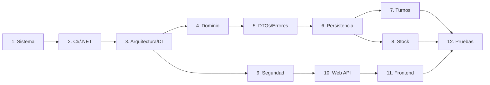

Cada módulo tiene: objetivo, conceptos, archivos reales, ejercicios y criterio de dominio. Las respuestas y desafíos ampliados están en las secciones 11 y 12.

---

<a id="m1"></a>
### Módulo 1 — Fundamentos del sistema y operación

**Objetivo:** ejecutar el sistema desde cero y explicar qué ocurre entre un clic del frontend y una fila en SQLite.

**Conceptos:** cliente-servidor, HTTP, JSON, API REST, endpoint, recurso, verbo, código de estado, puerto, `localhost`, base de datos embebida, archivo de base de datos, migración, Swagger, variable de entorno, User Secrets.

**Archivos de estudio:**

- `CapaWebApi/Program.cs`
- `CapaWebApi/Properties/launchSettings.json`
- `CapaWebApi/appsettings.json`
- `README.md`
- `scripts/verify.ps1`, `scripts/secret-scan.ps1`

**Preguntas guía:**

1. ¿Qué diferencia hay entre `http://localhost:5231` y `https://localhost:7244`?
2. ¿Dónde se guarda `clinica.db` y por qué no aparece en Git?
3. ¿Qué pasa si se borra `clinica.db` y se reinicia la API?
4. ¿Por qué el login no consulta SQLite?
5. ¿Qué significa que Swagger solo esté disponible en Development?

**Ejercicios:** ejecutar la API, abrir Swagger, autenticarse y listar pacientes. Reiniciar y comprobar qué datos sobreviven y cuáles no.

**Criterio de dominio:** podés levantar el sistema, explicar el rol de cada URL y describir qué se pierde al reiniciar.

---

<a id="m2"></a>
### Módulo 2 — C# y .NET modernos aplicados

**Objetivo:** leer sin fricción el código del proyecto y entender sus construcciones idiomáticas.

**Conceptos:**

- Tipos por referencia y por valor; `class`, `record`, `enum`, `struct`.
- `nullable reference types`: `string?`, `!`, advertencias.
- Propiedades con `get`/`set`, `private set`, `init`, propiedades calculadas.
- Constructores, guard clauses, `ArgumentNullException`, `ArgumentException`.
- `async`/`await`, `Task`, `Task<T>`, `ValueTask`, contexto de sincronización, `.Result` y deadlocks.
- LINQ: `Where`, `Select`, `Any`, `All`, `FirstOrDefault`, `OrderBy`, `Sum`.
- Genéricos, interfaces, inyección de dependencias.
- Excepciones: lanzar, capturar, filtrar, envolver, no silenciar.
- `DateTime`, `DateTimeKind`, UTC vs local, `TimeSpan`, `decimal`.
- Patrones modernos: `is not null`, `??`, `?.`, target-typed `new()`, file-scoped namespaces.
- Colecciones: `List<T>`, `IEnumerable<T>`, `IReadOnlyList<T>`, diccionarios.
- Serialización JSON y nombres de propiedades.

**Archivos de estudio:**

- `CapaDominio/Entidades/Turnos.cs`
- `CapaAplicacion/ServiciosAplicacion/TurnosService.cs`
- `CapaInfraestructura/Persistencia/TurnoRepositorySqlite.cs`
- `CapaPruebas/Servicios/TurnosServiceTests.cs`

**Ejercicios:**

1. Explicar por qué un método `async Task` no debe llamarse con `.Result` desde ASP.NET Core.
2. Identificar todas las guard clauses del constructor de `Turno`.
3. Explicar qué diferencia hay entre `DateTime.Now` y `DateTime.UtcNow` y dónde se usa cada uno.
4. Reescribir mentalmente una consulta LINQ del proyecto como bucle `foreach` (sin modificar archivos).

**Criterio de dominio:** podés explicar cualquier firma del proyecto, decir si es asíncrona, qué devuelve y qué excepciones puede lanzar.

---

<a id="m3"></a>
### Módulo 3 — Arquitectura por capas e inyección de dependencias

**Objetivo:** justificar la ubicación de cada clase y seguir el recorrido de una dependencia desde el controller hasta SQLite.

**Conceptos:**

- Separación de responsabilidades.
- Capas y dirección de dependencias.
- Puertos y adaptadores: interfaces en Aplicación, implementaciones en Infraestructura.
- Composición en el arranque (`Program.cs`).
- Ciclos de vida DI: singleton, scoped, transient.
- Principio de inversión de dependencias.
- DTOs como contrato de frontera.
- Controladores delgados; servicios orquestadores; dominio sin infraestructura.
- Errores comunes: lógica de negocio en controllers, entidades que conocen SQL, servicios que instancian repositorios con `new`.

**Archivos de estudio:**

- `CapaWebApi/Program.cs`
- `CapaAplicacion/Interfaces/ITurnoRepository.cs`
- `CapaAplicacion/Interfaces/IUnitOfWork.cs`
- `CapaAplicacion/ServiciosAplicacion/TurnosService.cs`
- `CapaInfraestructura/Persistencia/TurnoRepositorySqlite.cs`
- `CapaInfraestructura/Persistencia/UnitOfWorkSqlite.cs`

**Ejercicios:**

1. Dibujar las dependencias de `TurnosController`.
2. Explicar por qué `TurnosService` no menciona `SqliteConnection`.
3. Explicar por qué `TurnoRepositorySqlite` no puede existir dentro de `CapaDominio`.
4. Indicar qué registros son singleton, scoped y transient en `Program.cs`.
5. Explicar qué pasaría si un singleton dependiera de un scoped.

**Criterio de dominio:** podés agregar una funcionalidad indicando exactamente qué archivo toca cada capa, sin mezclar responsabilidades.

---

<a id="m4"></a>
### Módulo 4 — Dominio rico e invariantes

**Objetivo:** entender por qué las entidades no son “bolsas de propiedades” y cómo protegen sus reglas.

**Conceptos:**

- Entidad, identidad, estado, transición.
- Objeto de valor e inmutabilidad.
- Invariante: condición que siempre debe cumplirse.
- Encapsulamiento: setters privados, constructores validantes, métodos de negocio.
- Guard clauses y excepciones de dominio.
- Fábricas y constructores privados para rehidratación.
- Estado válido vs estado representable.
- Separación entre regla de dominio y regla de aplicación.

**Archivos de estudio:**

- `CapaDominio/Entidades/Turnos.cs`
- `CapaDominio/Entidades/Insumos.cs`
- `CapaDominio/Entidades/Tratamiento.cs`
- `CapaDominio/Entidades/TratamientoInsumo.cs`
- `CapaDominio/Entidades/Paciente.cs`
- `CapaDominio/Entidades/ObjetosDeValor/AgendaDiaria.cs`
- `CapaDominio/Entidades/ObjetosDeValor/IntervalosDeTiempo.cs`

**Ejercicios:**

1. Enumerar las invariantes de `Turno`, `Insumo` y `TratamientoInsumo`.
2. Explicar por qué `Stock`, `StockReservado` y `StockMinimo` tienen setters privados.
3. Explicar por qué `Turno.Reprogramar` lanza una excepción si el turno está cancelado.
4. Diseñar un caso de prueba que intente violar cada invariante.
5. Explicar por qué `TratamientoInsumo` valida `cantidadRequerida > 0` pero permite `tratamientoId == 0` (hallazgo real, no ejemplo).

**Criterio de dominio:** podés leer una entidad y decir qué estados son imposibles de construir y por qué.

---

<a id="m5"></a>
### Módulo 5 — DTOs, validación y manejo de errores

**Objetivo:** distinguir validación de borde, validación de aplicación y validación de dominio; y traducir errores a respuestas HTTP coherentes.

**Conceptos:**

- DTO de entrada vs DTO de salida.
- Data Annotations (`[Required]`, `[Range]`, `[EmailAddress]`, `[StringLength]`).
- Validación manual en servicios.
- `ModelState` y respuestas 400 automáticas.
- Excepciones de dominio vs excepciones técnicas.
- `ProblemDetails`, `application/problem+json`.
- Middleware de excepciones y orden del pipeline.
- Códigos 400, 401, 403, 404, 409, 500.
- Fuga de detalles internos en mensajes de error.

**Archivos de estudio:**

- `CapaAplicacion/DtosInput/`
- `CapaAplicacion/DtosOutput/`
- `CapaWebApi/Controllers/TurnosController.cs`
- `CapaWebApi/GlobalExceptionHandle.cs`
- `CapaDominio/Excepciones/`

**Ejercicios:**

1. Clasificar cinco validaciones del proyecto como “borde”, “aplicación” o “dominio”.
2. Explicar por qué `PacienteDtoOutput` no debe tener setters públicos.
3. Trazar qué respuesta HTTP produce `TurnoSolapadoException`.
4. Encontrar un mensaje de error que hoy podría revelar detalles de SQLite.
5. Explicar por qué un 401 no es lo mismo que un 403.

**Criterio de dominio:** podés agregar una regla y decidir en qué capa validarla, qué excepción lanzar y qué código HTTP devolver.

---

<a id="m6"></a>
### Módulo 6 — Persistencia con SQLite y Dapper

**Objetivo:** entender cómo se guarda y recupera el estado sin ORM completo, y cómo se protege la consistencia.

**Conceptos:**

- SQLite: archivo, bloqueo, WAL, claves foráneas, índices.
- Conexión por operación vs conexión compartida.
- SQL parametrizado y prevención de inyección.
- Dapper: `QueryAsync`, `ExecuteAsync`, `ExecuteScalarAsync`, multi-mapping.
- Type handlers: `DateTime`, `decimal`, `TimeSpan`.
- Type maps y constructores.
- Unidad de trabajo y transacciones.
- `BEGIN IMMEDIATE`, `COMMIT`, `ROLLBACK`.
- Propiedad de la transacción.
- Rehidratación de entidades ricas.
- `MAX(Id)+1` vs `AUTOINCREMENT`.
- Migraciones ad-hoc y deuda técnica.

**Archivos de estudio:**

- `CapaInfraestructura/Persistencia/DatabaseInitializer.cs`
- `CapaInfraestructura/Persistencia/SqliteConnectionFactory.cs`
- `CapaInfraestructura/Persistencia/UnitOfWorkSqlite.cs`
- `CapaInfraestructura/Persistencia/SqliteTypeHandlers.cs`
- `CapaInfraestructura/Persistencia/TurnoRepositorySqlite.cs`
- `CapaInfraestructura/Persistencia/InsumoRepositorySqlite.cs`
- `CapaInfraestructura/Persistencia/TratamientoRepositorySqlite.cs`

**Ejercicios:**

1. Escribir mentalmente el `SELECT` que obtiene los turnos de un día.
2. Explicar por qué `@Id` evita inyección SQL.
3. Explicar qué hace `BEGIN IMMEDIATE` y por qué se usa en lugar de una transacción diferida.
4. Seguir el recorrido de un `decimal` desde C# hasta SQLite y de vuelta.
5. Explicar por qué `UnitOfWorkSqlite.Transaction` siempre es `null`.
6. Detectar qué repositorios abren su propia transacción y cuáles dependen del UoW.

**Criterio de dominio:** podés leer un repositorio y explicar conexión, SQL, parámetros, mapeo y transacción.

---

<a id="m7"></a>
### Módulo 7 — Turnos y agenda: el núcleo del sistema

**Objetivo:** dominar el flujo más complejo del proyecto: agendar, validar solapamientos, buscar huecos, cancelar, reprogramar y completar con consumo de stock.

**Conceptos:**

- Intervalo semiabierto `[inicio, fin)`.
- Solapamiento: `inicioA < finB && inicioB < finA`.
- Agenda diaria por odontólogo.
- Duración mínima, fecha futura, estado.
- Huecos disponibles y “mejor hueco”.
- Transiciones de estado: pendiente → completado/cancelado; reprogramación.
- Transacción que abarca turno + stock.
- Idempotencia y doble completado.
- Concurrencia y lecturas fuera de transacción.
- Zona horaria y `DateTimeKind`.

**Archivos de estudio:**

- `CapaDominio/Entidades/Turnos.cs`
- `CapaDominio/Entidades/ObjetosDeValor/AgendaDiaria.cs`
- `CapaDominio/Entidades/ObjetosDeValor/IntervalosDeTiempo.cs`
- `CapaAplicacion/ServiciosAplicacion/TurnosService.cs`
- `CapaWebApi/Controllers/TurnosController.cs`
- `CapaInfraestructura/Persistencia/TurnoRepositorySqlite.cs`
- `CapaPruebas/Servicios/TurnosServiceTests.cs`
- `CapaPruebas/Dominio/AgendaDiariaValidacionTests.cs`

**Ejercicios:**

1. Calcular a mano si `[09:00, 10:00)` se solapa con `[10:00, 11:00)`.
2. Explicar por qué el solapamiento usa `<` y no `<=`.
3. Trazar el flujo de `RegistrarTurnoAsync` línea por línea.
4. Explicar qué pasa si el tratamiento no existe.
5. Explicar qué pasa si falla el descuento de stock al completar.
6. Enumerar los estados y transiciones legales.
7. Encontrar el punto exacto donde se lee el turno fuera de la transacción al cancelar.

**Criterio de dominio:** podés explicar el flujo completo y predecir el resultado de cualquier combinación de horarios y estados.

---

<a id="m8"></a>
### Módulo 8 — Insumos, tratamientos y stock

**Objetivo:** comprender el catálogo de tratamientos, la relación con insumos y el control transaccional del stock.

**Conceptos:**

- Catálogo vs inventario.
- Relación muchos-a-muchos con cantidad.
- Stock disponible = `Stock - StockReservado`.
- Stock mínimo, criticidad, reposición.
- Consumo al completar un turno.
- Movimiento de stock como registro de auditoría.
- Validación en definición vs validación en consumo.
- Atomicidad: todo o nada.
- Borrado restringido por claves foráneas.

**Archivos de estudio:**

- `CapaDominio/Entidades/Insumos.cs`
- `CapaDominio/Entidades/Tratamiento.cs`
- `CapaDominio/Entidades/TratamientoInsumo.cs`
- `CapaDominio/Entidades/MovimientoStock.cs`
- `CapaAplicacion/ServiciosAplicacion/TratamientoService.cs`
- `CapaAplicacion/ServiciosAplicacion/InsumosService.cs`
- `CapaInfraestructura/Persistencia/InsumoRepositorySqlite.cs`

**Ejercicios:**

1. Calcular stock disponible con `Stock=10`, `StockReservado=3`.
2. Explicar por qué `DescontarStock` no permite stock negativo.
3. Explicar por qué se registra un movimiento y quién lo hace.
4. Trazar `ConsumirInsumosAsync` y su rollback.
5. Explicar por qué no se puede borrar un insumo usado en un tratamiento.
6. Debatir si validar stock al definir un tratamiento es correcto.

**Criterio de dominio:** podés explicar cómo se evita vender stock inexistente y qué queda registrado.

---

<a id="m9"></a>
### Módulo 9 — Autenticación, autorización y seguridad

**Objetivo:** entender cómo se identifica un usuario, cómo se autoriza una acción y dónde están los riesgos.

**Conceptos:**

- Autenticación vs autorización.
- Hash vs cifrado; BCrypt y salt.
- JWT: header, payload, firma; claims; expiración; issuer; audience.
- Token de acceso vs refresh token; rotación y revocación.
- `[Authorize]`, `[Authorize(Roles="...")]`, `User.IsInRole`.
- 401 vs 403.
- Almacenamiento de tokens en el navegador: `localStorage` y XSS.
- CORS.
- HTTPS, HSTS, rate limiting, lockout.
- Secretos: User Secrets, variables de entorno, placeholders.
- Denegación por defecto.

**Archivos de estudio:**

- `CapaWebApi/Program.cs`
- `CapaWebApi/Controllers/AuthController.cs`
- `CapaWebApi/Controllers/UsuariosController.cs`
- `CapaAplicacion/Seguridad/Servicios/AuthService.cs`
- `CapaAplicacion/Seguridad/Servicios/UsuarioAdminService.cs`
- `CapaInfraestructura/Servicios/JwtProvider.cs`
- `CapaInfraestructura/Servicios/PasswordHasherBCrypt.cs`
- `CapaInfraestructura/Implementacion.cs/RepositorioUsuario.cs`
- `CapaDePresentacion/assets/js/api.js`

**Ejercicios:**

1. Explicar qué contiene un JWT y qué **no** debe contener.
2. Explicar por qué BCrypt no es reversible.
3. Comparar el rol `Recepcionista` en frontend y backend.
4. Encontrar todos los endpoints sin `[Authorize]`.
5. Explicar por qué `TratamientoController` público es un riesgo.
6. Diseñar un ataque de fuerza bruta y su mitigación.
7. Explicar por qué borrar el token del `localStorage` no revoca el token en el servidor.

**Criterio de dominio:** podés auditar un endpoint y justificar quién debería acceder, cómo se verifica y qué falta.

---

<a id="m10"></a>
### Módulo 10 — Web API, HTTP y middleware

**Objetivo:** leer y diseñar controladores REST correctos, con códigos de estado y manejo global de errores.

**Conceptos:**

- Routing por atributos.
- Binding: `[FromBody]`, `[FromQuery]`, `[FromRoute]`.
- `ActionResult<T>`, `IActionResult`.
- `Ok`, `CreatedAtAction`, `NoContent`, `BadRequest`, `Unauthorized`, `Forbid`, `NotFound`.
- Validación automática y `ProblemDetails`.
- Middleware: orden, `InvokeAsync`, `next`, captura de excepciones.
- Swagger/OpenAPI.
- Idempotencia de GET, PUT, DELETE.
- Diseño de URLs y recursos.
- CORS como política del navegador.

**Archivos de estudio:**

- `CapaWebApi/Program.cs`
- `CapaWebApi/Controllers/` (los 7)
- `CapaWebApi/GlobalExceptionHandle.cs`
- `CapaPruebas/WebApi/ExceptionHandlingMiddlewareTests.cs`
- `CapaPruebas/WebApi/TurnosControllerTests.cs`

**Ejercicios:**

1. Mapear cada endpoint a su controller, verbo, rol y código de éxito.
2. Explicar por qué `CreatedAtAction` recibe nombre de acción y valores de ruta.
3. Predecir la respuesta si el body es inválido.
4. Explicar el orden del pipeline y qué pasa si el middleware de errores va después de `MapControllers`.
5. Detectar ramas `NotFound()` inalcanzables.

**Criterio de dominio:** podés diseñar un endpoint nuevo con ruta, DTO, validación, autorización, códigos y errores.

---

<a id="m11"></a>
### Módulo 11 — Frontend estático

**Objetivo:** entender cómo el navegador consume la API y por qué la seguridad del cliente no reemplaza la del servidor.

**Conceptos:**

- HTML semántico y formularios.
- `fetch`, promesas, `async`/`await`.
- JSON y encabezados.
- `localStorage` y ciclo de sesión.
- Configuración de URL base.
- Renderizado dinámico del DOM.
- Escape de HTML y riesgo de XSS.
- Ocultamiento de UI vs autorización real.
- Paginación y filtros en cliente.
- Sin bundler, sin framework, sin build.

**Archivos de estudio:**

- `CapaDePresentacion/Login.html`
- `CapaDePresentacion/Api.html`
- `CapaDePresentacion/assets/js/config.js`
- `CapaDePresentacion/assets/js/api.js`
- `CapaDePresentacion/assets/js/login.js`
- `CapaDePresentacion/assets/js/app.js`
- `CapaDePresentacion/assets/css/tokens.css`

**Ejercicios:**

1. Trazar el login desde el formulario hasta `localStorage`.
2. Explicar qué hace `Api.request` con el token.
3. Encontrar controles que se ocultan por rol en el cliente.
4. Verificar si el backend aplica la misma restricción.
5. Identificar dónde se inserta texto del usuario en el DOM y si se escapa.
6. Explicar por qué el frontend no puede guardar secretos.

**Criterio de dominio:** podés seguir una acción de UI hasta el endpoint y explicar qué se valida en cada lado.

---

<a id="m12"></a>
### Módulo 12 — Pruebas, calidad y depuración

**Objetivo:** escribir y ejecutar pruebas que detecten regresiones reales, y depurar sin adivinar.

**Conceptos:**

- Pirámide de pruebas: unidad, integración, punta a punta.
- xUnit: `[Fact]`, `[Theory]`, `[InlineData]`, fixtures.
- Patrón Arrange-Act-Assert.
- Moq y fakes manuales.
- Dobles de prueba: stub, mock, fake, spy.
- Pruebas de dominio sin infraestructura.
- Pruebas de integración con SQLite temporal.
- Pruebas de concurrencia.
- Determinismo: fechas, reloj, orden, aleatoriedad.
- Cobertura como señal, no como objetivo.
- `dotnet test --filter`.
- Diagnóstico: leer stack trace, aislar, reproducir, reducir.

**Archivos de estudio:**

- `CapaPruebas/ProyectoOdontologia.Tests.csproj`
- `CapaPruebas/Dominio/AgendaDiariaValidacionTests.cs`
- `CapaPruebas/Servicios/TurnosServiceTests.cs`
- `CapaPruebas/Persistencia/SqliteTestDatabase.cs`
- `CapaPruebas/Concurrencia/IdAutoIncrementoConcurrenciaTests.cs`
- `CapaPruebas/WebApi/ExceptionHandlingMiddlewareTests.cs`

**Ejercicios:**

1. Ejecutar solo las pruebas de dominio con filtro.
2. Identificar un test que sea de integración y explicar por qué.
3. Explicar qué verifica un test de concurrencia y qué no.
4. Encontrar un test dependiente de la fecha actual y proponer cómo hacerlo determinista.
5. Escribir mentalmente un test que falle si se rompe una invariante.

**Criterio de dominio:** podés agregar una regla, escribir pruebas unitarias e intégralas, y explicar qué cubren y qué no.

---

### 4.1 Los temas difíciles, señalados

| Tema | Por qué cuesta | Dónde se estudia |
|---|---|---|
| `async`/`await` y transacciones | El orden de apertura/cierre y los `await` intermedios afectan atomicidad y concurrencia. | 6, 7, 8 |
| Propiedad de la transacción | Servicios y repositorios pueden abrir transacciones; si ambos lo hacen, se duplica o se rompe la unidad. | 8 |
| Mapeo Dapper de entidades ricas | Constructores privados, type maps y type handlers no son obvios. | 8 |
| Solapamiento de intervalos | Un error de `<` vs `<=` genera falsos positivos/negativos. | 7 |
| JWT y refresh tokens | Firma, expiración, revocación y rotación son conceptos distintos. | 9 |
| Autorización real vs UI | Ocultar un botón no impide llamar la API. | 9, 11 |
| Consistencia entre SQLite y memoria | Pacientes/odontólogos en SQLite, usuarios en memoria; no hay transacción común. | 8, 9, 13 |
| Migraciones ad-hoc | `CREATE TABLE IF NOT EXISTS` no agrega columnas a tablas existentes. | 8, 13 |

---

## 5. Arquitectura y capas

<a id="s5"></a>

### 5.1 Vista general

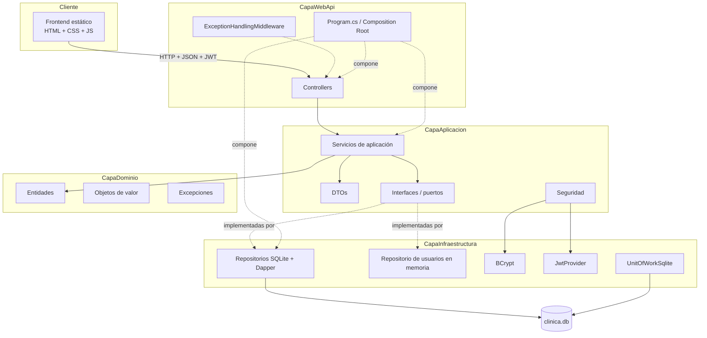

### 5.2 Regla de dependencias

```text
CapaDominio          no referencia a nadie
CapaAplicacion   →   CapaDominio
CapaInfraestructura → CapaDominio + CapaAplicacion
CapaWebApi       →   CapaDominio + CapaAplicacion + CapaInfraestructura
CapaPruebas      →   CapaInfraestructura + CapaWebApi
```

**Lectura correcta:** las flechas de código apuntan hacia adentro. La aplicación define interfaces; infraestructura las implementa; la API las conecta. El dominio no sabe que existe SQLite, HTTP ni JWT.

**Excepción conceptual:** `CapaAplicacion` contiene `AuthService` y `IJwtProvider`, que son conceptos de seguridad. La implementación concreta de JWT vive en infraestructura. Es aceptable, aunque algunos equipos separan “seguridad” en su propio módulo.

### 5.3 Responsabilidad de cada capa

| Capa | Hace | No hace |
|---|---|---|
| Dominio | Reglas e invariantes; estados; cálculos de agenda y stock. | SQL, HTTP, JWT, DTOs, logging. |
| Aplicación | Orquesta casos de uso; valida reglas de aplicación; coordina repositorios y UoW; mapea a DTOs. | SQL concreto; acceso directo a `SqliteConnection`; decidir HTTP. |
| Infraestructura | Implementa puertos con Dapper/SQLite, BCrypt, JWT; inicializa esquema. | Reglas de negocio; respuestas HTTP. |
| Web API | Recibe HTTP; valida borde; autoriza; traduce a DTOs; devuelve códigos; configura DI. | Lógica de agenda/stock; SQL. |
| Frontend | Presenta datos; envía comandos; guía al usuario. | Seguridad real; reglas de negocio autoritativas. |

### 5.4 Inyección de dependencias en `Program.cs`

| Registro | Interfaz | Implementación | Ciclo de vida |
|---|---|---|---|
| 1 | `IRepositorioUsuario` | `RepositorioUsuario` | Singleton |
| 2 | `IDbConnectionFactory` | `SqliteConnectionFactory` | Singleton |
| 3 | `IUnitOfWork` | `UnitOfWorkSqlite` | Scoped |
| 4 | `ITurnoRepository` | `TurnoRepositorySqlite` | Scoped |
| 5 | `ITratamientoRepository` | `TratamientoRepositorySqlite` | Scoped |
| 6 | `IInsumoRepository` | `InsumoRepositorySqlite` | Scoped |
| 7 | `IPacienteRepository` | `PacienteRepositorySqlite` | Scoped |
| 8 | `IOdontologoRepository` | `OdontologoRepositorySqlite` | Scoped |
| 9 | `IPacienteService` | `PacienteService` | Scoped |
| 10 | `IOdontologoService` | `OdontologoService` | Scoped |
| 11 | `IInsumosService` | `InsumosService` | Scoped |
| 12 | `ITratamientoService` | `TratamientoService` | Scoped |
| 13 | `ITurnosService` | `TurnosService` | Scoped |
| 14 | `IAuthService` | `AuthService` | Scoped |
| 15 | `IUsuarioAdminService` | `UsuarioAdminService` | Scoped |
| 16 | `IPasswordHasher` | `PasswordHasherBCrypt` | Scoped |
| 17 | `IJwtProvider` | `JwtProvider` | Scoped |

**Por qué scoped:** en ASP.NET Core, scoped significa “una instancia por request HTTP”. El UoW y los repositorios comparten la misma conexión durante una operación, lo que permite transacciones coherentes. El hasher de BCrypt y el proveedor JWT también se registran scoped: no guardan estado mutable, pero así pueden depender de servicios por request sin riesgo de captura.

**Por qué singleton:** la factory de conexiones no tiene estado mutable y el repositorio de usuarios debe conservar los datos entre requests porque vive en memoria.

**Riesgo didáctico:** un singleton que dependa de un scoped captura una instancia para siempre (“captive dependency”). No ocurre en los registros actuales, pero es un error clásico al agregar servicios.

### 5.5 Puertos y adaptadores del proyecto

| Puerto | Adaptador SQLite | Adaptador en memoria |
|---|---|---|
| `IPacienteRepository` | `PacienteRepositorySqlite` | `RepositorioPaciente` |
| `IOdontologoRepository` | `OdontologoRepositorySqlite` | `RepositorioOdontologo` |
| `ITurnoRepository` | `TurnoRepositorySqlite` | `RepositorioTurnos` |
| `ITratamientoRepository` | `TratamientoRepositorySqlite` | `RepositorioTratamiento` |
| `IInsumoRepository` | `InsumoRepositorySqlite` | `RepositorioInsumos` |
| `IRepositorioUsuario` | — | `RepositorioUsuario` |

Los repositorios en memoria no están registrados en `Program.cs`; se usan en pruebas y quedaron como legado. Los SQLite son los de producción.

### 5.6 Flujo de una petición HTTP

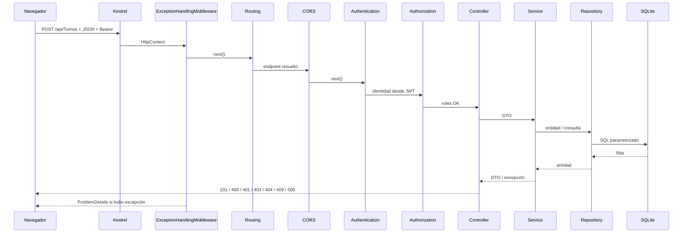

### 5.7 Controladores delgados

Ejemplo real: `TurnosController.Guardar` recibe el DTO, lo pasa al servicio y devuelve el ID generado con estado 201. No calcula solapamientos ni descuenta stock.

```csharp
[HttpPost]
public async Task<ActionResult<int>> Guardar(
    [FromBody] CrearTurnoRequestDto turno,
    CancellationToken cancellationToken)
{
    if (turno == null) return BadRequest();

    int id = await _turnosService.RegistrarTurnoAsync(turno, cancellationToken);
    return StatusCode(StatusCodes.Status201Created, id);
}
```

La autorización de lectura/escritura de turnos está a nivel de clase: `[Authorize(Roles = "Admin,Odontologo,Recepcionista")]`. La acción `completar` agrega una restricción más estricta (`Admin,Odontologo`). El controlador no conoce la regla de agenda ni el stock; solo traduce HTTP ↔ DTO.

### 5.8 Servicios de aplicación

`TurnosService` es el ejemplo más completo de orquestación:

1. Valida reglas de aplicación.
2. Recupera entidades.
3. Construye objetos de valor (`IntervaloDeTiempo`, `AgendaDiaria`).
4. Verifica solapamientos.
5. Persiste dentro de una transacción.
6. Al completar, consume stock y registra movimientos.
7. Traduce entidades a DTOs.

No contiene SQL. No conoce HTTP. No conoce `SqliteConnection`. Depende de interfaces.

### 5.9 Dominio aislado

`AgendaDiaria` recibe una fecha, un odontólogo y una lista de turnos. No consulta la base. Esto permite probar solapamientos y huecos sin infraestructura. Es una de las mejores decisiones del proyecto.

`Turno` protege sus transiciones: `Cancelar`, `Completar`, `Reprogramar`, `MarcarRecordatorioEnviado`. No se puede asignar `Estado` desde afuera.

### 5.10 Infraestructura como adaptador

`TurnoRepositorySqlite`:

- Abre una conexión por operación.
- Ejecuta SQL explícito y parametrizado.
- Mapea filas a entidades.
- Usa `UnitOfWorkSqlite` para transacciones de escritura compuesta.

`UnitOfWorkSqlite` no usa `IDbTransaction`; ejecuta `BEGIN IMMEDIATE;` sobre la conexión y expone `TransaccionActiva`. Los repositorios reciben `IDbTransaction?` y, en la práctica, siempre reciben `null`. La transacción real vive en la conexión. Es una decisión que funciona, pero exige entenderla para no romperla.

### 5.11 Composición y configuración

`Program.cs` es el **composition root**: el único lugar donde se elige la implementación concreta. Cambiar SQLite por otro motor requeriría, en teoría, nuevos adaptadores y cambios de registro; el dominio y la aplicación no deberían cambiar.

La cadena de conexión se lee de configuración con fallback. La clave JWT se lee de configuración y se usa para firma y validación. Los parámetros de expiración y refresh están parcialmente hardcodeados en `JwtProvider` y `AuthService`.

### 5.12 Fronteras y DTOs

| Frontera | Entra | Sale |
|---|---|---|
| HTTP → Controller | JSON + route + query | DTO de entrada |
| Controller → Service | DTO de entrada | `Task` / excepción |
| Service → Repository | Entidad / criterios | Entidad / colección |
| Repository → DB | Parámetros SQL | Filas |
| Service → Controller | DTO de salida | JSON |
| Controller → Cliente | `ActionResult` | HTTP + JSON |

**Regla:** las entidades no se serializan directamente al cliente. Los DTOs de salida evitan exponer detalles internos y permiten cambiar el modelo sin romper el contrato.

### 5.13 Dónde vive cada tipo de regla

| Regla | Capa correcta | Ejemplo |
|---|---|---|
| “El fin debe ser posterior al inicio” | Dominio | `Turno` / `IntervaloDeTiempo` |
| “No puede haber dos turnos del mismo odontólogo solapados” | Dominio + aplicación | `AgendaDiaria` + consulta de turnos |
| “El paciente debe existir” | Aplicación | `TurnosService` |
| “El rol debe ser Admin u Odontólogo” | Web API | `[Authorize(Roles=...)]` |
| “El nombre no puede estar vacío” | Borde + dominio | Data Annotation + constructor |
| “No se puede descontar más stock que el disponible” | Dominio | `Insumo.DescontarStock` |
| “La transacción debe confirmarse o revertirse” | Infraestructura | `UnitOfWorkSqlite` |

### 5.14 Fugas y deudas arquitectónicas visibles

1. **Usuarios en memoria y datos clínicos en SQLite.** No comparten transacción. Un alta de paciente puede crear un usuario y fallar después.
2. **Repositorios que abren su propia transacción.** Varios repositorios SQLite llaman a `BeginTransactionAsync`/`CommitAsync`/`RollbackAsync` si no hay una transacción activa, además de ser usados dentro del UoW del servicio. Duplica la propiedad de la transacción.
3. **`UnitOfWorkSqlite.Transaction` siempre `null`.** La interfaz sugiere una transacción de ADO.NET que no existe.
4. **Servicios con sobrecargas legacy.** `ITurnosService` conserva métodos que no usa el controller y que tienen reglas más débiles.
5. **Controladores con ramas muertas.** Varios `if (result == null) return NotFound()` nunca se ejecutan porque el servicio lanza excepción.
6. **Frontend con reglas de rol duplicadas.** No es la autoridad, pero puede dar falsa sensación de seguridad.
7. **Documentación desactualizada.** La arquitectura real no coincide con `docs/architecture.md`.

### 5.15 Cómo se agrega una funcionalidad (ejemplo didáctico)

Supongamos “registrar un pago de turno”. No existe en el proyecto; el ejercicio muestra el recorrido correcto:

1. **Dominio:** crear `Pago` con invariantes (monto > 0, turno existente, estado).
2. **Aplicación:** definir `IPagoRepository`, `PagoService`, DTOs de entrada/salida.
3. **Infraestructura:** crear tabla `Pagos`, repositorio Dapper, type handlers si hace falta.
4. **Web API:** crear `PagosController` con `[Authorize]`, validar DTO, mapear errores.
5. **Frontend:** agregar formulario y llamada; no confiar en la validación del cliente.
6. **Pruebas:** dominio, servicio con fake, repositorio con SQLite temporal, controller/middleware.
7. **Documentación:** actualizar esquema y esta guía.
8. **Spec:** aprobar antes de implementar, según el flujo SDD del repositorio.

**No se debe:** poner SQL en el controller, crear la entidad dentro del repositorio, devolver la entidad directamente, ni omitir la autorización.

---

## 6. Flujos completos

<a id="s6"></a>

Esta sección recorre los casos de uso reales. Para cada flujo se indica: disparador, recorrido, reglas, persistencia, errores y puntos débiles. Los números de línea corresponden al snapshot; si el código cambia, ubicá el método por nombre.

### 6.1 Mapa punta a punta

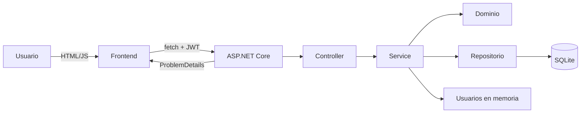

### 6.2 Login

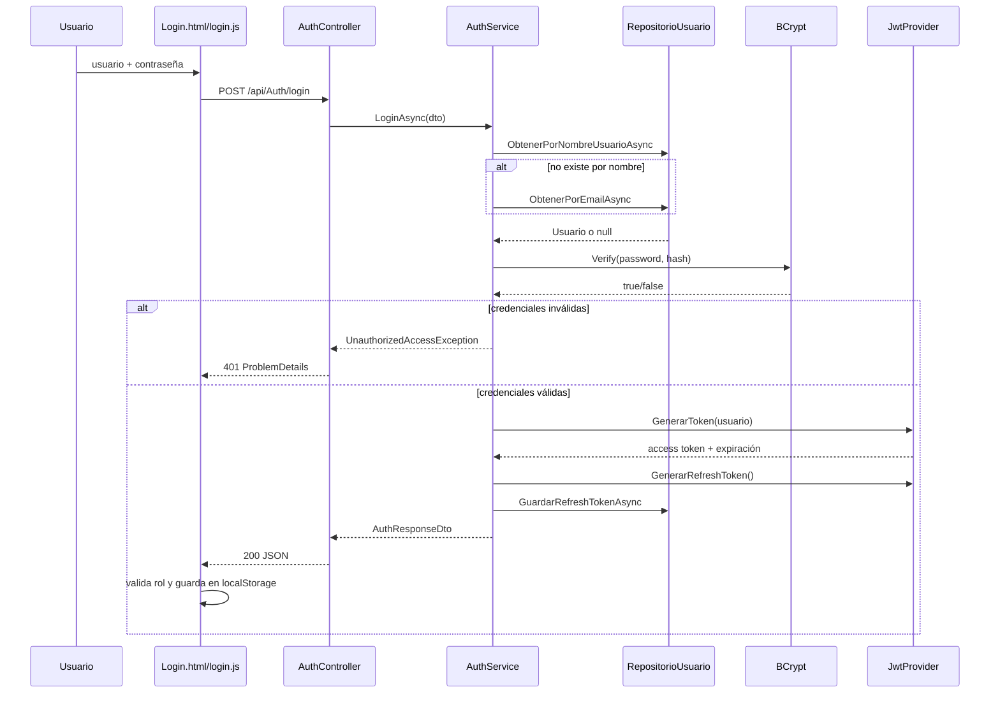

**Paso a paso**

1. El formulario envía `{ nombreUsuario, password }` a `Auth/login`.
2. `AuthController.Login` verifica `ModelState`. Si es inválido, devuelve 400.
3. `AuthService.LoginAsync` busca por nombre de usuario y, si no encuentra, por email.
4. Compara la contraseña con BCrypt. Nunca se desencripta: BCrypt verifica el hash.
5. Si falla, lanza `UnauthorizedAccessException`; el middleware devuelve 401.
6. Si acierta, `GenerarRespuestaAuthAsync` crea el access token JWT y un refresh token aleatorio de 64 bytes.
7. El refresh token se guarda en la lista del usuario **en memoria** con vencimiento a 7 días.
8. El frontend valida que el rol sea `Admin`, `Odontologo` o `Recepcionista`; si es `Paciente`, borra la sesión.
9. Guarda `accessToken`, `refreshToken` y datos del usuario en `localStorage` y redirige a `Api.html`.

**Reglas reales**

- El login acepta nombre de usuario **o** email en el mismo campo.
- No hay bloqueo por intentos fallidos, captcha ni rate limiting.
- No se valida `EstaActivo` en el login; un usuario desactivado puede autenticarse si tiene credenciales.
- El access token no se guarda en el servidor; no se puede revocar individualmente antes de expirar.
- El refresh token se revoca en memoria al usarse, pero no hay detección de reutilización de una familia.

**Puntos débiles**

- Credencial de administrador sembrada en código (valor omitido por política de seguridad).
- Usuarios y refresh tokens se pierden al reiniciar.
- Tokens en `localStorage` son accesibles desde JavaScript; un XSS los roba.

### 6.3 Refresh de sesión

1. El frontend tiene `Api.refresh`, pero el flujo automático no está implementado en `Api.request`: ante 401 borra la sesión y redirige, no intenta refrescar.
2. `POST /api/Auth/refresh` recibe `{ refreshToken }`.
3. `AuthService.RefreshAsync` busca el token en memoria, verifica `EstaActivo` (no revocado y no expirado).
4. Marca el token como usado y lo revoca.
5. Genera un nuevo access token y un nuevo refresh token.
6. Devuelve un `AuthResponseDto` completo.

**Observación:** el endpoint existe y funciona, pero el frontend no lo usa para renovar de forma transparente. Es una funcionalidad disponible por API, no integrada en la experiencia.

### 6.4 Petición autenticada

1. `Api.request` agrega `Authorization: Bearer <accessToken>` si hay token.
2. El pipeline de ASP.NET Core ejecuta el middleware de excepciones, routing, CORS, autenticación y autorización.
3. `UseAuthentication` valida firma, issuer, audience, expiración y `ClockSkew` de 8 minutos.
4. `UseAuthorization` evalúa `[Authorize]` y roles.
5. Si el token falta o es inválido: 401.
6. Si el token es válido pero el rol no alcanza: 403.
7. El controller ejecuta el caso de uso.

**Orden real del pipeline** (`Program.cs:88-94`):

```text
ExceptionHandlingMiddleware
→ UseRouting
→ UseCors
→ UseAuthentication
→ UseAuthorization
→ MapControllers
```

**Consecuencia:** el middleware de errores envuelve todo lo que sigue, incluida la autenticación. Las excepciones de cualquier etapa posterior se convierten en `ProblemDetails`.

### 6.5 Alta de paciente

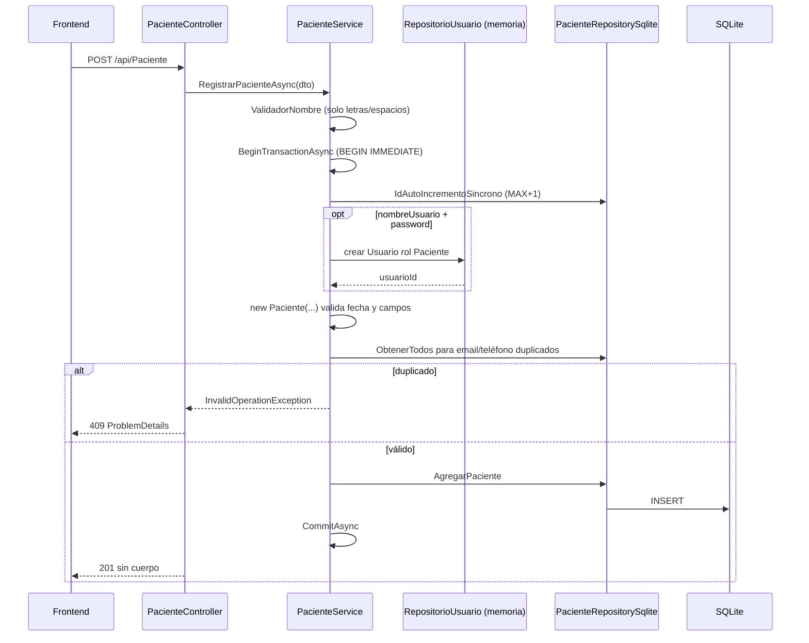

**Paso a paso**

1. `PacienteController.Guardar` recibe `PacienteDtoInput`; si es null, 400.
2. `PacienteService.RegistrarPacienteAsync` valida el nombre con `ValidadorNombre`: solo letras y espacios.
3. Abre transacción SQLite.
4. Obtiene el próximo ID con `MAX(Id)+1`.
5. Si el DTO trae `NombreUsuario` y `Password` y no trae `UsuarioId`, crea un usuario en memoria con rol `Paciente`.
6. Construye `Paciente`, que valida id, nombre, apellido, fecha, email y teléfono.
7. Verifica email y teléfono duplicados recorriendo **todos** los pacientes.
8. Inserta el paciente y confirma.

**Puntos débiles**

- El usuario se crea **antes** de las validaciones de duplicado de paciente y fuera de la transacción SQLite. Si el email del paciente ya existe, la transacción SQLite se revierte al liberar el UoW, pero el usuario en memoria queda creado.
- La fecha de nacimiento está limitada a `1920-01-01`–`2007-12-31`; un paciente nacido después de 2007 no puede registrarse.
- El teléfono y el email se comparan en memoria; no hay índice único en SQLite.
- El alta no devuelve el ID ni `Location`.

### 6.6 Alta de odontólogo

1. `POST /api/Odontologo` con `OdontologoInputDto`.
2. `OdontologoService.RegistrarOdontologoAsync` valida que la matrícula no esté vacía ni duplicada.
3. Abre transacción.
4. Calcula el próximo ID.
5. Si hay `NombreUsuario` y `Password`, crea un usuario con rol `Odontologo`.
6. Construye `Odontologo` y lo inserta.
7. Confirma.

**Puntos débiles**

- Al crear el usuario, se pasa la **matrícula como email** (`CrearUsuarioOdontologoAsync(..., odontologo.Matricula, ...)`), por lo que el usuario queda con un email que no es un email.
- La actualización no valida matrícula duplicada y puede cambiar `UsuarioId` a otro valor.
- No se actualiza el usuario asociado al cambiar nombre, matrícula o especialidad.
- El teléfono es `int`, no string; no admite formatos, guiones ni prefijos.

### 6.7 Alta de tratamiento

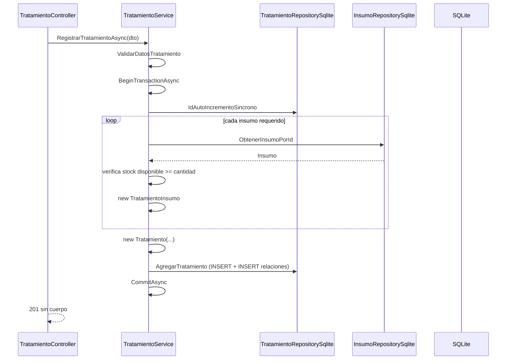

**Reglas**

- Descripción obligatoria.
- Costo mayor o igual a 0.
- Duración mayor a 0 minutos.
- Al menos un insumo.
- Cada insumo debe existir.
- Cada cantidad debe ser mayor a 0.
- El stock disponible debe alcanzar para la cantidad requerida **en el momento de definir el tratamiento**.

**Puntos débiles**

- `TratamientoController` no tiene `[Authorize]`: cualquier persona puede listar, crear, modificar o borrar tratamientos.
- Validar stock al definir el tratamiento acopla el catálogo al inventario. Un tratamiento debería poder definirse aunque hoy no haya stock; la validación crítica es al consumir.
- No se valida que no haya insumos repetidos; la clave primaria compuesta de `TratamientoInsumos` lo rechazaría en la base, pero el error sería tardío.
- La actualización borra todas las relaciones y las vuelve a insertar; es correcta transaccionalmente, pero pierde historial.

### 6.8 Alta y actualización de insumo

**Alta**

1. `POST /api/Insumos` con `{ id, nombre, categoria, stock }`.
2. `InsumosService.RegistrarInsumoAsync` valida el nombre con la misma regla restrictiva: solo letras y espacios.
3. Abre transacción; calcula ID; construye `Insumo`.
4. El constructor calcula automáticamente `StockSeguridad`, `PuntoPedido`, `StockMinimo` y `StockMaximo` según la categoría.
5. Inserta y confirma.

**Actualización**

1. `PUT /api/Insumos/{id}`.
2. Valida nombre; abre transacción; recupera el insumo.
3. `Insumo.Actualizar` recalcula los umbrales y valida stock/reservado/mínimo.
4. `InsumoRepositorySqlite.ActualizarInsumo` lee el stock anterior, actualiza la fila y, si el stock cambió, inserta un `MovimientoStock` con tipo Entrada/Salida/Ajuste.
5. Confirma.

**Puntos débiles**

- No hay endpoint para reponer stock ni para consultar movimientos.
- El motivo del movimiento es siempre `"Actualización de stock"`.
- La validación de nombre rechaza números y símbolos, por ejemplo `"Guantes nitrilo M"` pasa, pero `"Kit 2"` no.
- El `Insumo` tiene un `lock` por instancia que no protege contra dos instancias concurrentes; la protección real la da la transacción SQLite.

### 6.9 Alta de turno

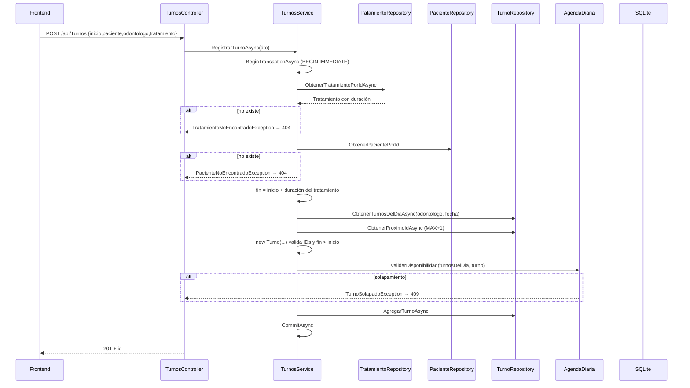

**Paso a paso**

1. El frontend envía solo inicio, paciente, odontólogo y tratamiento. **No envía fin.**
2. El servicio obtiene el tratamiento y calcula `fin = inicio + DuracionEstimada`.
3. Verifica que el paciente exista. **No verifica que el odontólogo exista.**
4. Obtiene los turnos del odontólogo para esa fecha.
5. Calcula el próximo ID.
6. Construye `Turno`: valida IDs positivos y `fin > inicio`. El estado inicial es `Pendiente`.
7. Llama a `AgendaDiaria.ValidarDisponibilidad`, que ignora cancelados, filtra por odontólogo y fecha, y detecta solapamientos.
8. Inserta y confirma.
9. Devuelve 201 con el ID generado.

**Lo que el flujo no valida**

- Que el odontólogo exista y esté activo.
- Que la fecha sea futura.
- Que el horario esté dentro de 8:00–18:00.
- Que el paciente no tenga otro turno solapado con otro odontólogo.
- Que el tratamiento esté activo (no existe estado de tratamiento).
- Que la duración sea razonable.

**Por qué se calcula el fin en el servidor:** evita que el cliente envíe una duración arbitraria. Es una buena decisión. La contracara es que el DTO de creación no incluye fin y el de actualización sí, lo que genera dos contratos distintos.

### 6.10 Consulta de agenda y huecos

**Listados**

| Endpoint | Servicio | Resultado |
|---|---|---|
| `GET /api/Turnos` | `ObtenerTodosLosTurnosAsync` | Todos los turnos |
| `GET /api/Turnos/{id}` | `ObtenerTurnoPorIdAsync` | Turno o 404 |
| `GET /api/Turnos/buscar?texto=` | `BuscarTurnosAsync` | Coincidencias por ID, paciente, odontólogo, tratamiento o fecha |
| `GET /api/Turnos/huecos` | `ConsultarHuecosDisponiblesAsync` | Intervalos libres de 8 a 18 |

**Cálculo de huecos**

1. Valida `DuracionMinutos > 0`.
2. Obtiene los turnos del odontólogo para la fecha.
3. Construye `AgendaDiaria`, que filtra cancelados y ordena por inicio.
4. `ObtenerHuecosDisponibles(8h, 18h, duración)` recorre los turnos activos:
   - Si hay espacio entre el puntero y el próximo turno, y ese espacio alcanza la duración mínima, agrega un hueco.
   - Avanza el puntero al fin del turno si corresponde.
   - Al final, agrega el hueco hasta las 18:00 si alcanza.
5. Si la fecha es hoy, el puntero se mueve a `DateTime.Now` para no ofrecer horarios pasados.

**Limitaciones**

- No valida que el odontólogo exista.
- No valida que la fecha no sea pasada (devuelve huecos de 8 a 18 de un día pasado si el puntero no se clampea porque no es hoy).
- No valida un máximo de duración.
- La jornada 8–18 está hardcodeada en el servicio, no configurada.
- `DateTime.Now` y `DateTime.Today` usan hora local del servidor; no hay zona horaria explícita.

### 6.11 Completar turno y consumir stock

Este es el flujo transaccional más importante.

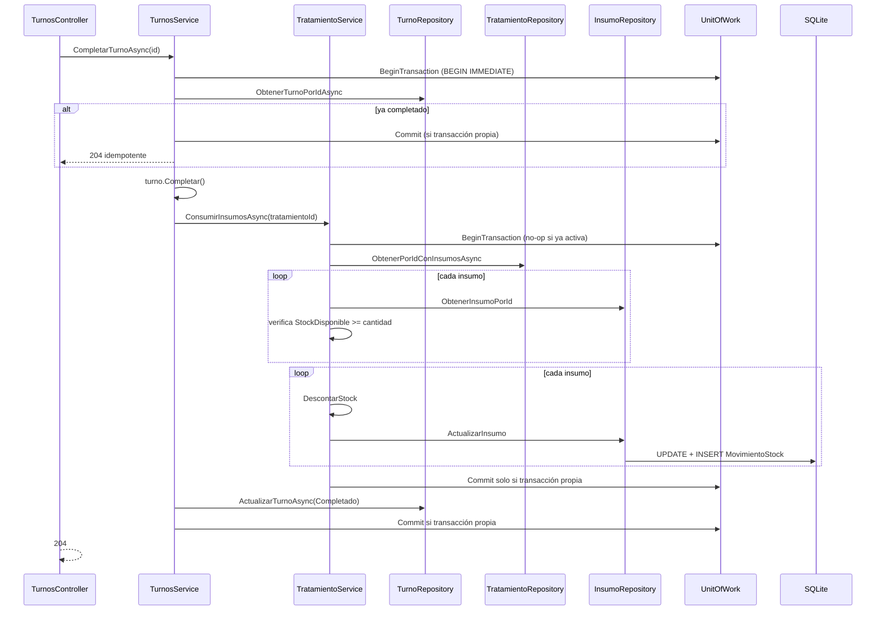

**Paso a paso**

1. `PATCH /api/Turnos/{id}/completar`, solo `Admin` y `Odontologo`.
2. `TurnosService` valida `id > 0`, detecta si la transacción es propia y abre transacción.
3. Recupera el turno. Si no existe: 404.
4. Si ya está `Completado`, confirma (si corresponde) y devuelve 204. **No vuelve a descontar stock.**
5. `turno.Completar()` cambia el estado; si está cancelado, lanza `InvalidOperationException` (el middleware lo mapea a 409).
6. Llama a `TratamientoService.ConsumirInsumosAsync(turno.TratamientoId)`.
7. Ese servicio abre transacción solo si no hay una activa (no-op si ya está la del turno).
8. Recupera el tratamiento con sus insumos.
9. Primera pasada: valida que cada insumo exista y que el stock disponible alcance. **No modifica nada todavía.**
10. Segunda pasada: descuenta stock y actualiza cada insumo; el repositorio registra el movimiento.
11. Si la transacción es propia, confirma. Si es la del turno, no confirma: deja que el turno lo haga.
12. `TurnosService` actualiza el turno a completado y confirma si es dueño de la transacción.

**Atomicidad**

- Si falla la validación de stock, no se descuenta nada y el turno no se persiste como completado.
- Si falla una actualización de insumo a mitad de la segunda pasada, la transacción queda activa y el `UnitOfWorkSqlite` hace `ROLLBACK` al liberarse el scope.
- El orden “primero validar todo, después modificar todo” reduce el riesgo de efectos parciales.
- `ConsumirInsumosAsync` también puede invocarse de forma independiente; en ese caso abre y confirma su propia transacción.

**Puntos débiles**

- Si `ITratamientoService` no está configurado, lanza `InvalidOperationException` y el turno queda sin completar. En producción está registrado, pero el parámetro opcional permite olvidarlo.
- No se registra quién completó el turno ni cuándo.
- No se revierte stock si luego se cancela un turno completado (no se permite cancelar completado).
- El movimiento de stock no distingue “consumo por turno” de “ajuste manual”; el motivo es genérico.

### 6.12 Cancelar turno

1. `PATCH /api/Turnos/{id}/cancelar`, roles `Admin`, `Odontologo`, `Recepcionista`.
2. `CancelarTurnoAsync` **lee el turno antes de abrir la transacción**.
3. `turno.Cancelar()`:
   - Si ya está cancelado, no hace nada.
   - Si está completado, lanza `InvalidOperationException`.
   - Si está pendiente, pasa a cancelado.
4. Abre transacción, actualiza y confirma.

**Punto débil de concurrencia:** entre la lectura y el `BEGIN IMMEDIATE`, otro request podría completar el turno. La cancelación pisaría el estado completado. La ventana es pequeña, pero existe. La solución es abrir la transacción antes de leer.

**No hay devolución de stock:** el stock se descuenta al completar, no al reservar. Cancelar un turno pendiente no afecta inventario.

### 6.13 Reprogramar turno

1. `PUT /api/Turnos/{id}` con `TurnoDtoInput` (inicio, fin, paciente, odontólogo, tratamiento).
2. Abre transacción.
3. Recupera el turno existente.
4. `existente.Reprogramar(inicio, fin)`: solo permite estado `Pendiente` y exige `fin > inicio`.
5. Obtiene los turnos del día del **odontólogo y fecha del DTO**.
6. Construye un `IntervaloDeTiempo` con los valores del DTO.
7. Recorre los turnos del día, ignora el mismo turno y los cancelados; si hay solapamiento, lanza 409.
8. Construye un `Turno` nuevo con el mismo estado y los datos del DTO.
9. Actualiza y confirma.

**Puntos débiles**

- No valida que el paciente, odontólogo o tratamiento existan.
- No recalcula la duración desde el tratamiento; acepta cualquier `fin` del cliente.
- No usa `AgendaDiaria.ValidarDisponibilidad`; duplica la lógica de solapamiento.
- No valida fecha futura ni horario 8–18.
- Si el turno está completado o cancelado, `Reprogramar` lanza `TurnoNoModificableException` (409), lo cual es correcto.
- La actualización puede cambiar el tratamiento de un turno ya agendado sin revalidar stock.

### 6.14 Frontend: sesión y panel

1. `Login.html` carga `config.js`, `api.js` y `login.js`.
2. `login.js` valida campos, llama a `Api.login`, verifica el rol y guarda la sesión.
3. `Api.html` carga `app.js`.
4. `app.js` lee `localStorage` (`odontocare.user`) y obtiene el rol.
5. Si el rol no está en `Admin`, `Odontologo`, `Recepcionista`, no muestra el panel.
6. `puede` decide qué secciones ocultar:
   - `Recepcionista`: sin odontólogos, sin insumos, sin botón completar.
7. Carga datos con `Promise.all` desde los endpoints.
8. Pagina en el cliente con `PAGE_SIZE = 8`; no hay paginación server-side.
9. Las acciones de crear, editar, eliminar, cancelar y completar llaman a `Api`.
10. Ante 401, `Api.request` limpia la sesión y redirige a `Login.html`.
11. Ante 403, muestra un mensaje de permisos.

**Advertencia central:** ocultar una sección o un botón no es autorización. Cualquier persona con un token válido puede llamar directamente a la API. La autorización real está en los atributos `[Authorize]`; donde faltan, el frontend no protege nada.

**XSS:** `app.js` usa una función `esc` para escapar textos en varias tablas, pero también construye HTML con interpolación. Hay que revisar cada interpolación de datos del usuario. Un dato sin escapar en `innerHTML` puede ejecutar JavaScript y robar tokens de `localStorage`.

### 6.15 Flujo de error

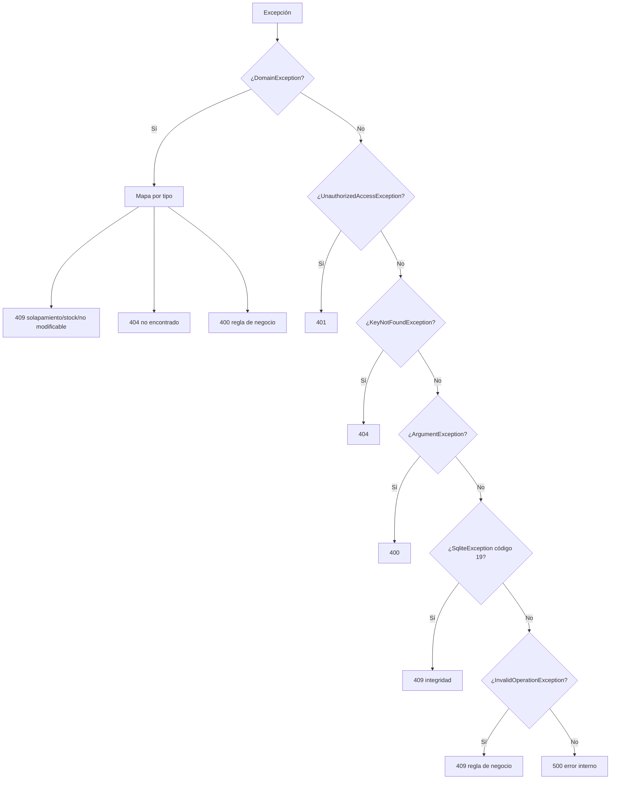

**Respuesta:** `ProblemDetails` con `status`, `title`, `detail` e `instance`. En 500 el detalle es genérico. En errores 400/404/409 se devuelve `ex.Message`, que puede incluir detalles internos.

**Cuidado con la fuga de información:** los mensajes de `SqliteException` y `KeyNotFoundException` pueden revelar nombres de tablas, columnas o IDs. En producción conviene un mensaje genérico y un identificador de correlación.

### 6.16 Persistencia y reinicio

| Dato | Almacenamiento | Sobrevive al reinicio |
|---|---|---|
| Pacientes | SQLite | Sí |
| Odontólogos | SQLite | Sí |
| Insumos | SQLite | Sí |
| Tratamientos | SQLite | Sí |
| Turnos | SQLite | Sí |
| Movimientos de stock | SQLite | Sí |
| Usuarios | Memoria | **No** |
| Refresh tokens | Memoria | **No** |
| Access tokens | Cliente (JWT) | Hasta expirar; el servidor no los guarda |

**Consecuencia:** tras reiniciar, los pacientes y odontólogos conservan `UsuarioId` que ya no existen en memoria. Las cuentas creadas junto con un paciente/odontólogo desaparecen. El admin vuelve a sembrarse.

### 6.17 Matriz de consistencia entre flujos

| Operación | ¿Valida paciente? | ¿Valida odontólogo? | ¿Valida tratamiento? | ¿Valida stock? | ¿Transacción? |
|---|---|---|---|---|---|
| Crear turno | Sí | **No** | Sí | No | Sí |
| Reprogramar | **No** | **No** | **No** | No | Sí |
| Completar | Ya existe | Ya existe | Sí | Sí | Sí |
| Cancelar | Ya existe | Ya existe | — | No | Parcial (lee antes) |
| Crear tratamiento | — | — | — | Sí (al definir) | Sí |
| Crear insumo | — | — | — | — | Sí |
| Actualizar insumo | — | — | — | Valida coherencia | Sí |
| Crear paciente | — | — | — | — | Sí (SQLite) + memoria |
| Crear odontólogo | — | — | — | — | Sí (SQLite) + memoria |

Esta matriz es una herramienta de auditoría: muestra dónde las reglas son asimétricas.

---

## 7. Explicación del código real

<a id="s7"></a>

> Los fragmentos se transcriben del snapshot; se copian literalmente para que puedas localizarlos.

### 7.1 Composition root: `Program.cs:13-37`

**Archivo:** `../../CapaWebApi/Program.cs`

```csharp
var builder = WebApplication.CreateBuilder(args);

builder.Services.AddSingleton<IRepositorioUsuario, RepositorioUsuario>();

string connectionString = builder.Configuration.GetConnectionString("ClinicaDb")
    ?? "Data Source=clinica.db;Foreign Keys=True";

builder.Services.AddSingleton<IDbConnectionFactory>(new SqliteConnectionFactory(connectionString));
builder.Services.AddScoped<IUnitOfWork, UnitOfWorkSqlite>();
builder.Services.AddScoped<IRepositorioInsumos, InsumoRepositorySqlite>();
builder.Services.AddScoped<IRepositorioTratamiento, TratamientoRepositorySqlite>();
builder.Services.AddScoped<IRepositorioTurnos, TurnoRepositorySqlite>();
builder.Services.AddScoped<IRepositorioPaciente, PacienteRepositorySqlite>();
builder.Services.AddScoped<IRepositorioOdontologo, OdontologoRepositorySqlite>();

builder.Services.AddScoped<IPacienteService, PacienteService>();
builder.Services.AddScoped<IOdontologoService, OdontologoService>();
builder.Services.AddScoped<IInsumosService, InsumosService>();
builder.Services.AddScoped<ITratamientoService, TratamientoService>();
builder.Services.AddScoped<ITurnosService, TurnosService>();
builder.Services.AddScoped<IAuthService, AuthService>();
builder.Services.AddScoped<IUsuarioAdminService, UsuarioAdminService>();
builder.Services.AddScoped<IPasswordHasher, PasswordHasherBCrypt>();
builder.Services.AddScoped<IJwtProvider, JwtProvider>();
```

**Lectura línea por línea**

| Línea | Qué hace | Por qué importa |
|---|---|---|
| 13 | Crea el builder con configuración, logging y DI. | Es el inicio de toda la aplicación. |
| 15 | Registra el repositorio de usuarios como singleton. | Los usuarios viven en memoria y deben sobrevivir entre requests. |
| 17-18 | Lee `ConnectionStrings:ClinicaDb`; si falta, usa `Data Source=clinica.db`. | Configuración con fallback para desarrollo. |
| 20 | Registra la factory de conexiones como singleton. | No tiene estado; crea conexiones nuevas. |
| 21 | Registra el UoW como scoped. | Una instancia por request, con una conexión y una transacción. |
| 22-26 | Registra los cinco repositorios SQLite como scoped. | Comparten el UoW del request. |
| 29-37 | Registra servicios de aplicación, seguridad, hasher y JWT como scoped. | Todos dependen de repositorios scoped o de configuración. |

**Qué enseña**

- El **composition root** es el único lugar donde se eligen implementaciones.
- `AddScoped` es el ciclo correcto para repositorios y servicios que participan de una operación HTTP.
- `AddSingleton` se usa para estado compartido (usuarios) y para objetos sin estado mutable (factory).
- Las interfaces (`I...`) permiten sustituir SQLite por mocks en pruebas.

**Verificación:** `IPasswordHasher` y `IJwtProvider` son **scoped**, no singleton. Si los cambiás a singleton, seguirá funcionando porque no dependen de scoped, pero no es necesario.

### 7.2 Autenticación JWT: `Program.cs:43-59`

```csharp
builder.Services.AddAuthentication(JwtBearerDefaults.AuthenticationScheme)
    .AddJwtBearer(options =>
    {
        options.TokenValidationParameters = new TokenValidationParameters
        {
            ValidateIssuer = true,
            ValidateAudience = true,
            ValidateLifetime = true,
            ValidateIssuerSigningKey = true,
            ValidIssuer = builder.Configuration["Jwt:Issuer"],
            ValidAudience = builder.Configuration["Jwt:Audience"],
            IssuerSigningKey = new SymmetricSecurityKey(
                Encoding.UTF8.GetBytes(builder.Configuration["Jwt:Key"]!)),
            ClockSkew = TimeSpan.FromMinutes(8),
            RoleClaimType = System.Security.Claims.ClaimTypes.Role
        };
    });
```

**Lectura**

- `ValidateIssuer`, `ValidateAudience`, `ValidateLifetime` y `ValidateIssuerSigningKey` activan las cuatro validaciones esenciales.
- `IssuerSigningKey` usa la clave simétrica de configuración. El `!` suprime la advertencia de nulabilidad: si falta, se lanza una excepción al construir la clave.
- `ClockSkew = 8 minutos` tolera relojes desfasados. Es generoso; en producción suele usarse 1–2 minutos.
- `RoleClaimType` indica que el rol se busca en el claim estándar de rol. `JwtProvider` emite `ClaimTypes.Role`.

**Qué falta**

- Validar el largo mínimo de la clave al arrancar, con un mensaje claro.
- Validar que `Jwt:Issuer`, `Jwt:Audience` y `Jwt:Key` existan antes de construir el pipeline.
- Usar `options.RequireHttpsMetadata` en producción.
- Configurar `TokenValidationParameters.ValidAlgorithms` para restringir a HS256.

### 7.3 Pipeline: `Program.cs:88-94`

```csharp
app.UseMiddleware<ExceptionHandlingMiddleware>();
app.UseRouting();
app.UseCors("PermitirTodo");
app.UseAuthentication();
app.UseAuthorization();

app.MapControllers();
```

**Orden y consecuencias**

1. **ExceptionHandlingMiddleware**: envuelve todo. Cualquier excepción posterior se captura.
2. **Routing**: resuelve el endpoint.
3. **CORS**: aplica la política. Está después de routing, lo cual es válido en ASP.NET Core moderno.
4. **Authentication**: valida el JWT y construye `HttpContext.User`.
5. **Authorization**: evalúa `[Authorize]`.
6. **MapControllers**: ejecuta la acción.

**Errores típicos de orden**

- Poner `UseAuthorization` antes de `UseAuthentication`: no hay usuario autenticado y todo da 401/403.
- Poner el middleware de errores después de `MapControllers`: no captura las excepciones de los controllers.
- Poner `UseCors` antes de `UseRouting` en versiones antiguas: puede no aplicar al endpoint correcto.

### 7.4 Login y emisión de tokens: `AuthService.cs:41-56` y `74-95`

**Archivo:** `../../CapaAplicacion/Seguridad/Servicios/AuthService.cs`

```csharp
public async Task<AuthResponseDto> LoginAsync(LoginRequestDto request)
{
    var usuario = await _repositorioUsuario.ObtenerPorNombreUsuarioAsync(request.NombreUsuario);

    if (usuario == null)
    {
        usuario = await _repositorioUsuario.ObtenerPorEmailAsync(request.NombreUsuario);
    }

    if (usuario == null || !_passwordHasher.Verify(request.Password, usuario.PasswordHash))
    {
        throw new UnauthorizedAccessException("Credenciales inválidas.");
    }

    return await GenerarRespuestaAuthAsync(usuario);
}
```

```csharp
private async Task<AuthResponseDto> GenerarRespuestaAuthAsync(Usuario usuario)
{
    var (accessToken, accessExpiration) = _jwtProvider.GenerarToken(usuario);
    var refreshToken = _jwtProvider.GenerarRefreshToken();
    var refreshExpiration = DateTime.UtcNow.AddDays(7);

    await _repositorioUsuario.GuardarRefreshTokenAsync(
        usuario.Id,
        new RefreshToken(refreshToken, refreshExpiration, usuario.Id));

    return new AuthResponseDto
    {
        AccessToken = accessToken,
        RefreshToken = refreshToken,
        AccessTokenExpirationUtc = accessExpiration,
        RefreshTokenExpirationUtc = refreshExpiration,
        UsuarioId = usuario.Id,
        NombreUsuario = usuario.NombreUsuario,
        Email = usuario.Email,
        Rol = usuario.Rol.ToString()
    };
}
```

**Lectura**

- La búsqueda es por nombre de usuario y, si falla, por email. El mismo campo del formulario sirve para ambos.
- `Verify` de BCrypt compara la contraseña en claro con el hash almacenado. No hay descifrado.
- Un usuario inexistente y una contraseña incorrecta producen el mismo error: buena práctica para no revelar qué parte falló.
- El access token y el refresh token se generan juntos.
- El refresh token se guarda en la lista del usuario en memoria, con vencimiento UTC a 7 días.
- La respuesta incluye el rol como string (`"Admin"`, `"Odontologo"`, etc.).

**Problemas**

- No se verifica `usuario.EstaActivo`. Un usuario desactivado puede iniciar sesión.
- No hay bloqueo por intentos fallidos.
- El refresh token se guarda en memoria: se pierde al reiniciar y no se comparte entre instancias.
- El refresh token no se hashea; si se filtra la memoria, es utilizable.
- No hay rotación con detección de reutilización de familia.

### 7.5 Generación de JWT: `JwtProvider.cs:22-56`

**Archivo:** `../../CapaInfraestructura/Servicios/JwtProvider.cs`

```csharp
public (string Token, DateTime ExpirationUtc) GenerarToken(Usuario usuario)
{
    var issuer = _configuration["Jwt:Issuer"] ?? throw new InvalidOperationException("Jwt:Issuer no configurado.");
    var audience = _configuration["Jwt:Audience"] ?? throw new InvalidOperationException("Jwt:Audience no configurado.");
    var key = _configuration["Jwt:Key"] ?? throw new InvalidOperationException("Jwt:Key no configurado.");
    var hours = double.Parse(_configuration["Jwt:ExpireHours"] ?? "8", CultureInfo.InvariantCulture);
    var expiration = DateTime.UtcNow.AddHours(hours);

    var claims = new List<Claim>
    {
        new(ClaimTypes.NameIdentifier, usuario.Id.ToString()),
        new(ClaimTypes.Name, usuario.NombreUsuario),
        new(ClaimTypes.Email, usuario.Email),
        new(ClaimTypes.Role, usuario.Rol.ToString())
    };

    var credentials = new SigningCredentials(
        new SymmetricSecurityKey(Encoding.UTF8.GetBytes(key)),
        SecurityAlgorithms.HmacSha256);

    var token = new JwtSecurityToken(
        issuer: issuer,
        audience: audience,
        claims: claims,
        expires: expiration,
        signingCredentials: credentials);

    return (new JwtSecurityTokenHandler().WriteToken(token), expiration);
}

public string GenerarRefreshToken()
{
    var bytes = RandomNumberGenerator.GetBytes(64);
    return Convert.ToBase64String(bytes);
}
```

**Lectura**

- `issuer`, `audience` y `key` se leen de configuración y fallan rápido si faltan.
- La expiración se calcula en UTC con `Jwt:ExpireHours` (por defecto 8).
- Los claims son: ID, nombre, email y rol.
- La firma es HMAC-SHA256 con clave simétrica.
- El refresh token son 64 bytes aleatorios criptográficamente seguros, codificados en Base64.

**Qué enseña**

- Un JWT no está cifrado: cualquiera puede leer el payload. **Nunca** poner contraseñas, datos clínicos sensibles ni secretos en los claims.
- La seguridad del JWT depende de la firma y de la protección de la clave.
- El refresh token debe ser opaco, largo y aleatorio; no necesita ser un JWT.

**Riesgos**

- La clave se usa directamente sin validar longitud mínima. Una clave corta debilita HS256 y puede hacer fallar la firma.
- `double.Parse` puede lanzar `FormatException` si `Jwt:ExpireHours` está mal configurado.
- No se incluye `jti` (identificador único del token); no se puede revocar un access token individual.
- No se incluye `iat` explícito; lo agrega la librería.

### 7.6 POST de turno: `TurnosController.cs:60-69`

**Archivo:** `../../CapaWebApi/Controllers/TurnosController.cs`

```csharp
[HttpPost]
public async Task<ActionResult<int>> Guardar(
    [FromBody] CrearTurnoRequestDto turno,
    CancellationToken cancellationToken)
{
    if (turno == null) return BadRequest();

    int id = await _turnosService.RegistrarTurnoAsync(turno, cancellationToken);
    return StatusCode(StatusCodes.Status201Created, id);
}
```

**Lectura**

- `[HttpPost]` mapea `POST /api/Turnos`.
- `[FromBody]` indica que el DTO viene del cuerpo JSON.
- El controller no calcula nada: delega.
- Devuelve 201 con el ID como cuerpo.
- La clase tiene `[Authorize(Roles = "Admin,Odontologo,Recepcionista")]`, que se aplica a todas las acciones salvo que una acción tenga su propio atributo (como `Completar`, que restringe a Admin/Odontólogo).

**Detalles**

- `if (turno == null)` es una rama prácticamente inalcanzable con `[ApiController]`: si el body falta o es inválido, el framework devuelve 400 antes de entrar.
- Lo ideal sería `CreatedAtAction(nameof(ObtenerPorId), new { id }, id)` para incluir `Location`. Hoy devuelve 201 sin `Location`.
- El DTO de creación tiene validaciones de Data Annotations para los IDs; `FechaHoraInicio` es `[Required]`, pero un `DateTime` por defecto (`0001-01-01`) no se considera inválido por `[Required]` en todos los casos. La validación real de fecha recae en el dominio/servicio.

### 7.7 Registro de turno: `TurnosService.cs:36-78`

**Archivo:** `../../CapaAplicacion/ServiciosAplicacion/TurnosService.cs`

```csharp
public async Task<int> RegistrarTurnoAsync(CrearTurnoRequestDto nuevoTurno, CancellationToken cancellationToken = default)
{
    if (nuevoTurno == null)
        throw new ArgumentNullException(nameof(nuevoTurno));

    await _unitOfWork.BeginTransactionAsync(cancellationToken);

    Tratamiento? tratamiento = await _repositorioTratamiento.ObtenerTratamientoPorIdAsync(
        nuevoTurno.TratamientoId,
        cancellationToken);

    if (tratamiento == null)
        throw new TratamientoNoEncontradoException(nuevoTurno.TratamientoId);

    Paciente? paciente = await _repositorioPaciente.ObtenerPacientePorId(nuevoTurno.PacienteId);

    if (paciente == null)
        throw new PacienteNoEncontradoException(nuevoTurno.PacienteId);

    DateTime inicio = nuevoTurno.FechaHoraInicio;
    DateTime fin = inicio.Add(tratamiento.DuracionEstimada);

    IReadOnlyList<Turno> turnosDelDia = await _repositorioTurnos.ObtenerTurnosDelDiaAsync(
        nuevoTurno.OdontologoId,
        inicio.Date,
        cancellationToken);

    int nuevoId = await _repositorioTurnos.ObtenerProximoIdAsync(cancellationToken);
    Turno turno = new Turno(
        nuevoId,
        inicio,
        fin,
        nuevoTurno.PacienteId,
        nuevoTurno.OdontologoId,
        nuevoTurno.TratamientoId);

    AgendaDiaria.ValidarDisponibilidad(turnosDelDia, turno);

    await _repositorioTurnos.AgregarTurnoAsync(turno, cancellationToken);
    await _unitOfWork.CommitAsync(cancellationToken);

    return turno.Id;
}
```

**Lectura por bloques**

| Líneas | Qué ocurre | Comentario |
|---|---|---|
| 38-39 | Valida que el DTO no sea null. | Guard clause. |
| 41 | Abre la transacción antes de leer. | Correcto: evita leer un estado que cambie antes de escribir. |
| 43-48 | Busca el tratamiento. | Necesita la duración para calcular el fin. |
| 50-53 | Busca el paciente. | Evita turnos para pacientes inexistentes. |
| 55-56 | Calcula inicio y fin. | El fin **no** viene del cliente. |
| 58-61 | Obtiene los turnos del odontólogo en esa fecha. | Solo del odontólogo, no todos. |
| 63 | Calcula el próximo ID con `MAX(Id)+1`. | Ver sección 8 para el debate. |
| 64-70 | Construye `Turno`. | Valida IDs y `fin > inicio`. |
| 72 | Valida solapamiento con `AgendaDiaria`. | Método estático; recibe la lista ya ordenada por la consulta. |
| 74 | Inserta. | SQL explícito en el repositorio. |
| 75 | Confirma. | Libera el bloqueo de escritura. |
| 77 | Devuelve el ID. | El controller lo usa en el 201. |

**Lo que no está**

- No hay consulta a `IRepositorioOdontologo`. Un `OdontologoId` inexistente pasa si es > 0.
- No se valida que `inicio` sea futuro.
- No se valida que `inicio` esté entre 8:00 y 18:00.
- No se valida que el paciente no tenga otro turno a la misma hora con otro odontólogo.
- No se valida que el tratamiento tenga una duración máxima razonable.

**Por qué la transacción empieza antes de leer:** `BEGIN IMMEDIATE` en SQLite adquiere un bloqueo de escritura. Esto serializa a los escritores y evita que dos turnos se inserten a la vez en el mismo hueco. Es una decisión conservadora y correcta para este modelo.

### 7.8 Validación de agenda: `AgendaDiaria.cs:61-140`

**Archivo:** `../../CapaDominio/Entidades/ObjetosDeValor/AgendaDiaria.cs`

```csharp
public static void ValidarDisponibilidad(IReadOnlyList<Turno> turnosOrdenados, Turno turnoNuevo)
{
    if (turnosOrdenados == null) throw new ArgumentNullException(nameof(turnosOrdenados));
    if (turnoNuevo == null) throw new ArgumentNullException(nameof(turnoNuevo));

    DateTime inicioNuevo = turnoNuevo.FechaHoraInicio;
    DateTime finNuevo = turnoNuevo.FechaHoraFin;

    if (finNuevo <= inicioNuevo)
    {
        throw new ArgumentOutOfRangeException(
            nameof(turnoNuevo),
            "La fecha de fin del turno debe ser posterior a la fecha de inicio.");
    }

    DateTime finTurnoAnterior = DateTime.MinValue;
    bool hayTurnoAnterior = false;
    bool candidatoValidado = false;

    for (int i = 0; i < turnosOrdenados.Count; i++)
    {
        Turno turnoActual = turnosOrdenados[i];

        if (turnoActual == null)
        {
            throw new ArgumentException(
                "La lista de turnos contiene un elemento nulo.",
                nameof(turnosOrdenados));
        }

        if (turnoActual.Estado == EstadoTurno.Cancelado)
        {
            continue;
        }

        if (turnoActual.OdontologoId != turnoNuevo.OdontologoId)
        {
            continue;
        }

        if (turnoActual.FechaHoraInicio.Date != inicioNuevo.Date)
        {
            continue;
        }

        if (hayTurnoAnterior && finTurnoAnterior > turnoActual.FechaHoraInicio)
        {
            throw new TurnoSolapadoException(
                "La agenda contiene turnos solapados en el mismo rango horario.");
        }

        if (!candidatoValidado)
        {
            if (finNuevo <= turnoActual.FechaHoraInicio)
            {
                if (hayTurnoAnterior && inicioNuevo < finTurnoAnterior)
                {
                    throw new TurnoSolapadoException(
                        "El hueco disponible entre turnos es menor a la duración requerida.");
                }

                candidatoValidado = true;
            }
            else if (inicioNuevo < turnoActual.FechaHoraFin)
            {
                throw new TurnoSolapadoException(
                    "El turno se solapa con otro turno existente de la agenda.");
            }
        }

        finTurnoAnterior = turnoActual.FechaHoraFin;
        hayTurnoAnterior = true;
    }

    if (!candidatoValidado && hayTurnoAnterior && inicioNuevo < finTurnoAnterior)
    {
        throw new TurnoSolapadoException(
            "El turno se solapa con otro turno existente de la agenda.");
    }
}
```

**Idea central**

El método recorre una lista **ordenada por inicio** de turnos del mismo odontólogo y mismo día. Para cada turno existente:

- Si el nuevo termina antes o justo cuando empieza el actual (`finNuevo <= inicioActual`), entonces el nuevo “entra” antes que el actual. Si ya había un turno anterior, verifica que el nuevo no invada ese anterior (`inicioNuevo < finAnterior`). Si no lo invade, marca `candidatoValidado = true`.
- Si el nuevo no termina antes del actual, pero empieza antes de que el actual termine (`inicioNuevo < finActual`), hay solapamiento.
- Si ya se validó el candidato, sigue recorriendo solo para detectar solapamientos internos de la agenda.

**Los tres casos**

| Caso | Condición | Resultado |
|---|---|---|
| El nuevo va antes del primer turno | `finNuevo <= inicioActual` y no hay anterior | Se valida; no hay solapamiento. |
| El nuevo va entre dos turnos | `finNuevo <= inicioActual` y `inicioNuevo >= finAnterior` | Se valida; hay hueco suficiente. |
| El nuevo se superpone | `inicioNuevo < finActual` y `finNuevo > inicioActual` | `TurnoSolapadoException`. |

**Intervalos semiabiertos**

Dos turnos que se tocan (`[09:00,10:00)` y `[10:00,11:00)`) **no** se solapan. Por eso se usa `<=` para “termina antes o justo al inicio” y `<` para “empieza antes del fin”. Es la convención correcta para agendas.

**Supuesto fuerte:** la lista debe estar ordenada. El método estático no ordena. El constructor de `AgendaDiaria` sí ordena; el servicio confía en el `ORDER BY FechaHoraInicio` del repositorio. Si alguien llama al método estático con una lista desordenada, el algoritmo puede dar resultados incorrectos. Es un candidato claro a encapsular.

**Complejidad:** O(n) sobre los turnos del día. Es adecuada para una agenda diaria.

### 7.9 Entidad `Turno`: `Turnos.cs:20-72`

**Archivo:** `../../CapaDominio/Entidades/Turnos.cs`

```csharp
private Turno()
{
}

public Turno(int id, DateTime fechaHoraInicio, DateTime fechaHoraFin, int pacienteId, int odontologoId, int tratamientoId)
{
    if (id <= 0) throw new ArgumentException("El ID debe ser mayor a cero.", nameof(id));
    if (pacienteId <= 0) throw new ArgumentException("El ID del paciente debe ser positivo.", nameof(pacienteId));
    if (odontologoId <= 0) throw new ArgumentException("El ID del odontólogo debe ser positivo.", nameof(odontologoId));
    if (tratamientoId <= 0) throw new ArgumentException("El ID del tratamiento debe ser positivo.", nameof(tratamientoId));
    if (fechaHoraFin <= fechaHoraInicio) throw new ArgumentOutOfRangeException(nameof(fechaHoraFin), "La fecha de fin debe ser posterior a la de inicio.");

    Id = id;
    PacienteId = pacienteId;
    OdontologoId = odontologoId;
    TratamientoId = tratamientoId;
    Estado = EstadoTurno.Pendiente;
    FechaHoraInicio = fechaHoraInicio;
    FechaHoraFin = fechaHoraFin;
}

public Turno(int id, DateTime fechaHoraInicio, DateTime fechaHoraFin, int pacienteId, int odontologoId, int tratamientoId, EstadoTurno estado)
    : this(id, fechaHoraInicio, fechaHoraFin, pacienteId, odontologoId, tratamientoId)
{
    if (!Enum.IsDefined(estado))
        throw new ArgumentOutOfRangeException(nameof(estado), "El estado del turno no es válido.");

    Estado = estado;
}

public void Cancelar()
{
    if (Estado == EstadoTurno.Cancelado) return;
    if (Estado == EstadoTurno.Completado) throw new InvalidOperationException("No se puede cancelar un turno completado.");
    Estado = EstadoTurno.Cancelado;
}

public void Completar()
{
    if (Estado == EstadoTurno.Completado) return;
    if (Estado == EstadoTurno.Cancelado) throw new InvalidOperationException("No se puede completar un turno cancelado.");
    Estado = EstadoTurno.Completado;
}

public void Reprogramar(DateTime inicio, DateTime fin)
{
    if (Estado != EstadoTurno.Pendiente)
        throw new TurnoNoModificableException("Solo se pueden modificar turnos en estado Pendiente.");
    if (fin <= inicio) throw new ArgumentOutOfRangeException(nameof(fin), "La fecha de fin debe ser posterior a la de inicio.");

    FechaHoraInicio = inicio;
    FechaHoraFin = fin;
}
```

**Lectura**

- Constructor privado sin parámetros: Dapper puede materializar la entidad; el type map fuerza el constructor público.
- El constructor público valida todas las invariantes básicas y fija `Pendiente`.
- El constructor con estado reutiliza el anterior y valida que el enum sea válido. Se usa para rehidratar desde la base.
- `Cancelar` y `Completar` son idempotentes si el estado ya es el destino.
- `Cancelar` prohíbe cancelar un completado; `Completar` prohíbe completar un cancelado.
- `Reprogramar` solo permite `Pendiente` y valida el orden de fechas.

**Inconsistencia:** `Reprogramar` lanza una excepción de dominio (`TurnoNoModificableException`), pero `Cancelar` y `Completar` lanzan `InvalidOperationException`. El middleware mapea ambas a 409, pero el contrato no es uniforme.

**Lo que no protege:** no valida que `FechaHoraInicio` sea futura, que esté en horario laboral, ni que la duración coincida con el tratamiento. Esas son reglas de aplicación, no de identidad del turno.

### 7.10 Stock de un insumo: `Insumos.cs:180-218`

**Archivo:** `../../CapaDominio/Entidades/Insumos.cs`

```csharp
public int StockDisponible()
{
    lock (_stockLock)
    {
        return ObtenerStockDisponibleInterno();
    }
}

public void DescontarStock(int cantidad)
{
    if (cantidad <= 0)
    {
        throw new ArgumentException("La cantidad a descontar debe ser mayor a cero.", nameof(cantidad));
    }

    lock (_stockLock)
    {
        int disponible = ObtenerStockDisponibleInterno();

        if (disponible < cantidad)
        {
            throw new StockInsuficienteException(Id, cantidad, disponible);
        }

        Stock -= cantidad;
    }
}

public void ReponerStock(int cantidad)
{
    if (cantidad <= 0)
    {
        throw new ArgumentException("La cantidad a reponer debe ser mayor a cero.", nameof(cantidad));
    }

    lock (_stockLock)
    {
        Stock += cantidad;
    }
}
```

**Lectura**

- `StockDisponible` resta lo reservado: `Stock - StockReservado`.
- `DescontarStock` valida cantidad positiva y stock suficiente; si no, lanza `StockInsuficienteException`.
- `ReponerStock` valida cantidad positiva y suma.
- El `lock` protege operaciones concurrentes **sobre la misma instancia**.

**Por qué el lock no alcanza:** cada repositorio materializa una instancia nueva de `Insumo` por lectura. Dos requests pueden tener dos objetos distintos y ambos locks no se coordinan. La protección real contra condiciones de carrera la da la transacción SQLite (`BEGIN IMMEDIATE`) y la relectura dentro de la transacción.

**Semántica de `ObtenerEstadoStock`:** `Critico` si disponible <= seguridad; `Medio` si disponible < punto de pedido; `Bajo` en caso contrario. `Bajo` significa “baja criticidad”, no “stock bajo”. Es un nombre ambiguo.

### 7.11 Consumo de insumos: `TratamientoService.cs:139-195`

**Archivo:** `../../CapaAplicacion/ServiciosAplicacion/TratamientoService.cs`

```csharp
public async Task ConsumirInsumosAsync(int tratamientoId, CancellationToken cancellationToken = default)
{
    if (tratamientoId <= 0)
    {
        throw new TratamientoNoEncontradoException(tratamientoId);
    }

    bool transaccionPropia = !_unitOfWork.TransaccionActiva;

    await _unitOfWork.BeginTransactionAsync(cancellationToken);

    Tratamiento? tratamiento = await _repositorioTratamiento.ObtenerPorIdConInsumosAsync(
        tratamientoId,
        cancellationToken);

    if (tratamiento == null)
    {
        throw new TratamientoNoEncontradoException(tratamientoId);
    }

    List<Insumo> insumosAfectados = new List<Insumo>();
    List<int> cantidades = new List<int>();

    foreach (TratamientoInsumo detalle in tratamiento.InsumosRequeridos)
    {
        Insumo? insumo = await _repositorioInsumos.ObtenerInsumoPorId(detalle.InsumoId);

        if (insumo == null)
        {
            throw new InsumoNoEncontradoException(detalle.InsumoId);
        }

        int disponible = insumo.StockDisponible();

        if (disponible < detalle.CantidadUsada)
        {
            throw new StockInsuficienteException(
                detalle.InsumoId,
                detalle.CantidadUsada,
                disponible);
        }

        insumosAfectados.Add(insumo);
        cantidades.Add(detalle.CantidadUsada);
    }

    for (int indice = 0; indice < insumosAfectados.Count; indice++)
    {
        insumosAfectados[indice].DescontarStock(cantidades[indice]);
        await _repositorioInsumos.ActualizarInsumo(insumosAfectados[indice]);
    }

    if (transaccionPropia)
    {
        await _unitOfWork.CommitAsync(cancellationToken);
    }
}
```

**Lectura**

- `tratamientoId <= 0` se trata como “no encontrado”. Es discutible: un ID inválido podría ser 400, no 404.
- `transaccionPropia` indica si este método debe confirmar o si la transacción la maneja un llamador (por ejemplo, `CompletarTurnoAsync`).
- `BeginTransactionAsync` es no-op si ya hay una transacción activa; el UoW lo controla.
- Recupera el tratamiento con todos sus insumos.
- Primera pasada: valida existencia y stock de **todos** los insumos, sin modificar nada. Esto permite fallar antes de escribir.
- Segunda pasada: descuenta y actualiza. `ActualizarInsumo` registra el movimiento en la misma transacción.
- Solo confirma si la transacción es propia. Si es prestada, el llamador confirma o revierte.

**Fortaleza:** el patrón “validar todo, luego escribir todo” evita descuentos parciales por stock insuficiente.

**Debilidades**

- No hay `try/catch` explícito con rollback; se depende del `DisposeAsync` del UoW scoped. Si el método se usa fuera de un scope correcto, el rollback podría no ocurrir.
- Si `ActualizarInsumo` falla después de algunos descuentos, los objetos en memoria quedan modificados aunque la base revierta. No se reutilizan después de la excepción, pero es una fuente de confusión en pruebas.
- El motivo del movimiento es genérico; no se registra el turno que originó el consumo.

### 7.12 Unidad de trabajo: `UnitOfWorkSqlite.cs:21-59`

**Archivo:** `../../CapaInfraestructura/Persistencia/UnitOfWorkSqlite.cs`

```csharp
public IDbConnection Connection => _connection ??= AbrirConexion();

public IDbTransaction? Transaction => null;

public bool TransaccionActiva => _transaccionActiva;

public async Task IniciarTransaccionAsync(CancellationToken cancellationToken = default)
{
    cancellationToken.ThrowIfCancellationRequested();

    if (_transaccionActiva)
        return;

    await EjecutarComandoAsync("BEGIN IMMEDIATE;", cancellationToken);
    _transaccionActiva = true;
}

public Task BeginTransactionAsync(CancellationToken cancellationToken = default) =>
    IniciarTransaccionAsync(cancellationToken);

public async Task CommitAsync(CancellationToken cancellationToken = default)
{
    cancellationToken.ThrowIfCancellationRequested();

    if (!_transaccionActiva)
        return;

    await EjecutarComandoAsync("COMMIT;", cancellationToken);
    _transaccionActiva = false;
}

public async Task RollbackAsync(CancellationToken cancellationToken = default)
{
    if (!_transaccionActiva)
        return;

    await EjecutarComandoAsync("ROLLBACK;", CancellationToken.None);
    _transaccionActiva = false;
}
```

**Lectura**

- `Connection` crea la conexión la primera vez y la reutiliza durante el request.
- `Transaction` siempre es `null`. La transacción real se ejecuta con SQL (`BEGIN IMMEDIATE`), no con `IDbTransaction`.
- `IniciarTransaccionAsync` es idempotente: si ya hay una activa, no hace nada.
- `BeginTransactionAsync` es un alias en inglés del método anterior. Los servicios usan el alias; algunos repositorios usan el nombre en español.
- `CommitAsync` y `RollbackAsync` también son idempotentes si no hay transacción activa.
- `DisposeAsync` hace `ROLLBACK` si quedó una transacción abierta y luego cierra la conexión.

**Por qué `BEGIN IMMEDIATE`:** SQLite tiene transacciones diferidas por defecto; el bloqueo de escritura se toma recién en la primera escritura. `BEGIN IMMEDIATE` lo toma al inicio, lo que evita conflictos de “database is locked” y serializa a los escritores. Para una agenda y un stock, es una elección adecuada.

**Costo:** bloquea escrituras durante toda la transacción. Con una sola instancia y operaciones cortas, es aceptable. Con muchas escrituras concurrentes, el rendimiento se degrada.

**Deuda:** la interfaz `IUnitOfWork` expone `Transaction` y `TransaccionActiva`, pero la primera siempre es `null`. Un consumidor que intente usar `IDbTransaction` no funcionará. Está documentado en la sección 8 y en la auditoría.

### 7.13 Consulta e inserción de turnos: `TurnoRepositorySqlite.cs:144-207`

**Archivo:** `../../CapaInfraestructura/Persistencia/TurnoRepositorySqlite.cs`

```csharp
public async Task<IReadOnlyList<Turno>> ObtenerTurnosDelDiaAsync(int odontologoId, DateTime fecha, CancellationToken cancellationToken = default)
{
    const string sql = @"
SELECT Id, FechaHoraInicio, FechaHoraFin, PacienteId, OdontologoId, TratamientoId, Estado
FROM Turnos
WHERE OdontologoId = @OdontologoId
  AND DATE(FechaHoraInicio) = DATE(@Fecha)
ORDER BY FechaHoraInicio;";

    IEnumerable<Turno> turnos = await _unitOfWork.Connection.QueryAsync<Turno>(
        new CommandDefinition(
            sql,
            new { OdontologoId = odontologoId, Fecha = fecha.Date },
            _unitOfWork.Transaction,
            cancellationToken: cancellationToken));

    return turnos.ToList();
}
```

```csharp
public async Task<int> AgregarTurnoAsync(Turno turno, CancellationToken cancellationToken = default)
{
    if (turno is null) throw new ArgumentNullException(nameof(turno));

    const string insertSql = @"
INSERT INTO Turnos (Id, FechaHoraInicio, FechaHoraFin, PacienteId, OdontologoId, TratamientoId, Estado)
VALUES (@Id, @FechaHoraInicio, @FechaHoraFin, @PacienteId, @OdontologoId, @TratamientoId, @Estado);";

    await _unitOfWork.Connection.ExecuteAsync(
        new CommandDefinition(
            insertSql,
            CrearParametros(turno),
            _unitOfWork.Transaction,
            cancellationToken: cancellationToken));

    const string lastIdSql = @"
SELECT last_insert_rowid();";

    long idInsertado = await _unitOfWork.Connection.ExecuteScalarAsync<long>(
        new CommandDefinition(
            lastIdSql,
            transaction: _unitOfWork.Transaction,
            cancellationToken: cancellationToken));

    if (idInsertado != turno.Id)
    {
        throw new InvalidOperationException(
            $"SQLite generó el ID {idInsertado} pero el turno tenía el ID {turno.Id}.");
    }

    return (int)idInsertado;
}
```

**Lectura**

- `@OdontologoId` y `@Fecha` son parámetros: Dapper los envía como valores, no como texto concatenado. Esto evita inyección SQL.
- `DATE(FechaHoraInicio) = DATE(@Fecha)` compara solo la fecha. Funciona, pero impide que SQLite use el índice `IX_Turnos_OdontologoId_FechaHoraInicio` para el rango completo, porque aplica una función sobre la columna. Una consulta por rango (`>= @Inicio AND < @Fin`) sería más eficiente.
- El `ORDER BY` es necesario para que `AgendaDiaria.ValidarDisponibilidad` reciba la lista ordenada.
- `AgregarTurnoAsync` inserta un ID explícito y luego verifica `last_insert_rowid()`. Como el ID se envía explícitamente, SQLite lo usa y `last_insert_rowid()` devuelve ese valor. La verificación detecta desajustes.
- `CrearParametros` formatea las fechas como `yyyy-MM-dd HH:mm:ss` invariante y el estado como entero.

**Por qué IDs explícitos:** el dominio exige `Id > 0` en el constructor. El servicio calcula `MAX(Id)+1` antes de construir la entidad. Es una consecuencia del modelo rico y de no usar `AUTOINCREMENT` como fuente del ID. La transacción `BEGIN IMMEDIATE` evita que dos requests obtengan el mismo `MAX+1` al mismo tiempo.

**Riesgo:** si se borra el último turno y se crea otro, el ID puede reutilizarse. `AUTOINCREMENT` evitaría la reutilización, pero el esquema lo declara y el código inserta IDs manualmente. Hay dos fuentes de verdad.

### 7.14 Actualización de insumo y movimiento: `InsumoRepositorySqlite.cs:145-196` y `243-284`

**Archivo:** `../../CapaInfraestructura/Persistencia/InsumoRepositorySqlite.cs`

```csharp
public async Task ActualizarInsumo(Insumo insumo)
{
    if (insumo == null)
        throw new ArgumentNullException(nameof(insumo));

    bool transaccionPropia = !_unitOfWork.TransaccionActiva;

    if (transaccionPropia)
        await _unitOfWork.BeginTransactionAsync();

    try
    {
        int? stockAnterior = await ObtenerStockAsync(insumo.Id);

        if (!stockAnterior.HasValue)
            throw new KeyNotFoundException($"No se encontró un insumo con el ID {insumo.Id}.");

        const string sql = @"
UPDATE Insumos
SET Nombre = @Nombre,
    Categoria = @Categoria,
    Stock = @Stock,
    StockReservado = @StockReservado,
    StockMinimo = @StockMinimo,
    PuntoPedido = @PuntoPedido,
    StockSeguridad = @StockSeguridad,
    StockMaximo = @StockMaximo
WHERE Id = @Id;";

        int filas = await _unitOfWork.Connection.ExecuteAsync(
            new CommandDefinition(
                sql,
                CrearParametros(insumo),
                _unitOfWork.Transaction));

        if (filas == 0)
            throw new KeyNotFoundException($"No se encontró un insumo con el ID {insumo.Id}.");

        if (stockAnterior.Value != insumo.Stock)
            await RegistrarMovimientoAsync(insumo.Id, stockAnterior.Value, insumo.Stock);

        if (transaccionPropia)
            await _unitOfWork.CommitAsync();
    }
    catch
    {
        if (transaccionPropia)
            await _unitOfWork.RollbackAsync();

        throw;
    }
}
```

```csharp
private async Task RegistrarMovimientoAsync(int insumoId, int stockAnterior, int stockNuevo)
{
    TipoMovimientoStock tipoMovimiento = TipoMovimientoStock.Ajuste;
    int cantidad = Math.Abs(stockNuevo - stockAnterior);

    if (stockNuevo > stockAnterior)
    {
        tipoMovimiento = TipoMovimientoStock.Entrada;
    }
    else if (stockNuevo < stockAnterior)
    {
        tipoMovimiento = TipoMovimientoStock.Salida;
    }

    MovimientoStock movimiento = new MovimientoStock(
        insumoId,
        tipoMovimiento,
        cantidad,
        stockAnterior,
        stockNuevo,
        DateTime.Now,
        "Actualización de stock");

    const string sql = @"
INSERT INTO MovimientosStock (InsumoId, TipoMovimiento, Cantidad, StockAnterior, StockNuevo, FechaHora, Motivo)
VALUES (@InsumoId, @TipoMovimiento, @Cantidad, @StockAnterior, @StockNuevo, @FechaHora, @Motivo);";

    await _unitOfWork.Connection.ExecuteAsync(
        new CommandDefinition(
            sql,
            new
            {
                InsumoId = movimiento.InsumoId,
                TipoMovimiento = (int)movimiento.TipoMovimiento,
                Cantidad = movimiento.Cantidad,
                StockAnterior = movimiento.StockAnterior,
                StockNuevo = movimiento.StockNuevo,
                FechaHora = movimiento.FechaHora.ToString(FormatoFecha, CultureInfo.InvariantCulture),
                Motivo = movimiento.Motivo
            },
            _unitOfWork.Transaction));
}
```

**Lectura**

- El repositorio también implementa la propiedad de transacción: si no hay una activa, abre una; si ya hay, se suma a ella.
- Lee el stock anterior antes de actualizar.
- Actualiza todos los campos, no solo el stock.
- Si el stock cambió, registra el movimiento.
- El movimiento clasifica Entrada/Salida/Ajuste según la diferencia y guarda cantidad absoluta, stock anterior, stock nuevo, fecha y motivo.
- La fecha es `DateTime.Now` local, no UTC. El formato de persistencia es `yyyy-MM-dd HH:mm:ss`.

**Problema de diseño:** la transacción puede ser propiedad del servicio o del repositorio. Cuando `TratamientoService.ConsumirInsumosAsync` ya abrió una, el repositorio no confirma; cuando se llama solo, sí. Es correcto, pero exige que cada método respete la bandera. Un `Commit` accidental en el lugar equivocado rompería la atomicidad.

**Observación:** `RegistrarMovimientoAsync` no es público; no hay forma de consultar los movimientos desde la API. Se guardan para auditoría, pero no se explotan.

### 7.15 Type handlers y type maps: `SqliteTypeHandlers.cs:10-66` y `120-147`

**Archivo:** `../../CapaInfraestructura/Persistencia/SqliteTypeHandlers.cs`

```csharp
public static void AsegurarRegistrados()
{
    if (_registrados) return;

    lock (_lock)
    {
        if (_registrados) return;

        SqlMapper.AddTypeHandler(new DateTimeTextoHandler());
        SqlMapper.AddTypeHandler(new DecimalInvarianteHandler());
        SqlMapper.AddTypeHandler(new TimeSpanTicksHandler());

        SqlMapper.SetTypeMap(
            typeof(Turno),
            new ConstructorForzadoTypeMap(
                typeof(Turno),
                new[]
                {
                    typeof(int),
                    typeof(DateTime),
                    typeof(DateTime),
                    typeof(int),
                    typeof(int),
                    typeof(int),
                    typeof(EstadoTurno)
                }));

        SqlMapper.SetTypeMap(
            typeof(Tratamiento),
            new ConstructorForzadoTypeMap(
                typeof(Tratamiento),
                new[]
                {
                    typeof(int),
                    typeof(string),
                    typeof(decimal),
                    typeof(TimeSpan)
                }));

        SqlMapper.SetTypeMap(
            typeof(TratamientoInsumo),
            new ConstructorForzadoTypeMap(
                typeof(TratamientoInsumo),
                new[]
                {
                    typeof(int),
                    typeof(int),
                    typeof(int)
                }));

        _registrados = true;
    }
}
```

```csharp
private sealed class ConstructorForzadoTypeMap : SqlMapper.ITypeMap
{
    private readonly DefaultTypeMap _mapaPorDefecto;
    private readonly ConstructorInfo _constructor;

    public ConstructorForzadoTypeMap(Type type, Type[] tiposParametros)
    {
        _mapaPorDefecto = new DefaultTypeMap(type);

        _constructor = type.GetConstructor(
            BindingFlags.Instance | BindingFlags.Public | BindingFlags.NonPublic,
            binder: null,
            types: tiposParametros,
            modifiers: null)
            ?? throw new InvalidOperationException(
                $"No se encontró el constructor de {type.Name} con los tipos especificados.");
    }

    public ConstructorInfo? FindConstructor(string[] names, Type[] types) => _constructor;

    public ConstructorInfo? FindExplicitConstructor() => null;

    public SqlMapper.IMemberMap? GetConstructorParameter(ConstructorInfo constructor, string columnName) =>
        _mapaPorDefecto.GetConstructorParameter(constructor, columnName);

    public SqlMapper.IMemberMap? GetMember(string columnName) =>
        _mapaPorDefecto.GetMember(columnName);
}
```

**Qué resuelve**

- Dapper, por defecto, busca un constructor sin parámetros o mapea propiedades. Las entidades tienen setters privados y constructores ricos; sin type map, Dapper no podría materializarlas correctamente.
- `ConstructorForzadoTypeMap` obliga a usar un constructor específico por tipos. Dapper asigna cada columna al parámetro correspondiente por nombre.
- `DateTimeTextoHandler` convierte `DateTime` a texto `yyyy-MM-dd HH:mm:ss` y viceversa.
- `DecimalInvarianteHandler` guarda `decimal` como texto invariante para no perder precisión ni depender de la cultura.
- `TimeSpanTicksHandler` guarda `TimeSpan` como ticks (`long`).

**Por qué es necesario:** SQLite no tiene un tipo `decimal` nativo. Guardarlo como texto invariante evita problemas de coma/punto. Las fechas como texto permiten orden lexicográfico si el formato es fijo. Los ticks son un entero estable para duraciones.

**Riesgo:** el registro es global en Dapper y se hace una sola vez. Si dos pruebas o dos partes de la app registran handlers distintos, el último gana. `AsegurarRegistrados` usa un lock y una bandera estática, lo cual evita duplicados, pero no aisla entre tests.

**Pérdida de información:** `DateTimeTextoHandler` no conserva `DateTimeKind`. Al leer, las fechas vuelven como `Unspecified`. La aplicación usa `DateTime.Now`/`DateTime.Today` locales, así que es consistente con esa decisión, pero no con UTC.

### 7.16 Middleware de errores: `ExceptionHandlingMiddleware.cs:24-85`

**Archivo:** `../../CapaWebApi/Middlewares/ExceptionHandlingMiddleware.cs`

```csharp
public async Task InvokeAsync(HttpContext context)
{
    try
    {
        await _next(context);
    }
    catch (DomainException ex)
    {
        _logger.LogWarning(ex, "Excepción de dominio capturada.");

        int statusCode;
        string title;

        switch (ex)
        {
            case TurnoSolapadoException:
                statusCode = StatusCodes.Status409Conflict;
                title = "Conflicto de agenda";
                break;

            case PacienteNoEncontradoException:
                statusCode = StatusCodes.Status404NotFound;
                title = "Paciente no encontrado";
                break;

            case OdontologoNoEncontradoException:
                statusCode = StatusCodes.Status404NotFound;
                title = "Odontólogo no encontrado";
                break;

            case TratamientoNoEncontradoException:
                statusCode = StatusCodes.Status404NotFound;
                title = "Tratamiento no encontrado";
                break;

            case TurnoNoEncontradoException:
                statusCode = StatusCodes.Status404NotFound;
                title = "Turno no encontrado";
                break;

            case InsumoNoEncontradoException:
                statusCode = StatusCodes.Status404NotFound;
                title = "Insumo no encontrado";
                break;

            case StockInsuficienteException:
                statusCode = StatusCodes.Status409Conflict;
                title = "Stock insuficiente";
                break;

            case TurnoNoModificableException:
                statusCode = StatusCodes.Status409Conflict;
                title = "Turno no modificable";
                break;

            default:
                statusCode = StatusCodes.Status400BadRequest;
                title = "Regla de negocio incumplida";
                break;
        }

        await EscribirProblemDetailsAsync(context, statusCode, title, ex.Message);
    }
    catch (UnauthorizedAccessException ex)
    {
        _logger.LogWarning(ex, "Acceso no autorizado.");
        await EscribirProblemDetailsAsync(
            context,
            StatusCodes.Status401Unauthorized,
            "No autorizado",
            ex.Message);
    }
    // ... KeyNotFoundException, ArgumentException, SqliteException, InvalidOperationException, Exception
}
```

**Lectura**

- Un solo `try` alrededor de `_next`.
- `DomainException` se traduce según el tipo concreto.
- `UnauthorizedAccessException` se usa para credenciales inválidas y se mapea a 401.
- `KeyNotFoundException` y `ArgumentException` se mapean a 404 y 400.
- `SqliteException` con código 19 (constraint) se mapea a 409.
- `InvalidOperationException` se mapea a 409.
- Cualquier otra excepción se registra como error y devuelve 500 con mensaje genérico.
- `EscribirProblemDetailsAsync` respeta `Response.HasStarted` para no intentar escribir si la respuesta ya comenzó.

**Por qué el orden de los `catch` importa:** `DomainException` hereda de `Exception`; debe ir antes que el `catch` genérico. `UnauthorizedAccessException`, `KeyNotFoundException` y `ArgumentException` también son tipos específicos y deben ir antes del genérico.

**Fuga de información:** para 400/404/409 se envía `ex.Message`. En `SqliteException` eso puede incluir el SQL o nombres de columnas. En `KeyNotFoundException` incluye el ID. No es crítico para una demo, pero en producción conviene un mensaje genérico y un `traceId`.

**Confusión 401 vs 403:** este middleware no genera 403. El 403 lo genera el sistema de autorización cuando el usuario está autenticado pero no tiene el rol. Es correcto.

### 7.17 Alta de paciente: `PacienteService.cs:31-69`

**Archivo:** `../../CapaAplicacion/ServiciosAplicacion/PacienteService.cs`

```csharp
public async Task RegistrarPacienteAsync(PacienteDtoInput paciente)
{
    if (!ValidadorNombre(paciente))
    {
        throw new ArgumentException("El nombre del paciente contiene caracteres no válidos o está vacío.");
    }

    await _unitOfWork.BeginTransactionAsync();

    int idPaciente = _repositorioPaciente.IdAutoIncrementoSincrono();
    int? usuarioId = paciente.UsuarioId;

    if (usuarioId is null && !string.IsNullOrWhiteSpace(paciente.NombreUsuario) && !string.IsNullOrWhiteSpace(paciente.Password))
    {
        usuarioId = await CrearUsuarioPacienteAsync(paciente.NombreUsuario, paciente.Email, paciente.Password);
    }

    Paciente nuevoPaciente = new Paciente(
        idPaciente,
        paciente.Nombre,
        paciente.Apellido,
        paciente.FechaNacimiento,
        paciente.Telefono,
        paciente.Email,
        usuarioId);

    if (!await ValidadorDeEmail(nuevoPaciente))
    {
        throw new InvalidOperationException($"El correo electrónico '{paciente.Email}' ya está registrado.");
    }

    if (!await ValidarTelefono(nuevoPaciente))
    {
        throw new InvalidOperationException($"El teléfono '{paciente.Telefono}' ya está registrado por otro paciente.");
    }

    await _repositorioPaciente.AgregarPaciente(nuevoPaciente);
    await _unitOfWork.CommitAsync();
}
```

**Lectura**

- Valida el nombre antes de abrir transacción.
- Abre la transacción SQLite.
- Calcula el ID con `MAX+1`.
- Crea el usuario en memoria **antes** de validar duplicados del paciente.
- Construye el paciente; sus invariantes se validan acá.
- Verifica email y teléfono duplicados.
- Inserta y confirma.

**El problema de consistencia, en concreto**

Si `ValidadorDeEmail` devuelve `false`:

1. El usuario ya se creó en `RepositorioUsuario` (memoria).
2. Se lanza `InvalidOperationException`.
3. El middleware devuelve 409.
4. La transacción SQLite queda activa; el `UnitOfWorkSqlite` la revierte al liberarse el scope.
5. El paciente no se guarda, pero **el usuario queda en memoria**.

Resultado: usuario huérfano, sin paciente asociado. Además, si el usuario se creó con un email que ya existía como paciente, el login de ese usuario puede funcionar aunque el alta haya fallado.

**Solución conceptual:** validar duplicados antes de crear el usuario, o crear el usuario después de insertar el paciente, o mover usuarios a SQLite y usar una sola transacción.

### 7.18 Petición del frontend: `api.js:19-82`

**Archivo:** `../../CapaDePresentacion/assets/js/api.js`

```javascript
async request(endpoint, options = {}) {
  const request = async baseUrl => {
    const headers = { "Content-Type": "application/json", ...options.headers };
    if (this.accessToken && !headers.Authorization) {
      headers.Authorization = `Bearer ${this.accessToken}`;
    }
    const cleanEndpoint = endpoint.replace(/^\/+/, "");
    return fetch(`${baseUrl}/${cleanEndpoint}`, {
      ...options,
      headers
    });
  };
  const configuredUrl = this.baseUrl;
  let response;

  try {
    response = await request(configuredUrl);
  } catch (error) {
    if (configuredUrl === APP_CONFIG.apiBaseUrl) {
      throw new Error(`No se pudo conectar con la API en ${APP_CONFIG.apiBaseUrl}.`);
    }

    try {
      response = await request(APP_CONFIG.apiBaseUrl);
      localStorage.removeItem(APP_CONFIG.storageKey);
    } catch (_) {
      throw new Error(`No se pudo conectar con la API en ${APP_CONFIG.apiBaseUrl}.`);
    }
  }

  if (!response.ok) {
    const esLogin = endpoint.toLowerCase() === "auth/login";

    if (response.status === 401 && !esLogin) {
      this.clearSession();
      window.location.href = "Login.html";
      throw new Error("Sesión expirada o no autorizada. Por favor, inicia sesión.");
    }

    if (response.status === 403) {
      throw new Error("Tu rol no tiene permisos para realizar esta acción.");
    }

    let message = `La API respondió con el código ${response.status}.`;
    try {
      const problema = await response.json();
      message = problema.detail || problema.title || problema.message || problema.errors?.[Object.keys(problema.errors)[0]]?.[0] || message;
    } catch (_) { }
    throw new Error(message);
  }

  if (response.status === 204) return null;

  const raw = await response.text();
  if (!raw) return null;

  const contentType = response.headers.get("content-type") || "";
  if (contentType.includes("json")) {
    try { return JSON.parse(raw); } catch (_) { return raw; }
  }
  return raw;
}
```

**Lectura**

- `baseUrl` se obtiene de `localStorage` o de `APP_CONFIG.apiBaseUrl`. Permite cambiar la URL sin recompilar.
- `accessToken` se lee de `localStorage`.
- Agrega `Content-Type: application/json` y `Authorization: Bearer` si hay token.
- Si la URL configurada falla, reintenta con la URL por defecto y borra la URL guardada. Es una estrategia de recuperación para demos.
- 401 (excepto en login) limpia la sesión y redirige.
- 403 muestra un mensaje de permisos.
- Intenta leer `ProblemDetails` (`detail`, `title`, `message`, `errors`).
- 204 devuelve `null`.
- Si hay cuerpo, intenta JSON; si falla, devuelve texto.

**Riesgos**

- **No refresca el token automáticamente.** Ante 401, expulsa al usuario aunque tenga un refresh token válido.
- **Tokens en `localStorage`.** Cualquier XSS puede leerlos.
- **No valida el origen de la URL.** Un `localStorage` manipulado puede apuntar a otro servidor.
- **No usa `credentials: "include"`.** No hay cookies; todo depende del header.
- **No maneja reintentos con backoff.** Una caída temporal de la API se muestra como error.

---

## 8. Persistencia con SQLite y Dapper

<a id="s8"></a>

### 8.1 Por qué SQLite y Dapper

**SQLite** es una base de datos relacional embebida en un archivo. No necesita servidor, usuario ni puerto. Es ideal para una demo, un prototipo o una aplicación de escritorio. Para una clínica con múltiples servidores y alta concurrencia, no es la opción natural.

**Dapper** es un micro-ORM: no genera SQL por vos, solo mapea el resultado de una consulta a objetos. El SQL sigue siendo explícito. Esto da control y transparencia, a cambio de escribir más código que con Entity Framework.

**Decisión del proyecto:** SQL explícito, parametrizado, con repositorios por agregado. No hay `DbContext`, no hay migraciones automáticas y no hay tracking de cambios.

### 8.2 Archivo y cadena de conexión

- Archivo por defecto: `clinica.db` en el directorio de ejecución.
- Cadena por defecto: `Data Source=clinica.db;Foreign Keys=True`.
- Configuración: `ConnectionStrings:ClinicaDb`.
- `.gitignore` excluye `*.db`, `*.db-shm`, `*.db-wal`.
- `SqliteConnectionFactory` fuerza `ForeignKeys = true` en el `SqliteConnectionStringBuilder`, aunque la cadena no lo incluya.

**Consecuencia:** cada conexión tiene claves foráneas activas. Sin esto, SQLite las ignoraría por defecto y las restricciones `RESTRICT`/`CASCADE` no se aplicarían.

### 8.3 Esquema real

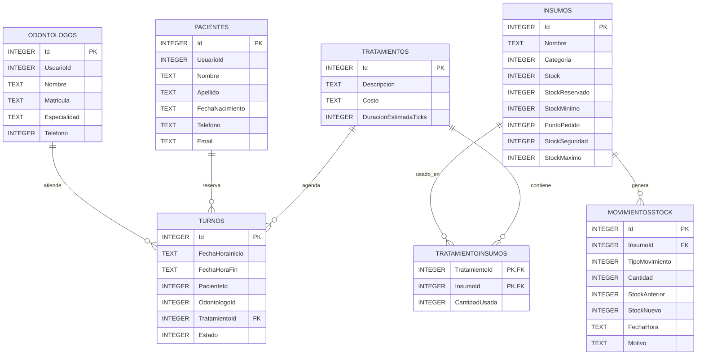

**Aclaración importante:** en el diagrama, las relaciones `PACIENTES ||--o{ TURNOS` y `ODONTOLOGOS ||--o{ TURNOS` representan la intención lógica, pero **no existen claves foráneas** en el esquema para `Turnos.PacienteId` ni `Turnos.OdontologoId`. Solo `Turnos.TratamientoId` tiene FK. Es una inconsistencia de integridad.

### 8.4 Tablas, columnas y restricciones

| Tabla | Clave | Restricciones | Observaciones |
|---|---|---|---|
| `Pacientes` | `Id INTEGER PRIMARY KEY AUTOINCREMENT` | `UsuarioId` nullable; campos de texto NOT NULL | No hay FK a usuarios porque no hay tabla de usuarios. |
| `Odontologos` | `Id INTEGER PRIMARY KEY AUTOINCREMENT` | `UsuarioId` nullable; `Telefono INTEGER NOT NULL` | El teléfono es numérico, no texto. |
| `Insumos` | `Id INTEGER PRIMARY KEY AUTOINCREMENT` | Todos los stocks NOT NULL | Sin `CHECK` de no negativos; el dominio los valida. |
| `Tratamientos` | `Id INTEGER PRIMARY KEY AUTOINCREMENT` | `Costo TEXT`; `DuracionEstimadaTicks INTEGER` | `Costo` como texto invariante para preservar decimal. |
| `TratamientoInsumos` | PK compuesta (`TratamientoId`, `InsumoId`) | FK a Tratamientos `ON DELETE CASCADE`; FK a Insumos `ON DELETE RESTRICT` | Impide borrar un insumo usado. |
| `MovimientosStock` | `Id INTEGER PRIMARY KEY AUTOINCREMENT` | FK a Insumos `ON DELETE RESTRICT` | Registro de auditoría; no se expone por API. |
| `Turnos` | `Id INTEGER PRIMARY KEY AUTOINCREMENT` | FK a Tratamientos; sin FK a Pacientes/Odontólogos | Estado entero (1/2/3). |

### 8.5 Índices

```sql
IX_Turnos_OdontologoId_FechaHoraInicio (OdontologoId, FechaHoraInicio)
IX_Turnos_FechaHoraInicio (FechaHoraInicio)
IX_Turnos_PacienteId (PacienteId)
IX_Turnos_TratamientoId (TratamientoId)
IX_TratamientoInsumos_InsumoId (InsumoId)
IX_MovimientosStock_InsumoId_FechaHora (InsumoId, FechaHora)
IX_Tratamientos_Descripcion (Descripcion)
IX_Pacientes_Apellido_Nombre (Apellido, Nombre)
IX_Odontologos_Matricula (Matricula)
IX_Insumos_Categoria (Categoria)
```

**Problema de la consulta de agenda:** `WHERE OdontologoId = @OdontologoId AND DATE(FechaHoraInicio) = DATE(@Fecha)` aplica `DATE()` a la columna. SQLite no puede usar eficientemente `IX_Turnos_OdontologoId_FechaHoraInicio` para el segundo componente. Una versión por rango sería:

```sql
WHERE OdontologoId = @OdontologoId
  AND FechaHoraInicio >= @Inicio
  AND FechaHoraInicio <  @Fin
```

Ese cambio es una **recomendación**, no está implementado.

**Índices únicos ausentes:** no hay `UNIQUE` en `Pacientes.Email`, `Pacientes.Telefono`, `Odontologos.Matricula` ni `Tratamientos.Descripcion`. Las validaciones de duplicado se hacen en memoria/servicio, con riesgo de carrera. La base no impone la regla.

### 8.6 Inicialización y migraciones

**Archivo:** `../../CapaInfraestructura/Persistencia/DatabaseInitializer.cs`

El inicializador:

1. Abre una conexión.
2. Abre una `IDbTransaction` de ADO.NET.
3. Ejecuta el script `EsquemaSql` con `CREATE TABLE IF NOT EXISTS` e índices.
4. Verifica si existe la columna `StockMinimo` en `Insumos`.
5. Si no existe, la agrega y copia `PuntoPedido` como valor inicial.
6. Verifica si la FK de `TratamientoInsumos` hacia `Insumos` tiene `ON DELETE RESTRICT`.
7. Si no, reconstruye la tabla: crea `TratamientoInsumos_Nuevo`, copia filas válidas, borra la original, renombra y recrea el índice.
8. Confirma o revierte.

**Fortalezas**

- Es idempotente para las dos migraciones que conoce.
- Usa transacción.
- La migración de FK evita perder la restricción al actualizar una base vieja.

**Debilidades**

- No hay tabla de versión de esquema ni historial de migraciones.
- `CREATE TABLE IF NOT EXISTS` no agrega columnas nuevas a tablas existentes. Cada columna nueva requiere una migración manual como la de `StockMinimo`.
- El script se ejecuta en cada arranque; si crece, el costo de arranque crece.
- No hay estrategia de backup antes de migrar.
- No se validan datos huérfanos antes de crear FKs.

**Ejemplo didáctico de migración futura:** agregar `Activo INTEGER NOT NULL DEFAULT 1` a `Tratamientos` requeriría comprobar `pragma_table_info('Tratamientos')` y ejecutar `ALTER TABLE ... ADD COLUMN ...`, igual que con `StockMinimo`.

### 8.7 Ciclo de vida de la conexión

```text
Request HTTP
  → scope DI
    → UnitOfWorkSqlite (scoped)
      → Connection (se abre en la primera operación)
        → repositorios comparten esa conexión
  → fin del request
    → DisposeAsync
      → ROLLBACK si quedó transacción activa
      → Dispose de la conexión
```

- La conexión se abre de forma perezosa: `_connection ??= AbrirConexion()`.
- Todos los repositorios del request usan la misma conexión a través del UoW.
- Al terminar el request, el contenedor libera el UoW y este cierra la conexión.
- La factory es singleton, pero crea una conexión nueva por UoW.

**Por qué una conexión por request:** permite una transacción coherente entre varios repositorios sin pasar la conexión por parámetro. También evita el costo de abrir/cerrar en cada consulta dentro del mismo caso de uso.

### 8.8 Modelo de transacción

**Estados del UoW**

| Estado | `TransaccionActiva` | `Connection` | Qué significa |
|---|---|---|---|
| Inicial | `false` | Cerrada hasta el primer uso | No hay transacción. |
| Lectura | `false` | Abierta | Se hicieron consultas sin transacción. |
| Activa | `true` | Abierta | `BEGIN IMMEDIATE` ejecutado. |
| Confirmada | `false` | Abierta | `COMMIT` ejecutado; se pueden seguir usando la conexión. |
| Revertida | `false` | Abierta | `ROLLBACK` ejecutado. |
| Liberada | — | Cerrada | `DisposeAsync` cerró la conexión. |

**Métodos**

- `IniciarTransaccionAsync` / `BeginTransactionAsync`: idempotentes; si ya hay transacción, no hacen nada.
- `CommitAsync`: idempotente; si no hay transacción, no hace nada.
- `RollbackAsync`: idempotente; si no hay transacción, no hace nada.
- `DisposeAsync`: si hay transacción activa, intenta `ROLLBACK` y la marca inactiva; luego cierra la conexión.

**Propiedad de la transacción**

| Llamador | ¿Abre? | ¿Confirma? | ¿Revierte? |
|---|---|---|---|
| `TurnosService.RegistrarTurnoAsync` | Sí | Sí | Por dispose si hay excepción |
| `TurnosService.CompletarTurnoAsync` | Sí | Sí, si es propia | Por dispose |
| `TratamientoService.ConsumirInsumosAsync` | Solo si no hay activa | Solo si es propia | Por dispose |
| `InsumoRepositorySqlite.ActualizarInsumo` | Solo si no hay activa | Solo si es propia | Sí, explícito si es propia |
| `TratamientoRepositorySqlite.AgregarTratamiento` | Solo si no hay activa | Solo si es propia | Sí, explícito si es propia |
| `PacienteRepositorySqlite.AgregarPaciente` | Solo si no hay activa | Solo si es propia | Sí, explícito si es propia |

**Regla de oro:** quien abre la transacción es quien la confirma o revierte. Los demás solo participan. El código respeta esta regla en la mayoría de los casos, pero la implementa de forma dispersa y fácil de romper.

### 8.9 Dapper: consultas, parámetros y mapeo

**Consulta típica**

```csharp
IEnumerable<Turno> turnos = await _unitOfWork.Connection.QueryAsync<Turno>(
    new CommandDefinition(
        sql,
        new { OdontologoId = odontologoId, Fecha = fecha.Date },
        _unitOfWork.Transaction,
        cancellationToken: cancellationToken));
```

- `QueryAsync<T>` ejecuta un `SELECT` y mapea cada fila.
- `CommandDefinition` agrupa SQL, parámetros, transacción y cancellation token.
- Los parámetros anónimos se convierten en parámetros SQL (`@OdontologoId`, `@Fecha`).
- Dapper nunca interpola valores en el SQL; los envía aparte.

**Comando típico**

```csharp
int filas = await _unitOfWork.Connection.ExecuteAsync(
    new CommandDefinition(
        sql,
        CrearParametros(turno),
        _unitOfWork.Transaction,
        cancellationToken: cancellationToken));
```

- `ExecuteAsync` devuelve filas afectadas.
- Si `filas == 0` en un `UPDATE` o `DELETE`, el recurso no existía.
- En un `INSERT`, `filas` debería ser 1.

**Escalar típico**

```csharp
int id = await _unitOfWork.Connection.ExecuteScalarAsync<int>(
    new CommandDefinition(
        "SELECT COALESCE(MAX(Id), 0) + 1 FROM Turnos;",
        transaction: _unitOfWork.Transaction,
        cancellationToken: cancellationToken));
```

- `ExecuteScalarAsync<T>` devuelve el primer valor de la primera fila.
- `COALESCE(MAX(Id), 0)` evita `NULL` cuando la tabla está vacía.

**Multi-mapping**

`TratamientoRepositorySqlite.ObtenerPorIdConInsumosAsync` usa:

```csharp
QueryAsync<Tratamiento, TratamientoInsumo, Tratamiento>(
    sql,
    (tratamiento, insumo) => { ... },
    splitOn: "TratamientoId")
```

Dapper divide las columnas en dos grupos a partir de `TratamientoId` y llama al mapper por cada fila. El mapper agrega los insumos al tratamiento. Luego se deduplican. Es una técnica útil cuando hay un `JOIN` uno-a-muchos.

### 8.10 Type handlers y type maps

**Handlers**

| Tipo CLR | Representación SQLite | Handler | Por qué |
|---|---|---|---|
| `DateTime` | `TEXT` `yyyy-MM-dd HH:mm:ss` | `DateTimeTextoHandler` | Orden lexicográfico y legibilidad. |
| `decimal` | `TEXT` invariante | `DecimalInvarianteHandler` | Evita pérdida de precisión y cultura. |
| `TimeSpan` | `INTEGER` ticks | `TimeSpanTicksHandler` | Entero estable. |

**Type maps**

| Entidad | Constructor forzado |
|---|---|
| `Turno` | `(int, DateTime, DateTime, int, int, int, EstadoTurno)` |
| `Tratamiento` | `(int, string, decimal, TimeSpan)` |
| `TratamientoInsumo` | `(int, int, int)` |

**Por qué `Tratamiento` usa el constructor de 4 parámetros:** el repositorio selecciona `DuracionEstimadaTicks AS DuracionEstimada` y no selecciona la lista de insumos. El constructor `(id, descripcion, costo, duracion)` crea la lista vacía; luego el repositorio agrega los insumos. Es una decisión de mapeo, no de dominio.

**Riesgo:** si se agrega un campo a una entidad y no se actualiza el type map, Dapper puede fallar o mapear mal. Las pruebas de persistencia son la red de seguridad.

### 8.11 Generación de IDs

**Patrón actual**

```text
id = SELECT COALESCE(MAX(Id), 0) + 1
entidad = new Entidad(id, ...)
INSERT INTO ... (Id, ...) VALUES (@Id, ...)
```

Se usa en turnos, tratamientos, insumos, pacientes y odontólogos. El repositorio de usuarios usa `Interlocked.Increment` sobre un contador en memoria.

**Ventajas**

- El dominio recibe un ID positivo desde el inicio.
- El ID está disponible antes de insertar, lo que simplifica la construcción de relaciones (`TratamientoInsumo` necesita `TratamientoId`).
- La transacción `BEGIN IMMEDIATE` serializa a los escritores y evita colisiones dentro de una instancia.

**Desventajas**

- Se desaprovecha `AUTOINCREMENT`.
- Si se borra la última fila, el ID puede reutilizarse.
- Si otra aplicación escribe en la misma base sin la misma transacción, puede colisionar.
- Es una consulta extra por cada alta.
- El ID es predecible y enumerable; no es un problema de seguridad grave en este contexto, pero es una decisión a conocer.

**Alternativa recomendada (no implementada):** dejar que SQLite genere el ID con `AUTOINCREMENT` y recuperarlo con `last_insert_rowid()`. Requeriría que el dominio permita construir entidades sin ID y asignarlo después, o usar un ID temporal. Es un cambio de contrato y requiere spec.

### 8.12 Movimientos de stock

**Entidad `MovimientoStock`**

Valida:

- `Id >= 0` (0 para nuevo).
- `InsumoId > 0`.
- Tipo de movimiento definido en el enum.
- `Cantidad > 0`.
- Stock anterior y nuevo no negativos.
- Fecha distinta de `default`.
- Motivo no vacío.
- Coherencia matemática:
  - Entrada: `stockNuevo == stockAnterior + cantidad`.
  - Salida: `stockNuevo == stockAnterior - cantidad`.
  - Ajuste: `cantidad == abs(stockNuevo - stockAnterior)`.
- Stock nuevo distinto del anterior.

**Cuándo se registra:** `InsumoRepositorySqlite.ActualizarInsumo` compara el stock leído con el nuevo. Si cambió, crea el movimiento. El tipo se deduce: Entrada si sube, Salida si baja, Ajuste si no cambia (aunque el movimiento nunca se crea si no cambió, así que Ajuste es inalcanzable en la práctica).

**Limitación:** el movimiento no registra el turno, el usuario ni el motivo real. Todos los consumos por turno quedan como “Actualización de stock”. Para auditoría clínica real, faltaría contexto.

### 8.13 Concurrencia

**Escenario:** dos recepcionistas intentan reservar el mismo horario.

1. Ambos requests abren `BEGIN IMMEDIATE`.
2. SQLite solo permite un escritor; el segundo espera.
3. El primero lee, valida, inserta y confirma.
4. El segundo obtiene el bloqueo, lee la agenda actualizada, detecta el solapamiento y falla con 409.

**Por qué funciona:** `BEGIN IMMEDIATE` se toma antes de leer. Si se usara una transacción diferida, ambos podrían leer antes de que el otro escriba y luego uno fallaría al escribir con “database is locked” o se produciría una condición de carrera lógica.

**Escenario:** dos requests completan el mismo turno.

1. El primero abre transacción, lee `Pendiente`, completa, descuenta stock, confirma.
2. El segundo abre transacción, lee `Completado`, devuelve 204 sin descontar de nuevo.
3. La bandera `Estado == Completado` hace el flujo idempotente.

**Escenario:** cancelar y completar a la vez.

`CancelarTurnoAsync` lee **antes** de abrir la transacción. Es el único flujo con esa ventana. Si el completado ocurre entre la lectura y el `BEGIN`, la cancelación puede sobrescribir el estado. Es un hallazgo real.

**Limitación de SQLite:** un solo escritor a la vez. Para una clínica pequeña con pocas escrituras, alcanza. Para alto volumen, habría que migrar a PostgreSQL/SQL Server y revisar el UoW.

### 8.14 Consistencia entre SQLite y memoria

| Dato | Dónde vive | ¿Transacción común con el resto? |
|---|---|---|
| Paciente | SQLite | Sí, con turnos/tratamientos/insumos. |
| Odontólogo | SQLite | Sí. |
| Usuario | Memoria | **No.** |
| Refresh token | Memoria | **No.** |
| `UsuarioId` de paciente/odontólogo | SQLite (columna) | Apunta a un usuario que puede desaparecer al reiniciar. |

**Riesgos**

- Alta de paciente con usuario: si falla la validación del paciente después de crear el usuario, queda un usuario huérfano.
- Reinicio: los usuarios desaparecen; los `UsuarioId` persistidos quedan colgados.
- Dos instancias de la API: cada una tiene su propio repositorio de usuarios; un usuario creado en una no existe en la otra.
- No hay forma de recuperar la contraseña ni de cambiar el rol de un paciente desde la API de pacientes.

**Recomendación:** mover usuarios y refresh tokens a SQLite con tablas `Usuarios` y `RefreshTokens`, y incluir el alta de paciente/odontólogo en la misma transacción. Requiere spec aprobada por el cambio de contrato y de esquema.

### 8.15 Cómo inspeccionar la base

**Opción 1: DB Browser for SQLite**

- Abrir `clinica.db`.
- Pestaña “Database Structure” para ver tablas e índices.
- Pestaña “Browse Data” para ver filas.
- Pestaña “Execute SQL” para consultas.

**Opción 2: línea de comandos**

Si `sqlite3` está instalado:

```powershell
sqlite3 clinica.db ".tables"
sqlite3 clinica.db ".schema Turnos"
sqlite3 clinica.db "SELECT Id, FechaHoraInicio, Estado FROM Turnos ORDER BY Id DESC LIMIT 10;"
```

**Opción 3: desde C#**

```csharp
using var connection = new SqliteConnection("Data Source=clinica.db");
connection.Open();
var tablas = connection.Query<string>(
    "SELECT name FROM sqlite_master WHERE type = 'table' ORDER BY name;");
```

**Precaución:** no editar la base mientras la API está corriendo con una transacción abierta. SQLite bloquea escrituras y podrías ver “database is locked”.

### 8.16 Ejercicios de persistencia

1. Dibujar el esquema real y marcar qué relaciones lógicas no tienen FK.
2. Explicar por qué `Costo` se guarda como `TEXT`.
3. Explicar qué pasaría si se quitara `Foreign Keys=True`.
4. Simular mentalmente dos altas concurrentes de turno y describir el orden de bloqueos.
5. Encontrar un índice que no se usa por la forma de la consulta.
6. Proponer una migración para agregar `Activo` a `Tratamientos`.
7. Explicar por qué `MAX(Id)+1` funciona con `BEGIN IMMEDIATE` y por qué no sería suficiente con transacciones diferidas.
8. Diseñar una consulta de movimientos de stock por insumo y rango de fechas.

## 9. Seguridad y validaciones

<a id="s9"></a>

### 9.1 Modelo de amenazas

| Elemento | Qué es | Por qué importa |
|---|---|---|
| Datos de pacientes | Nombre, apellido, email, teléfono, fecha de nacimiento | Dato personal; permite identificar y contactar a una persona. |
| Turnos | Fecha, hora, paciente, odontólogo, tratamiento | Revela atención médica y hábitos. |
| Tratamientos e insumos | Costos, duración, insumos usados | Dato comercial y operativo. |
| Usuarios y credenciales | Nombre de usuario, hash BCrypt, rol, estado | Si se compromete un Admin, se compromete todo el sistema. |
| Access token JWT | Portador de identidad y rol | Quien lo tenga puede actuar como el usuario hasta que expire. |
| Refresh token | Permite obtener nuevos access tokens | Vida útil de 7 días; más valioso que el access token. |
| Base `clinica.db` | Datos clínicos y operativos | Copia completa del sistema si se filtra. |
| Logs | IDs, mensajes de excepción, rutas | Pueden filtrar datos si se registran cuerpos o valores sensibles. |

**Actores considerados:** visitante anónimo, usuario autenticado con rol `Paciente`, recepcionista, odontólogo, administrador, atacante con un token robado, insider con acceso a la base o al servidor.

**Fronteras de confianza:** navegador → API (HTTP/JSON/JWT), API → SQLite, API → repositorio de usuarios en memoria, configuración → proceso, frontend → `localStorage`.

**Supuestos no verificados en el código:** que la API se despliegue detrás de HTTPS, que la red sea privada, que solo personal autorizado use el frontend y que la base esté protegida por el sistema operativo. El repositorio no demuestra ninguno de esos supuestos.

### 9.2 Autenticación frente a autorización

- **Autenticación:** responde “¿quién eres?”. La resuelve el JWT Bearer. Sin token válido, el usuario es anónimo.
- **Autorización:** responde “¿puedes hacer esto?”. La resuelven los `[Authorize(Roles = ...)]` y las reglas de aplicación.
- Un endpoint con `[Authorize]` sin rol exige estar autenticado, pero no distingue roles.
- `[AllowAnonymous]` desactiva ambas comprobaciones; solo debería usarse en login, registro y refresh.
- Ocultar un botón en el frontend **no** es autorización. El atacante puede llamar a la API directamente.

### 9.3 Contraseñas

Implementación real:

```csharp
public class PasswordHasherBCrypt : IPasswordHasher
{
    public string Hash(string password) => BCrypt.Net.BCrypt.HashPassword(password);

    public bool Verify(string password, string passwordHash) =>
        BCrypt.Net.BCrypt.Verify(password, passwordHash);
}
```

**Lo correcto:**

- No se guarda la contraseña en texto plano; se guarda el hash BCrypt.
- BCrypt incorpora una sal aleatoria por hash y un factor de trabajo; no hace falta agregar sal manualmente.
- `Verify` compara la contraseña con el hash sin desencriptarlo.
- El hash no se devuelve en `AuthResponseDto` ni en `UsuarioDtoOutput`.

**Lo que falta o preocupa:**

1. No hay política de complejidad ni longitud máxima. El registro público exige mínimo 8 caracteres, pero el alta de paciente/odontólogo con contraseña **no** aplica ese mínimo porque usa `PacienteDtoInput.Password`/`OdontologoInputDto.Password`, que no tienen `MinLength`.
2. No hay cambio de contraseña, recuperación, bloqueo por intentos fallidos ni MFA.
3. `RepositorioUsuario` siembra un usuario `admin` con una contraseña literal en el código. No se reproduce aquí; debe rotarse o eliminarse antes de cualquier despliegue y no debe usarse en producción.
4. El registro público crea siempre rol `Paciente`. Es correcto para evitar escalada de privilegios, pero no hay verificación de email.
5. Las comprobaciones de unicidad de nombre de usuario/email no son atómicas: dos requests concurrentes pueden pasar la validación y crear duplicados.

### 9.4 Access token JWT

`JwtProvider.GenerarToken` construye un token con:

| Claim | Valor |
|---|---|
| `NameIdentifier` | ID del usuario |
| `Name` | nombre de usuario |
| `Email` | email |
| `Role` | rol (`Admin`, `Odontologo`, `Recepcionista`, `Paciente`) |

Características reales:

- Firma HMAC-SHA256 con `Jwt:Key`.
- Emisor, audiencia, expiración y firma se validan en `Program.cs`.
- `ClockSkew` es de 8 minutos: el token se acepta hasta 8 minutos después de su expiración nominal.
- Expiración por defecto: 8 horas (`Jwt:ExpireHours`).
- No hay `ValidAlgorithms` restringido a HS256; es una mejora recomendable.
- No hay revocación de access tokens. Si se desactiva un usuario, su token sigue siendo válido hasta expirar.
- No hay endpoint de logout.
- El token se devuelve en el cuerpo de la respuesta y el frontend lo guarda en `localStorage`.

**Consecuencia:** un XSS exitoso puede leer el token; un token robado sirve desde cualquier cliente hasta su expiración. Para un sistema clínico, conviene evaluar cookies `HttpOnly`/`Secure`/`SameSite`, expiración más corta y revocación.

### 9.5 Refresh tokens

Implementación real:

1. `GenerarRefreshToken` usa `RandomNumberGenerator.GetBytes(64)` y Base64.
2. `AuthService` lo guarda asociado al usuario con expiración de 7 días.
3. En `refresh`, busca el token, verifica `EstaActivo`, marca el token como usado y lo revoca.
4. Emite un nuevo access token y un nuevo refresh token.

**Lo correcto:** el token es aleatorio criptográficamente fuerte, tiene expiración y se rota al usarse.

**Riesgos:**

- Se guarda en texto plano en memoria, no hasheado. Un volcado de memoria o un log accidental lo expone.
- No sobrevive un reinicio: los usuarios quedan con access tokens válidos pero refresh tokens perdidos.
- La secuencia “buscar → verificar → marcar → revocar” no es atómica; dos refresh concurrentes con el mismo token podrían emitir dos respuestas antes de la revocación.
- No hay detección de reutilización de un token ya rotado (familia de tokens).
- No hay revocación masiva al cambiar rol, desactivar usuario o cambiar contraseña.

### 9.6 Matriz de autorización real

| Grupo | Métodos | Roles permitidos | Observación |
|---|---|---|---|---|
| `/api/Auth/register` | POST | Anónimo | Crea rol `Paciente`. |
| `/api/Auth/login` | POST | Anónimo | Login por usuario o email. |
| `/api/Auth/refresh` | POST | Anónimo | Requiere refresh token válido. |
| `/api/Paciente` | GET, GET id, GET buscar, POST, PUT, DELETE | `Admin`, `Odontologo`, `Recepcionista` | Sin alcance por paciente. |
| `/api/Odontologo` | GET, GET id, GET buscar, POST, PUT, DELETE | `Admin`, `Odontologo` | Un odontólogo puede administrar a otros. |
| `/api/Tratamiento` | GET, GET id, GET buscar, POST, PUT, DELETE | **Ninguno: sin `[Authorize]`** | Cualquier anónimo puede operar. |
| `/api/Insumos` | GET, GET id, GET buscar, POST, PUT, DELETE | `Admin`, `Odontologo` | Un odontólogo puede borrar insumos. |
| `/api/Turnos` | GET, GET id, GET buscar, GET huecos, POST, PATCH cancelar, PUT, DELETE | `Admin`, `Odontologo`, `Recepcionista` | Sin alcance por odontólogo. |
| `/api/Turnos/{id}/completar` | PATCH | `Admin`, `Odontologo` | Restricción adicional sobre la clase. |
| `/api/Usuarios` | GET, GET id, PUT rol, PATCH estado | `Admin` | Correcto en apariencia. |
| `/swagger` | GET | Anónimo solo en Development | En otros entornos no se registra. |

El rol `Paciente` puede autenticarse pero no tiene ningún controlador que lo acepte. Hoy no puede operar; si en el futuro se agrega un portal de pacientes, la autorización debe diseñarse explícitamente y no reutilizar los roles del personal.

### 9.7 Hallazgos de autorización y exposición

| ID | Severidad | Hallazgo | Evidencia |
|---|---|---|---|
| S-01 | Crítica | `TratamientoController` no tiene `[Authorize]`: lectura y escritura anónima de tratamientos. | `CapaWebApi/Controllers/TratamientoController.cs` |
| S-02 | Alta | Un usuario desactivado sigue pudiendo iniciar sesión y refrescar tokens: no se comprueba `EstaActivo`. | `AuthService.LoginAsync`, `AuthService.RefreshAsync` |
| S-03 | Alta | Los DTOs de paciente/odontólogo aceptan `UsuarioId` del cliente; un miembro del personal puede asociar un paciente/odontólogo a un usuario arbitrario. | `PacienteDtoInput.UsuarioId`, `OdontologoInputDto.UsuarioId` |
| S-04 | Alta | El alta de paciente/odontólogo con contraseña evita la política mínima de 8 caracteres del registro público. | `PacienteDtoInput.Password`, `OdontologoInputDto.Password` |
| S-05 | Media-Alta | No hay alcance horizontal: cualquier recepcionista/odontólogo puede leer y modificar turnos y pacientes de todos. Si el despliegue es multi-clínica o multi-profesional, es crítico. | Controladores de `Paciente` y `Turnos` |
| S-06 | Media | CORS `AllowAnyOrigin` y ausencia de `UseHttpsRedirection`/HSTS en el código. | `Program.cs` |
| S-07 | Media | Tokens en `localStorage`; sin CSP ni cabeceras de seguridad; superficie de XSS. | `CapaDePresentacion/assets/js/api.js` |
| S-08 | Media | Sin rate limiting ni bloqueo por fuerza bruta en login/refresh. | `Program.cs`, `AuthController` |
| S-09 | Media | Sin auditoría de accesos o cambios administrativos; solo logs de excepción. | `ExceptionHandlingMiddleware` |
| S-10 | Media | Refresh tokens en texto plano y en memoria; no hay detección de reutilización. | `RepositorioUsuario` |
| S-11 | Baja-Media | Los errores 400/404/409 devuelven `ex.Message`, que puede incluir IDs, emails o detalles de constraint SQLite. | `ExceptionHandlingMiddleware` |
| S-12 | Baja | El admin sembrado usa una credencial literal conocida; no hay flujo de rotación. | `RepositorioUsuario` constructor |
| S-13 | Baja | No hay `ValidAlgorithms` ni longitud mínima explícita para `Jwt:Key`; el fallo de configuración no es amigable. | `Program.cs`, `JwtProvider` |
| S-14 | Baja | El registro y el refresh no tienen verificación de email, MFA ni recuperación de cuenta. | `AuthService` |

**No se debe corregir esto dentro de la guía sin una spec aprobada.** La sección 13 amplía el análisis y propone prioridades.

### 9.8 Validación en capas

| Capa | Qué valida | Ejemplo real | ¿Es autoridad final? |
|---|---|---|---|
| Navegador | Campos requeridos, formato de email, fecha | `login.js`, formularios HTML | No; se puede saltar. |
| ASP.NET Core | Data Annotations del DTO; `[ApiController]` responde 400 automático con `ModelState` | `[Required]`, `[EmailAddress]`, `[Range]` | No; es borde. |
| Controlador | Nulos y mapeo HTTP | `if (turno == null) return BadRequest()` | No; defensa superficial. |
| Aplicación | Existencia, duplicados, estado, transacción | `TurnosService`, `PacienteService` | Sí para reglas de caso de uso. |
| Dominio | Invariantes del modelo | Constructores de `Turno`, `Paciente`, `Insumo`; `AgendaDiaria` | **Sí**, es la última barrera. |
| SQLite | PK, `NOT NULL`, FK, tipos | `DatabaseInitializer` | No reemplaza al dominio; no hay `CHECK` de negocio. |

**Regla práctica:** validar en el borde para dar un error claro y temprano; revalidar en el dominio para que ninguna ruta interna pueda violar la invariante. Una validación solo en el controlador es frágil; una validación solo en la base produce errores pobres.

### 9.9 Ejemplo de recorrido de una validación

Supongamos que llega un paciente con fecha de nacimiento `1800-01-01`:

1. El DTO tiene `[Required]`, pero eso no limita el rango; el modelo pasa.
2. `PacienteService` construye `Paciente`.
3. El constructor de `Paciente` compara contra `1920-01-01` y lanza `ArgumentException`.
4. El middleware traduce `ArgumentException` a `400 ProblemDetails`.
5. No se escribe nada en SQLite.

Si la validación estuviera solo en el controlador y otro servicio interno construyera el paciente, la regla podría saltarse. Por eso el dominio valida de nuevo.

### 9.10 Transporte, CORS y cabeceras

Estado real:

- No hay `app.UseHttpsRedirection()` ni `app.UseHsts()`.
- CORS se llama `PermitirTodo`: cualquier origen, cualquier método, cualquier cabecera.
- No se configuran cabeceras de seguridad (`Content-Security-Policy`, `X-Content-Type-Options`, `Referrer-Policy`, etc.).
- Swagger solo se habilita en Development.
- No hay límite de tamaño de request ni rate limiting.

**Riesgo:** si la API se sirve por HTTP o se expone a Internet, el token y los datos clínicos pueden viajar sin cifrar. `AllowAnyOrigin` no autentica por sí solo, pero amplía la superficie si un token queda accesible desde el navegador.

### 9.11 Secretos y configuración

Reglas del repositorio:

- `appsettings.json` y `appsettings.Development.json` solo deben tener placeholders.
- Los valores reales van en User Secrets o variables de entorno.
- `scripts/secret-scan.ps1` reporta ubicación y tipo, nunca el valor.
- Nunca pegar tokens, hashes o contraseñas en un informe, un commit o esta guía.

En el estado actual, la clave JWT de los archivos versionados es un placeholder; el escaneo no encontró secretos reales en configuración. Pero **sí existe una contraseña literal en el código de seed del admin**, que el escaneo no reportó. No se reproduce el valor aquí. Debe rotarse y sacarse del código.

### 9.12 Frontend y sesión

`api.js`:

- Guarda `accessToken`, `refreshToken`, usuario y rol en `localStorage`.
- Agrega `Authorization: Bearer <token>` a las llamadas.
- Ante 401, limpia la sesión y redirige al login.
- No intenta refrescar automáticamente; el refresh existe en el backend pero el flujo principal no lo usa.
- Reintenta con una URL por defecto si la URL configurada falla.

Implicaciones:

- `localStorage` es accesible a JavaScript; cualquier XSS puede exfiltrar los tokens.
- El frontend oculta opciones por rol, pero el backend es la única autoridad.
- Si el access token expira, el usuario debe volver a iniciar sesión salvo que se implemente el refresh en el cliente.
- No hay protección CSRF porque no se usan cookies; a cambio, se asume el riesgo de XSS.

### 9.13 Logs, privacidad y auditoría

- El middleware registra excepciones con `LogWarning` o `LogError`.
- Los mensajes de dominio suelen incluir IDs, no nombres clínicos; aun así, conviene revisar cada mensaje antes de agregar datos personales.
- No se registran cuerpos de request ni contraseñas.
- No hay tabla de auditoría de accesos, cambios de rol, altas/bajas de pacientes o consumos de stock.
- Para un sistema clínico, “quién vio/modificó qué y cuándo” suele ser un requisito; hoy no está implementado.

### 9.14 Checklist de seguridad para nuevos cambios

- [ ] ¿El controlador o la acción tiene `[Authorize]` con el rol mínimo necesario?
- [ ] ¿El endpoint es realmente público? Si sí, ¿está justificado con `[AllowAnonymous]` explícito?
- [ ] ¿El servidor deriva identidad, rol, precios, stock y estado de fuentes confiables, no del DTO?
- [ ] ¿Se valida en el borde y se revalida en el dominio?
- [ ] ¿Se usa SQL parametrizado y se evita concatenar entrada?
- [ ] ¿Se evita registrar tokens, contraseñas, cuerpos clínicos o datos personales?
- [ ] ¿Los errores no exponen stack traces, SQL ni detalles internos?
- [ ] ¿Hay pruebas de 401, 403, 404 y 409?
- [ ] ¿Se actualizó la configuración sin secretos reales?
- [ ] ¿Se revisó el impacto en pacientes/historias clínicas según la política del repo?

### 9.15 Ejercicios de seguridad

1. Quitar temporalmente `[Authorize]` de `PacienteController` en un entorno local y comprobar con `curl`/`Invoke-RestMethod` que un anónimo puede listar pacientes. Revertir el cambio; no commitear.
2. Explicar por qué el token sigue funcionando después de `CambiarEstadoAsync(usuarioId, false)`.
3. Diseñar en papel un filtro para que un odontólogo solo vea sus propios turnos. ¿Dónde va: controller, servicio, repositorio o los tres?
4. Encontrar todos los lugares donde se acepta `UsuarioId` desde un DTO y proponer una alternativa segura.
5. Proponer una política de contraseñas y comparar el registro público con el alta de paciente.
6. Diseñar una tabla `Auditoria` mínima y enumerar los eventos que registraría.
7. Revisar `ExceptionHandlingMiddleware` y proponer qué mensajes deberían dejar de devolverse al cliente.
8. Explicar el riesgo de `AllowAnyOrigin` si el frontend se publica en un dominio comprometido.

---

## 10. Testing y depuración

<a id="s10"></a>

### 10.1 Punto de partida

El proyecto tiene **228 pruebas ejecutadas y en verde** con:

```powershell
dotnet test CapaPruebas\ProyectoOdontologia.Tests.csproj
```

El proyecto de pruebas **no está incluido** en `ProyectoOdontologia.slnx`. Por eso:

```powershell
dotnet test ProyectoOdontologia.slnx
```

puede compilar la solución pero no ejecutar estas 228 pruebas. Usar siempre el `.csproj` de `CapaPruebas` o agregar el proyecto a la solución en una tarea aprobada.

### 10.2 Organización de las pruebas

| Carpeta | Tipo | Ejemplos |
|---|---|---|
| `Dominio/` | Pruebas puras de invariantes | `AgendaDiariaValidacionTests`, `InsumoStockTests` |
| `Servicios/` | Unitarias con Moq o fakes | `TurnosServiceTests`, `PacienteServiceTests`, `TratamientoServiceTests` |
| `Repositorios/` | Repositorios en memoria | `RepositorioTurnosTests`, `RepositorioPacienteTests` |
| `Persistencia/` | Integración con SQLite temporal | `TurnoRepositorySqliteTests`, `DapperMappingSqliteTests` |
| `WebApi/` | Middleware y controladores directos | `ExceptionHandlingMiddlewareTests`, `TurnosControllerTests` |
| `Concurrencia/` | IDs atómicos y bloqueos | `IdAutoIncrementoConcurrenciaTests`, `TurnosServiceConcurrenciaTests` |
| `Helpers/` | Datos y dobles de prueba | `EntidadesFactory`, `UnitOfWorkNulo` |
| `Fakes/` | Implementaciones controladas | `FakeRepositorioInsumos` |

### 10.3 Anatomía de una prueba

Patrón **AAA** (Arrange, Act, Assert):

```csharp
[Fact]
public async Task RegistrarTurnoAsync_TurnoValido_PersisteElTurno()
{
    // Arrange
    TurnoDtoInput dto = CrearTurnoDto();

    // Act
    await _servicio.RegistrarTurnoAsync(dto);

    // Assert
    _mockRepositorio.Verify(r => r.AgregarTurno(It.IsAny<Turno>()), Times.Once);
}
```

Convención de nombres observada:

```text
Metodo_Escenario_ResultadoEsperado
```

Ejemplos:

- `RegistrarTurnoAsync_AgendaSolapadaMismoOdontologo_LanzaTurnoSolapadoYNoPersiste`
- `CompletarTurnoAsync_TurnoYaCompletado_NoVuelveAConsumirInsumos`
- `InvokeAsync_ExcepcionNoControlada_Responde500SinExponerElDetalle`

Una prueba debe fallar por una sola razón y describir el comportamiento, no la implementación.

### 10.4 xUnit: lo que se usa

- `[Fact]`: prueba sin parámetros.
- `[Theory]` + `[InlineData]`: misma lógica con varios datos (si se agregan).
- `Assert.Equal`, `Assert.True`, `Assert.Null`, `Assert.NotNull`, `Assert.Single`, `Assert.All`, `Assert.ThrowsAsync<T>`, `Assert.ThrowsAnyAsync<T>`.
- `IAsyncLifetime` no se usa de forma general; la limpieza se hace con `await using` y `IAsyncDisposable`.
- El proyecto incluye `Using Include="Xunit"`, por eso no hace falta `using Xunit;` en cada archivo.

### 10.5 Moq: dobles de repositorio y verificación

`TurnosServiceTests` construye el servicio con cinco dobles:

```csharp
_mockRepositorio = new Mock<IRepositorioTurnos>();
_mockTratamientos = new Mock<IRepositorioTratamiento>();
_mockPacientes = new Mock<IRepositorioPaciente>();
_mockUnitOfWork = new Mock<IUnitOfWork>();
_mockTratamientoService = new Mock<ITratamientoService>();

_servicio = new TurnosService(
    _mockRepositorio.Object,
    _mockTratamientos.Object,
    _mockPacientes.Object,
    _mockUnitOfWork.Object,
    _mockTratamientoService.Object);
```

Patrones usados:

```csharp
// Devolver un valor
_mockRepositorio
    .Setup(r => r.ObtenerTurnoPorIdAsync(9, It.IsAny<CancellationToken>()))
    .ReturnsAsync(turno);

// Verificar que se llamó una vez
_mockRepositorio.Verify(
    r => r.AgregarTurnoAsync(It.IsAny<Turno>(), It.IsAny<CancellationToken>()),
    Times.Once);

// Verificar que NO se llamó
_mockUnitOfWork.Verify(
    u => u.CommitAsync(It.IsAny<CancellationToken>()),
    Times.Never);

// Capturar el argumento y comprobar propiedades
_mockRepositorio.Verify(
    r => r.AgregarTurnoAsync(
        It.Is<Turno>(t => t.Id == 77 && t.PacienteId == 3),
        It.IsAny<CancellationToken>()),
    Times.Once);
```

`IUnitOfWork.BeginTransactionAsync` tiene implementación por defecto en la interfaz y delega en `IniciarTransaccionAsync`; por eso `UnitOfWorkNulo` solo implementa la versión española y sigue compilando.

### 10.6 Fakes y helpers

- `FakeRepositorioInsumos`: repositorio en memoria controlado para probar servicios sin SQLite.
- `UnitOfWorkNulo`: UoW sin conexión; permite probar servicios que abren transacción sin abrir una base real.
- `EntidadesFactory`: crea entidades válidas con datos sintéticos; evita repetir constructores largos.
- `AssertionHelper`: utilidades de aserción compartidas.
- `SqliteTestDatabase`: base temporal por prueba; crea un archivo único en `%TEMP%`, usa `Foreign Keys=True`, inicializa el esquema y borra el archivo al terminar.

**Regla:** los datos de prueba son sintéticos. Nunca usar nombres, emails, teléfonos o fechas de pacientes reales.

### 10.7 Pruebas de dominio

`AgendaDiariaValidacionTests` prueba el objeto de valor sin base de datos ni mocks:

- Agenda vacía.
- Solapamiento en el mismo odontólogo.
- Turnos consecutivos que no se solapan.
- Distinto odontólogo.
- Huecos disponibles.
- Validación de límites.

`InsumoStockTests` prueba:

- Descuento válido.
- Stock insuficiente.
- Reposición.
- Stock disponible.
- Punto de pedido.

Estas son las pruebas más valiosas: rápidas, deterministas y protegen las reglas centrales.

### 10.8 Pruebas de servicios

`TurnosServiceTests` es la suite más grande. Cubre, entre otros:

| Área | Comportamiento verificado |
|---|---|
| Registro legacy | Firma CQS, ID desde repositorio, persistencia, nulo, solapamiento, siguiente turno tras conflicto. |
| Registro nuevo | Duración del tratamiento, tratamiento/paciente inexistente, solapamiento, transacción. |
| Lectura | Mapeo a DTO, inexistente lanza excepción, búsqueda. |
| Actualización | Misma ID, inexistente, completado/cancelado, solapamiento, solo consigo mismo. |
| Eliminación | Existente, inexistente, no elimina si falla. |
| Huecos | Jornada completa, best-fit, sin hueco, lista vacía. |
| Completar | Consume insumos, idempotencia, turno cancelado. |
| Cancelar | Cambia estado, inexistente. |

Lo importante no es memorizar la lista, sino el patrón: **verificar el efecto y también el no-efecto**. Por ejemplo, ante un solapamiento se comprueba que se lanza la excepción y que `AgregarTurnoAsync` nunca se llamó.

`TratamientoServiceTests` cubre el consumo de insumos y sus validaciones. `PacienteServiceTests` cubre altas, duplicados y actualización. `OdontologoServiceTests` cubre matrícula y alta. `InsumosServiceTests` cubre stock y movimientos.

### 10.9 Pruebas de persistencia con SQLite

`SqliteTestDatabase` es la pieza clave:

```csharp
internal sealed class SqliteTestDatabase : IAsyncDisposable
{
    private readonly string _rutaArchivo;

    public SqliteTestDatabase()
    {
        _rutaArchivo = Path.Combine(
            Path.GetTempPath(),
            $"odontologia-{Guid.NewGuid():N}.db");
        ConnectionString = $"Data Source={_rutaArchivo};Foreign Keys=True";
    }

    public async Task InicializarAsync() =>
        await DatabaseInitializer.InicializarAsync(CrearFactory());

    public UnitOfWorkSqlite CrearUnitOfWork() =>
        new UnitOfWorkSqlite(CrearFactory());

    public ValueTask DisposeAsync()
    {
        SqliteConnection.ClearAllPools();
        if (File.Exists(_rutaArchivo))
            File.Delete(_rutaArchivo);
        return ValueTask.CompletedTask;
    }
}
```

Cada prueba usa una base nueva. Se inicializa el esquema real, se ejecuta SQL real y se borra el archivo. Así se detectan errores que los mocks no ven: mapeo de columnas, type handlers, claves foráneas, índices, rollback y bloqueos.

Ejemplos de lo que ya está cubierto:

- Creación de tablas e índices (`IX_Turnos_OdontologoId_FechaHoraInicio`, `IX_MovimientosStock_InsumoId_FechaHora`).
- Persistencia y recuperación de un turno con estado.
- Filtro por odontólogo y fecha.
- Cancelación persistida.
- Búsqueda por ID y fecha.
- `BEGIN IMMEDIATE` bloquea a un segundo escritor (error SQLite 5).
- `ROLLBACK` no persiste el turno.
- Eliminación y segunda eliminación falsa.
- Mapeo Dapper de `DateTime`, `decimal` y `TimeSpan`.
- Consumo de stock y movimientos en la misma transacción.

**Precaución:** las pruebas de bloqueo usan timeouts cortos; en una máquina lenta pueden ser sensibles. Si una prueba de concurrencia falla de forma intermitente, revisar timeout y orden, no “arreglarla” con `Thread.Sleep` arbitrario.

### 10.10 Pruebas de Web API

No se usa `WebApplicationFactory` ni `Microsoft.AspNetCore.Mvc.Testing`. Las pruebas actuales son directas:

- **Middleware:** se construye `DefaultHttpContext`, se lanza una excepción desde el `RequestDelegate` y se deserializa `ProblemDetails`.
- **Controlador:** se instancia `TurnosController` con un `Mock<ITurnosService>` y se comprueba el `IActionResult` y el `CancellationToken`.

Ventajas: rápidas y sin red. Limitaciones: no prueban el pipeline completo, la autenticación, la autorización, el routing, la serialización real ni CORS. Para eso haría falta una prueba de integración con `WebApplicationFactory` y un esquema de autenticación de prueba.

### 10.11 Pruebas de concurrencia

`IdAutoIncrementoConcurrenciaTests`:

- `Parallel.For` con 1000 IDs, sin repetidos.
- `Task.WhenAll` con 1000 IDs, sin repetidos.
- Primer ID = 1, secuenciales consecutivos, instancias independientes.

`TurnosServiceConcurrenciaTests` y `TurnoRepositorySqliteTests` cubren:

- Generación atómica de IDs con `Interlocked.Increment`.
- `BEGIN IMMEDIATE` y bloqueo de escritores concurrentes.
- Comportamiento del servicio bajo solicitudes simultáneas.

Las pruebas de concurrencia son las más difíciles de estabilizar. Deben usar barreras o `TaskCompletionSource` cuando se necesite forzar un intercalado, no solo lanzar tareas y esperar.

### 10.12 Cobertura actual y huecos

**Cubierto con buena profundidad:**

- Dominio de agenda y stock.
- Servicio de turnos.
- Repositorios SQLite principales.
- Mapeo Dapper.
- Middleware de excepciones.
- Concurrencia de IDs y bloqueo SQLite.

**Sin pruebas visibles o con cobertura insuficiente:**

- `AuthService`, `JwtProvider`, `PasswordHasherBCrypt`, `UsuarioAdminService`.
- `TratamientoController`, `PacienteController`, `OdontologoController`, `InsumosController`, `UsuariosController`.
- Autorización real (`401`/`403`) y pipeline HTTP completo.
- Refresh token: rotación, expiración, reutilización, concurrencia.
- Frontend.
- Migraciones de esquema y bases preexistentes.
- Recuperación ante fallos entre la creación del usuario en memoria y la escritura SQLite.

No se debe interpretar “228 pruebas en verde” como “todo está cubierto”. La cobertura mide líneas, no garantiza comportamiento; aun así, ejecutar cobertura ayuda a encontrar zonas sin probar.

### 10.13 Comandos de prueba y cobertura

```powershell
# Todas las pruebas
dotnet test CapaPruebas\ProyectoOdontologia.Tests.csproj

# Una clase
dotnet test CapaPruebas\ProyectoOdontologia.Tests.csproj `
  --filter "FullyQualifiedName~TurnosServiceTests"

# Un test concreto
dotnet test CapaPruebas\ProyectoOdontologia.Tests.csproj `
  --filter "FullyQualifiedName~TurnosServiceTests.RegistrarTurnoAsync_TurnoValido_PersisteElTurno"

# Ver nombres sin ejecutar
dotnet test CapaPruebas\ProyectoOdontologia.Tests.csproj --list-tests

# Salida detallada
dotnet test CapaPruebas\ProyectoOdontologia.Tests.csproj `
  --logger "console;verbosity=detailed"

# Cobertura (coverlet.collector ya está referenciado)
dotnet test CapaPruebas\ProyectoOdontologia.Tests.csproj `
  --collect:"XPlat Code Coverage"

# Sin recompilar, tras un build correcto
dotnet test CapaPruebas\ProyectoOdontologia.Tests.csproj --no-build
```

Los resultados de cobertura quedan en `CapaPruebas\TestResults\` como XML `coverage.cobertura.xml`. Se puede abrir con ReportGenerator o una extensión del editor; no se versiona.

### 10.14 Depuración local

**Compilar todo:**

```powershell
dotnet build ProyectoOdontologia.slnx
```

**Ejecutar la API:**

```powershell
dotnet run --project CapaWebApi\ProyectoOdontologia.API.csproj
```

Con el perfil `http`, la API queda en `http://localhost:5231` y Swagger en `http://localhost:5231/swagger` si el entorno es Development.

**Probar un endpoint con token (PowerShell):**

```powershell
$login = Invoke-RestMethod -Method Post `
  -Uri "http://localhost:5231/api/Auth/login" `
  -ContentType "application/json" `
  -Body '{"nombreUsuario":"USUARIO_SINTETICO","password":"CONTRASENA_SINTETICA"}'

$headers = @{ Authorization = "Bearer $($login.accessToken)" }
Invoke-RestMethod -Method Get `
  -Uri "http://localhost:5231/api/Turnos" `
  -Headers $headers
```

No usar credenciales reales en ejemplos, scripts ni historial de shell.

**Inspeccionar SQLite:**

```powershell
sqlite3 clinica.db ".tables"
sqlite3 clinica.db ".schema Turnos"
sqlite3 clinica.db "SELECT Id, FechaHoraInicio, Estado FROM Turnos ORDER BY Id DESC LIMIT 5;"
```

**Depurar una prueba:**

1. Ejecutar solo la prueba con `--filter`.
2. Agregar `--logger "console;verbosity=detailed"`.
3. Si falla por datos, imprimir el estado con `Assert` descriptivos o el debugger del editor.
4. Si falla solo a veces, revisar concurrencia, hora local/UTC y orden de inicialización.

### 10.15 Errores frecuentes al escribir pruebas

| Síntoma | Causa probable | Solución |
|---|---|---|
| `NullReferenceException` en el constructor del servicio | Falta configurar un mock que el constructor o el método usa | Revisar todos los `Setup` del Arrange. |
| La prueba pasa pero el servicio no persistió | Se verifica el estado en memoria y no la llamada al repositorio | Usar `Verify` sobre el método de escritura. |
| `DateTime` no coincide | Mezcla de `DateTime.Now` y `DateTime.UtcNow`, o milisegundos | Usar fechas fijas y comparar con tolerancia solo si está justificado. |
| SQLite “database is locked” | UoW/conexión sin liberar o prueba concurrente sin timeout | Usar `await using`, cerrar pools y timeout explícito. |
| La prueba de integración ve datos de otra prueba | Se reutiliza el mismo archivo `.db` | Crear una base temporal por prueba con `Guid`. |
| El test de controller falla por `ModelState` | Se instancia el controller sin el pipeline de ASP.NET | Probar el servicio/middleware por separado o usar integración real. |

### 10.16 Ejercicios de testing

1. Agregar una prueba de `Insumo.DescontarStock` con cantidad exactamente igual al stock.
2. Escribir una prueba que verifique que `CompletarTurnoAsync` no consume insumos si el turno está cancelado.
3. Crear una prueba de integración que guarde un `Tratamiento` con dos insumos y lo recupere con el mapeo correcto.
4. Probar que `ExceptionHandlingMiddleware` responde 409 ante `StockInsuficienteException`.
5. Escribir una prueba que falle si `RegistrarTurnoAsync` confirma la transacción cuando el paciente no existe.
6. Diseñar una prueba de autorización para `/api/Tratamiento`; explicar por qué hoy fallaría.
7. Medir cobertura y elegir la clase con menor cobertura; proponer tres casos.
8. Explicar por qué `dotnet test ProyectoOdontologia.slnx` no ejecuta estas pruebas y cómo se corrige sin romper la solución.

## 11. Ejercicios prácticos

<a id="s11"></a>

### 11.1 Cómo usar los ejercicios

Los ejercicios están ordenados por nivel de dificultad. No son un examen: son una secuencia para leer, ejecutar, romper y explicar el sistema.

Reglas:

1. Trabajar en una rama local y no commitear cambios de práctica.
2. Usar solo datos sintéticos.
3. No modificar código de producción para “probar”; si un ejercicio requiere un cambio, hacerlo en una copia o en una rama descartable.
4. Ante una duda, leer primero el código real y recién después esta guía.
5. Escribir la respuesta con archivo y línea cuando sea posible.
6. Si un ejercicio no se puede completar, anotar qué falta: eso es el aprendizaje.

Preparación:

```powershell
dotnet build ProyectoOdontologia.slnx
dotnet test CapaPruebas\ProyectoOdontologia.Tests.csproj
dotnet run --project CapaWebApi\ProyectoOdontologia.API.csproj
```

### 11.2 Autodiagnóstico inicial

Marcar “sí”, “parcial” o “no”:

- [ ] Puedo explicar qué hace la API y qué hace el frontend.
- [ ] Puedo levantar el sistema y abrir Swagger.
- [ ] Entiendo qué es un DTO y por qué no se devuelve la entidad.
- [ ] Puedo seguir una petición desde el controlador hasta SQLite.
- [ ] Entiendo qué es una transacción y por qué existe `UnitOfWorkSqlite`.
- [ ] Puedo explicar la diferencia entre `Scoped` y `Singleton`.
- [ ] Sé qué es un JWT y qué claims lleva.
- [ ] Puedo leer una prueba y decir qué comportamiento protege.
- [ ] Puedo encontrar un endpoint sin autorización.
- [ ] Puedo explicar por qué los usuarios viven en memoria y los pacientes en SQLite.

Si hay más de tres “no”, empezar por los módulos 1–3 antes de seguir con los ejercicios avanzados.

### 11.3 Nivel 1 — Orientación y ejecución

**Objetivo:** entender el sistema como usuario y como operador.

1. **Levantar la API.** Ejecutar `dotnet run --project CapaWebApi\ProyectoOdontologia.API.csproj`. Anotar la URL HTTP y la URL HTTPS.
2. **Abrir Swagger.** Entrar a `/swagger` en Development. Identificar los controladores y los endpoints.
3. **Login.** Crear un usuario con `/api/Auth/register` o usar un usuario sintético existente. Guardar el token solo en memoria para la prueba; no pegarlo en archivos.
4. **Listar pacientes.** Llamar a `/api/Paciente` con y sin token. Explicar la diferencia.
5. **Crear un paciente sintético.** Usar datos inventados. Verificar que aparece en el listado.
6. **Reiniciar la API.** Comprobar qué datos sobreviven y cuáles no. Explicar por qué.
7. **Borrar `clinica.db` en una copia.** Reiniciar y describir qué se recrea.
8. **Abrir la base.** Ejecutar `.tables` y `.schema Turnos`. Identificar la tabla que no existe.

**Criterio de aprobación:** podés levantar el sistema, autenticarte, distinguir datos persistentes de datos en memoria y nombrar las tablas reales.

### 11.4 Nivel 2 — C# y dominio

**Objetivo:** leer el modelo sin miedo y explicar sus invariantes.

1. Abrir `CapaDominio/Entidades/Turnos.cs`. Enumerar todas las guard clauses del constructor y decir qué excepción lanza cada una.
2. Explicar la diferencia entre `Cancelar`, `Completar` y `Reprogramar`. ¿Qué estados permiten cada operación?
3. Abrir `Insumos.cs`. Explicar `DescontarStock`, `ReponerStock`, `StockDisponible` y `RequiereReposicion`.
4. Abrir `AgendaDiaria.cs`. Explicar cómo se detecta un solapamiento y cómo se calculan los huecos.
5. Explicar por qué `Turno` tiene setters privados y qué pasaría si `Estado` fuera público.
6. Buscar todos los usos de `DateTime.Now` y `DateTime.UtcNow`. Explicar el riesgo de mezclarlos.
7. Explicar qué es un `record` y por qué los DTOs de salida lo usan.
8. Escribir en papel una prueba para `Insumo.DescontarStock` con cantidad mayor al stock.
9. Explicar por qué `TratamientoInsumo` permite `tratamientoId = 0` y si eso es un error.
10. Explicar por qué `Paciente` rechaza una fecha de nacimiento de 2010.

**Criterio de aprobación:** podés justificar cada invariante y predecir qué excepción lanza una entrada inválida.

### 11.5 Nivel 3 — Arquitectura, DI y DTOs

**Objetivo:** ubicar cada responsabilidad en la capa correcta.

1. Dibujar las cuatro capas y las flechas de dependencia reales.
2. Explicar por qué `CapaDominio` no referencia a nadie.
3. Seguir la cadena `TurnosController → ITurnosService → TurnosService → IUnitOfWork → TurnoRepositorySqlite → Dapper → SQLite`.
4. Explicar qué diferencia hay entre `ITurnoRepository` e `IRepositorioTurnos` si ambos existen. ¿Cuál usa el servicio?
5. Explicar por qué `IPasswordHasher` y `IJwtProvider` son Scoped y no Singleton.
6. Explicar qué pasaría si `IRepositorioUsuario` dejara de ser Singleton.
7. Clasificar diez clases del proyecto en su capa correcta.
8. Explicar por qué el controlador no debe calcular solapamientos.
9. Explicar por qué `UnitOfWorkSqlite.Transaction` devuelve `null` y cómo se maneja la transacción real.
10. Proponer dónde viviría una regla “no se puede cancelar un turno con menos de 24 horas de anticipación”. No implementarla.

**Criterio de aprobación:** podés justificar la ubicación de una clase nueva y detectar una fuga de responsabilidades.

### 11.6 Nivel 4 — Persistencia y transacciones

**Objetivo:** entender SQLite, Dapper y la propiedad de la transacción.

1. Abrir `DatabaseInitializer.cs`. Listar las tablas, claves primarias y claves foráneas.
2. Explicar por qué `Costo` se guarda como `TEXT` y cómo se convierte.
3. Explicar por qué `DateTime` se guarda como `TEXT` y `TimeSpan` como ticks.
4. Explicar qué hace `BEGIN IMMEDIATE` y por qué se usa en lugar de una transacción diferida.
5. Explicar qué pasa si dos altas de turno concurrentes llaman a `ObtenerProximoIdAsync` al mismo tiempo.
6. Explicar por qué `TurnoRepositorySqlite.AgregarTurnoAsync` inserta el ID explícitamente y verifica `last_insert_rowid()`.
7. Explicar qué tablas no tienen FK y qué riesgo implica.
8. Explicar por qué `TratamientoInsumos` usa `ON DELETE RESTRICT` hacia `Insumos`.
9. Explicar qué hace `MovimientosStock` y en qué transacción se escribe.
10. Abrir una base temporal y ejecutar un `ROLLBACK`; comprobar que el dato no quedó.

**Criterio de aprobación:** podés explicar el esquema, el mapeo y el ciclo de una transacción sin mirar la guía.

### 11.7 Nivel 5 — Flujos de negocio

**Objetivo:** reconstruir los casos de uso completos.

1. Describir el alta de un paciente, incluyendo la creación opcional del usuario.
2. Describir el alta de un odontólogo y explicar por qué usa la matrícula como email del usuario.
3. Describir la creación de un turno con `CrearTurnoRequestDto`, incluyendo el cálculo de la hora de fin.
4. Describir qué ocurre al completar un turno: validaciones, consumo de insumos, movimientos y commit.
5. Explicar por qué completar dos veces no vuelve a consumir stock.
6. Describir la cancelación y explicar qué pasa si el turno ya está completado.
7. Describir la reprogramación y los estados que la permiten.
8. Explicar cómo se consultan los huecos disponibles.
9. Explicar el flujo de login, refresh y expiración del access token.
10. Explicar qué pasa si se crea un paciente con email duplicado y por qué puede quedar un usuario huérfano.

**Criterio de aprobación:** podés narrar cada flujo indicando capa, validación, transacción y efecto persistente.

### 11.8 Nivel 6 — Seguridad, API y frontend

**Objetivo:** pensar como atacante y como defensor.

1. Listar todos los endpoints y su rol requerido.
2. Encontrar el controlador sin `[Authorize]` y explicar el impacto.
3. Explicar por qué ocultar un botón no es seguridad.
4. Explicar qué pasa si se desactiva un usuario que ya tiene un token.
5. Explicar por qué `PacienteDtoInput.UsuarioId` es peligroso.
6. Explicar el riesgo de `localStorage` y proponer una alternativa.
7. Explicar qué cambia si la API se sirve por HTTP en vez de HTTPS.
8. Explicar por qué `AllowAnyOrigin` es riesgoso en producción.
9. Revisar `ExceptionHandlingMiddleware` y proponer qué mensajes ocultar.
10. Diseñar en papel una prueba de 401 y otra de 403.

**Criterio de aprobación:** podés identificar los hallazgos S-01 a S-14 y proponer una mitigación concreta para cada uno.

### 11.9 Nivel 7 — Testing, depuración y refactor

**Objetivo:** cambiar el sistema con red de seguridad.

1. Ejecutar una sola clase de pruebas con `--filter`.
2. Explicar qué verifica `RegistrarTurnoAsync_SolapamientoEnAgendaDelDia_LanzaTurnoSolapadoYNoConfirma`.
3. Escribir una prueba nueva para un caso no cubierto de `Insumo`.
4. Explicar por qué `dotnet test ProyectoOdontologia.slnx` no ejecuta las 228 pruebas.
5. Explicar cómo `SqliteTestDatabase` evita contaminar pruebas.
6. Reproducir un fallo de concurrencia con una prueba de bloqueo.
7. Leer un stack trace de `SqliteException` y traducirlo a una causa de negocio.
8. Diseñar un refactor pequeño para eliminar una sobrecarga legacy, sin implementarlo.

**Criterio de aprobación:** podés agregar una prueba que falle antes del cambio y pase después, y explicar el fallo sin adivinar.

### 11.10 Capstone: mini-informe técnico

Elegir uno de estos temas y escribir un informe de 2–3 páginas, sin modificar código:

- **A.** “Cómo se agenda un turno de principio a fin”.
- **B.** “Cómo se descuenta stock al completar un tratamiento”.
- **C.** “Por qué los usuarios en memoria son un riesgo para la consistencia”.
- **D.** “Qué falta para que la API sea segura en producción”.
- **E.** “Cómo agregar una funcionalidad de bajo riesgo siguiendo el flujo SDD”.

El informe debe incluir:

1. Problema y alcance.
2. Diagrama de flujo o de capas.
3. Archivos y líneas relevantes.
4. Tres hallazgos concretos.
5. Tres recomendaciones priorizadas.
6. Qué pruebas agregaría.
7. Qué no se puede afirmar sin más evidencia.

**Criterio de aprobación:** el informe distingue hechos verificados de opiniones y no inventa código ni funcionalidades.

### 11.11 Soluciones y criterios de ejercicios seleccionados

**E1.2 — Login sin SQLite.** Porque `IRepositorioUsuario` está implementado por `RepositorioUsuario`, que guarda usuarios en un `ConcurrentDictionary` en memoria. `PacienteRepositorySqlite` y los demás repositorios clínicos usan SQLite; el usuario no.

**E1.6 — Qué sobrevive al reinicio.** Sobreviven pacientes, odontólogos, insumos, tratamientos, turnos y movimientos. Se pierden usuarios, refresh tokens y la sesión del frontend. El admin se vuelve a sembrar.

**E2.2 — Estados.** `Cancelar` permite Pendiente y devuelve sin error si ya está Cancelado; falla si está Completado. `Completar` permite Pendiente y es idempotente si ya está Completado; falla si está Cancelado. `Reprogramar` solo permite Pendiente.

**E2.5 — Setters privados.** Protegen las invariantes: nadie puede asignar un estado inválido ni un fin anterior al inicio desde fuera. Si `Estado` fuera público, se podría completar un turno cancelado o inventar un estado.

**E2.10 — Fecha de nacimiento.** El constructor limita la fecha máxima a `2007-12-31` y la mínima a `1920-01-01`; una fecha de 2010 supera el máximo y lanza `ArgumentException`.

**E3.4 — Dos interfaces.** El servicio nuevo usa `IRepositorioTurnos` (interfaz de aplicación). `ITurnoRepository` es una interfaz más nueva/asíncrona usada por el repositorio SQLite moderno; conviven por evolución. No son intercambiables sin adaptar firmas.

**E3.5 — Scoped.** Porque se registran por request y no guardan estado global. No ser Singleton evita capturar dependencias scoped y permite sustituirlos en pruebas. El repositorio de usuarios sí debe ser Singleton porque es la “base” en memoria.

**E3.9 — `Transaction` null.** `UnitOfWorkSqlite` no crea `IDbTransaction`; ejecuta `BEGIN IMMEDIATE`/`COMMIT`/`ROLLBACK` como comandos SQL sobre la conexión. `Transaction` existe para cumplir la interfaz, pero no representa la transacción real. La propiedad real es `TransaccionActiva`.

**E4.1 — Tablas.** `Pacientes`, `Odontologos`, `Insumos`, `Tratamientos`, `TratamientoInsumos`, `MovimientosStock`, `Turnos`. No hay tabla `Usuarios`.

**E4.4 — `BEGIN IMMEDIATE`.** Adquiere el bloqueo de escritura al inicio. Evita que dos transacciones lean el mismo `MAX(Id)` y luego intenten insertar el mismo ID. Con una transacción diferida, ambas podrían leer antes de que una escriba.

**E4.5 — Concurrencia.** Con `BEGIN IMMEDIATE`, la segunda transacción espera o falla por timeout antes de leer. El ID se calcula dentro del bloqueo, por lo que no se repite. Sin bloqueo, ambas podrían obtener el mismo valor.

**E4.7 — Sin FK.** `Turnos.PacienteId` y `Turnos.OdontologoId` no tienen FK; `Pacientes`/`Odontologos` existen en SQLite pero la tabla `Turnos` solo referencia `Tratamientos`. Se pueden crear turnos con paciente/odontólogo inexistente. `Turnos.UsuarioId` no existe; el vínculo con usuario es lógico.

**E5.4 — Completar.** El servicio abre/usa transacción, busca el turno, si ya está completado retorna sin consumir; si está cancelado lanza `InvalidOperationException`; si está pendiente llama a `TratamientoService.ConsumirInsumosAsync`, marca el turno como completado, actualiza y confirma solo si la transacción es propia.

**E5.10 — Email duplicado.** `PacienteService` crea el usuario antes de validar email/teléfono del paciente. Si la validación falla, lanza `InvalidOperationException`; el UoW se descarta y revierte SQLite, pero el usuario en memoria ya quedó agregado. El paciente no se persiste.

**E6.2 — Sin autorización.** `TratamientoController` no tiene `[Authorize]`. Un anónimo puede listar, crear, actualizar y borrar tratamientos. Es el hallazgo S-01.

**E6.4 — Usuario desactivado.** `AuthService.LoginAsync` no comprueba `EstaActivo`; `RefreshAsync` tampoco. El token sigue siendo aceptado porque la autorización solo valida firma, emisor, audiencia y expiración. Desactivar no expulsa al usuario.

**E6.5 — `UsuarioId` del DTO.** Permite que el cliente asocie el paciente/odontólogo a cualquier usuario existente, o lo desvincule. La aplicación debería derivar el usuario del token o impedir que el cliente lo elija.

**E7.4 — slnx.** Porque `ProyectoOdontologia.slnx` no incluye `CapaPruebas/ProyectoOdontologia.Tests.csproj`. La solución compila los proyectos de producción, pero no descubre el proyecto de pruebas. Se corrige agregándolo a la solución en una tarea aprobada.

### 11.12 Rúbrica de ejercicios

| Nivel | Insuficiente | Aceptable | Sólido |
|---|---|---|---|
| 1. Orientación | No logra levantar la API. | La levanta y usa Swagger con ayuda. | Explica URLs, persistencia y reinicio sin ayuda. |
| 2. Dominio | No identifica invariantes. | Enumera las principales. | Predice excepciones y justifica el modelo rico. |
| 3. Arquitectura | Confunde capas. | Ubica clases con ayuda. | Justifica dependencias y detecta fugas. |
| 4. Persistencia | No explica el esquema. | Describe tablas y SQL básico. | Explica transacciones, mapeo y concurrencia. |
| 5. Flujos | Narra pasos sueltos. | Sigue el flujo principal. | Distingue validaciones, transacción y efectos. |
| 6. Seguridad | No ve riesgos. | Encuentra hallazgos evidentes. | Prioriza impacto y propone mitigaciones. |
| 7. Testing | No ejecuta pruebas. | Ejecuta y lee resultados. | Diseña pruebas y diagnostica fallos. |

---

## 12. Evaluaciones

<a id="s12"></a>

### 12.1 Reglas de evaluación

- Cada nivel se aprueba con **70%** de respuestas correctas y una defensa oral o escrita de los errores.
- Las evaluaciones prácticas se corrigen con la rúbrica de 12.11.
- No se evalúa memoria de nombres: se evalúa capacidad de leer el código y justificar decisiones.
- No usar datos reales ni secretos en las respuestas.
- Si una respuesta depende de una suposición, debe decirse explícitamente.

### 12.2 Evaluación diagnóstica (20 preguntas)

Responder sin mirar la guía. Luego comparar con 12.10.

1. ¿Qué diferencia hay entre autenticación y autorización?
2. ¿Qué es un DTO y por qué no se devuelve la entidad?
3. ¿Qué capa no referencia a ninguna otra?
4. ¿Qué hace `[ApiController]`?
5. ¿Qué diferencia hay entre `Scoped` y `Singleton`?
6. ¿Qué es una transacción?
7. ¿Qué hace `BEGIN IMMEDIATE`?
8. ¿Por qué `UnitOfWorkSqlite.Transaction` es `null`?
9. ¿Qué tabla no existe en SQLite?
10. ¿Dónde se guardan los usuarios?
11. ¿Qué claims lleva el JWT?
12. ¿Qué pasa cuando expira el access token?
13. ¿Qué endpoint no tiene autorización?
14. ¿Qué rol puede completar un turno?
15. ¿Qué ocurre al completar un turno dos veces?
16. ¿Qué es un solapamiento de agenda?
17. ¿Cómo se calcula la hora de fin de un turno nuevo?
18. ¿Qué hace `DescontarStock` si no hay suficiente?
19. ¿Por qué `dotnet test` de la slnx no corre las pruebas?
20. ¿Qué evidencia usarías para afirmar que una funcionalidad está terminada?

### 12.3 Nivel 1 — Operación

**Tarea práctica:** levantar la API, autenticarte con un usuario sintético, crear un paciente, listarlo, reiniciar la API y explicar qué sobrevivió.

**Preguntas:**

1. ¿Qué entorno habilita Swagger?
2. ¿Qué URL usa el perfil HTTP?
3. ¿Dónde se crea `clinica.db`?
4. ¿Qué se pierde al borrar la base?
5. ¿Qué se pierde al reiniciar sin borrar la base?

**Aprobación:** la API responde, el paciente persiste y la explicación distingue SQLite de memoria.

### 12.4 Nivel 2 — Dominio

**Preguntas:**

1. Escribir las guard clauses de `Turno`.
2. Explicar los estados y transiciones.
3. Explicar `AgendaDiaria.TieneSolapamiento`.
4. Explicar cómo se calculan los huecos.
5. Explicar `Insumo.DescontarStock` y `RequiereReposicion`.
6. ¿Qué pasa si se intenta reprogramar un turno completado?
7. ¿Qué pasa si se intenta completar un turno cancelado?
8. ¿Por qué `Paciente` limita la fecha de nacimiento?
9. ¿Qué invariantes protege `TratamientoInsumo`?
10. ¿Qué diferencia hay entre una entidad y un objeto de valor en este proyecto?

**Aprobación:** 7/10 correctas y justificación de las tres más importantes.

### 12.5 Nivel 3 — Arquitectura

**Preguntas:**

1. Dibujar las capas y dependencias.
2. Explicar el composition root.
3. Explicar el recorrido de una dependencia hasta SQLite.
4. ¿Por qué la aplicación define interfaces?
5. ¿Dónde vive la validación de rol?
6. ¿Dónde vive la regla de solapamiento?
7. ¿Dónde vive el SQL?
8. ¿Qué es una fuga de capa? Dar un ejemplo real.
9. ¿Por qué los repositorios en memoria quedaron como legado?
10. Proponer la ubicación de una nueva regla de negocio.

**Aprobación:** 7/10 y un diagrama correcto.

### 12.6 Nivel 4 — Persistencia

**Preguntas:**

1. Listar tablas y PK.
2. Explicar las FK existentes y las ausentes.
3. Explicar el mapeo de `DateTime`, `decimal` y `TimeSpan`.
4. Explicar `BEGIN IMMEDIATE` y `COMMIT`.
5. Explicar el riesgo de `MAX(Id)+1` sin bloqueo.
6. Explicar `last_insert_rowid()`.
7. Explicar `ON DELETE RESTRICT`.
8. Explicar `MovimientosStock`.
9. ¿Qué pasa con una transacción si el servicio lanza una excepción?
10. ¿Cómo se prueba SQLite sin ensuciar la base real?

**Aprobación:** 7/10 y una explicación correcta de la propiedad de la transacción.

### 12.7 Nivel 5 — Flujos

**Preguntas:**

1. Narrar el alta de paciente.
2. Narrar el alta de odontólogo.
3. Narrar la creación de turno con duración del tratamiento.
4. Narrar la cancelación.
5. Narrar la reprogramación.
6. Narrar el completado y consumo de insumos.
7. Narrar el login y refresh.
8. Explicar el alta de paciente con email duplicado.
9. Explicar la consulta de huecos.
10. Explicar qué datos cambian en cada flujo y en qué tabla.

**Aprobación:** 7/10 y detectar el problema de atomicidad usuario/paciente.

### 12.8 Nivel 6 — Seguridad

**Preguntas:**

1. ¿Qué endpoint es anónimo y por qué es crítico?
2. ¿Qué pasa con un usuario desactivado?
3. ¿Qué riesgo tiene `UsuarioId` en los DTOs?
4. ¿Qué riesgo tiene `localStorage`?
5. ¿Qué falta en transporte y cabeceras?
6. ¿Qué riesgo tiene CORS abierto?
7. ¿Qué información filtran los errores?
8. ¿Qué es un refresh token y cómo se rota?
9. ¿Qué es una prueba de 401/403?
10. Proponer tres mitigaciones priorizadas.

**Aprobación:** 7/10 y al menos una mitigación por hallazgo crítico.

### 12.9 Nivel 7 — Capstone

**Tarea:** elegir un flujo, escribir un informe técnico y defenderlo oralmente durante 10 minutos.

El informe debe contener:

1. Diagrama de flujo.
2. Archivos y líneas.
3. Tres hechos verificados.
4. Tres riesgos.
5. Tres pruebas propuestas.
6. Una propuesta de mejora con alcance y exclusión.

**Aprobación:** claridad, evidencia, distinción hecho/opinión y ausencia de datos reales.

### 12.10 Clave de la evaluación diagnóstica

1. Autenticación identifica; autorización decide permisos.
2. Un DTO es un contrato de transporte; evita acoplar el cliente al modelo interno.
3. `CapaDominio`.
4. Habilita validación automática del modelo, binding y respuestas 400.
5. Scoped: una instancia por request; Singleton: una por proceso.
6. Una unidad de trabajo que se confirma o revierte completa.
7. Adquiere el bloqueo de escritura de SQLite al iniciar.
8. Porque la transacción se ejecuta como SQL, no con `IDbTransaction`.
9. `Usuarios`.
10. En memoria, en `RepositorioUsuario`.
11. ID, nombre, email y rol.
12. El cliente debe renovarlo con el refresh token o volver a loguearse.
13. `TratamientoController`.
14. `Admin` y `Odontologo`.
15. No vuelve a consumir insumos; es idempotente.
16. Dos turnos del mismo odontólogo cuyos intervalos se cruzan.
17. `inicio + tratamiento.DuracionEstimada`.
18. Lanza `StockInsuficienteException` y no deja stock negativo.
19. Porque el `.slnx` no incluye el proyecto de pruebas.
20. Build, pruebas del comportamiento, revisión de seguridad y validación contra criterios de aceptación.

### 12.11 Rúbrica final (100 puntos)

| Criterio | Puntos | Descripción |
|---|---|---|
| Comprensión del dominio | 20 | Explica entidades, invariantes y estados sin leer. |
| Arquitectura | 15 | Ubica responsabilidades y justifica dependencias. |
| Persistencia | 15 | Explica SQLite, Dapper, transacciones y mapeo. |
| Flujos | 15 | Narra casos de uso completos y sus efectos. |
| Seguridad | 15 | Detecta riesgos y propone mitigaciones. |
| Testing | 10 | Ejecuta, lee y diseña pruebas. |
| Comunicación | 10 | Informe claro, evidencia y límites. |

**Aprobado:** 70/100, con al menos 8/15 en seguridad y 8/15 en persistencia.

### 12.12 Defensa oral: preguntas de seguimiento

- ¿Qué parte del sistema no está transaccional y por qué importa?
- ¿Qué cambiarías primero si tuvieras una semana?
- ¿Qué no cambiarías sin una spec?
- ¿Dónde está la autoridad final de una regla de negocio?
- ¿Qué prueba te daría más confianza para tocar turnos?
- ¿Qué evidencia tenés de que el sistema funciona hoy?
- ¿Qué afirmación de esta guía no pudiste verificar?

## 13. Auditoría técnica

<a id="s13"></a>

### 13.1 Alcance y método

**Fecha del análisis:** 2026-11-16.

**Base analizada:** working tree del repositorio, rama `pruebas-locas`, commit `a051ebb`, con cambios locales sin commitear. No se analizó una versión limpia del commit.

**Método:**

- Lectura estática de código, configuración, documentación y pruebas.
- Ejecución de `dotnet build ProyectoOdontologia.slnx` (correcto, 0 errores, 0 advertencias).
- Ejecución de `dotnet test CapaPruebas\ProyectoOdontologia.Tests.csproj` (228 pruebas en verde).
- Ejecución de `scripts/secret-scan.ps1` (sin secretos reales en configuración; sí se detectó una credencial literal en código, no reportada por el script).
- Revisión de Git, esquema SQLite, Dapper, JWT, BCrypt, controladores, servicios y frontend.

**Lo que esta auditoría no hizo:**

- No explotó vulnerabilidades en un entorno real.
- No hizo pruebas de carga ni de penetración.
- No auditó dependencias con un escáner de vulnerabilidades.
- No revisó el despliegue, la red, el sistema operativo ni la base real.
- No verificó datos clínicos reales; solo se usaron datos sintéticos.
- No modificó código de producción.

### 13.2 Hechos verificados

| Hecho | Evidencia |
|---|---|
| La solución compila sin errores ni advertencias. | `dotnet build` |
| Hay 228 pruebas en verde. | `dotnet test CapaPruebas\ProyectoOdontologia.Tests.csproj` |
| El proyecto de pruebas no está en la solución. | `ProyectoOdontologia.slnx` |
| `scripts/verify.ps1` ejecuta `dotnet test` sobre la solución, no sobre el proyecto de pruebas. | `scripts/verify.ps1` |
| Pacientes y odontólogos se persisten en SQLite. | `PacienteRepositorySqlite`, `OdontologoRepositorySqlite`, `DatabaseInitializer` |
| Usuarios y refresh tokens viven en memoria. | `RepositorioUsuario` |
| No existe tabla `Usuarios`. | `DatabaseInitializer` |
| `TratamientoController` no tiene `[Authorize]`. | `CapaWebApi/Controllers/TratamientoController.cs` |
| Un usuario desactivado puede iniciar sesión y refrescar. | `AuthService` |
| El admin se siembra con una contraseña literal en el código. | `RepositorioUsuario` |
| `UnitOfWorkSqlite.Transaction` siempre es `null`. | `UnitOfWorkSqlite` |
| `RegistrarTurnoAsync` no valida que el odontólogo exista. | `TurnosService` |
| `Turnos.PacienteId` y `Turnos.OdontologoId` no tienen FK. | `DatabaseInitializer` |
| Hay endpoints de tratamiento accesibles sin token. | `TratamientoController` |
| El frontend guarda tokens en `localStorage`. | `CapaDePresentacion/assets/js/api.js` |
| El esquema no tiene restricciones `UNIQUE` para email, teléfono ni matrícula. | `DatabaseInitializer` |
| `Paciente` rechaza fechas posteriores a `2007-12-31`. | `Paciente` constructor |

### 13.3 Hallazgos críticos y altos

#### A-01 — Tratamientos sin autorización (Crítica)

**Evidencia:** `TratamientoController` tiene `[ApiController]` y `[Route]`, pero ninguna clase o acción tiene `[Authorize]`.

**Impacto:**

- Cualquier cliente anónimo puede listar tratamientos, costos y requerimientos de insumos.
- Puede crear, actualizar o eliminar tratamientos.
- Alterar un tratamiento puede cambiar el precio y los insumos que se consumirán al completar un turno.
- Eliminar un tratamiento usado por turnos puede fallar por FK, pero también puede dejar datos inconsistentes según el caso.

**Recomendación:** proteger el controlador con el rol mínimo (`Admin` para escritura, `Admin`/`Odontologo` para lectura, a definir en spec) y agregar pruebas de 401/403. Es un cambio de contrato: requiere aprobación.

#### A-02 — Usuario desactivado sigue operando (Alta)

**Evidencia:** `AuthService.LoginAsync` valida existencia y contraseña, pero no `EstaActivo`. `RefreshAsync` valida el refresh token, pero tampoco `EstaActivo`. El middleware JWT no consulta el repositorio de usuarios.

**Impacto:** desactivar una cuenta no expulsa al usuario. Su access token sigue válido hasta expirar y puede obtener nuevos tokens con el refresh token. En un sistema clínico, esto impide revocar accesos de forma efectiva.

**Recomendación:** validar `EstaActivo` en login y refresh; agregar una versión/claims de seguridad o una denylist para invalidar tokens; reducir la vida del access token; probar el flujo completo.

#### A-03 — Credencial de admin embebida en el código (Alta)

**Evidencia:** `RepositorioUsuario` siembra un usuario `admin` con una contraseña literal. El valor no se reproduce en esta guía.

**Impacto:** cualquiera con acceso al repositorio conoce la credencial por defecto. Si se despliega sin rotarla, el sistema queda con una cuenta administrativa conocida. Además, el seed no distingue entornos.

**Recomendación:** eliminar el seed de producción, exigir un alta inicial segura o leer la credencial de un secreto de entorno; forzar cambio; documentar la rotación; agregar un test que verifique que no existe una credencial por defecto en producción.

#### A-04 — Alta de paciente/odontólogo no atómica respecto del usuario (Alta)

**Evidencia:** `PacienteService.RegistrarPacienteAsync` abre la transacción SQLite, crea el usuario en memoria y después valida email/teléfono duplicados. Si la validación falla, la transacción SQLite se revierte, pero el usuario queda en memoria. `OdontologoService` tiene un patrón similar: crea el usuario antes de persistir el odontólogo.

**Impacto:** usuarios huérfanos, nombres de usuario “ocupados” sin paciente asociado, inconsistencia entre el mundo SQLite y la memoria. Si el commit de SQLite falla después de crear el usuario, el huérfano también queda.

**Recomendación:** separar el alta de usuario del alta clínica; validar duplicados antes de crear el usuario; persistir usuarios en SQLite o implementar compensación/outbox; hacer que la operación completa sea idempotente. Requiere spec de consistencia.

#### A-05 — Acceso horizontal sin alcance (Alta/Media)

**Evidencia:** `PacienteController` y `TurnosController` autorizan por rol, pero no filtran por odontólogo, sucursal ni relación con el paciente. Cualquier `Recepcionista` u `Odontologo` autenticado puede listar y modificar todos los pacientes y turnos.

**Impacto:** depende del modelo de negocio. En una clínica única con personal de confianza puede ser aceptable; en un despliegue multi-profesional o multi-sucursal es una fuga de datos clínicos y una violación de mínimo privilegio.

**Recomendación:** decidir el modelo (clínica única vs multi-tenant), agregar `ClinicaId`/propietario si corresponde, filtrar en repositorio y servicio, y probar que un odontólogo no accede a turnos ajenos. Documentar la decisión si se mantiene el acceso global.

#### A-06 — `UsuarioId` y contraseñas controladas por el cliente (Alta)

**Evidencia:** `PacienteDtoInput` y `OdontologoInputDto` aceptan `UsuarioId`, `NombreUsuario` y `Password` desde el cuerpo. El servicio confía en `UsuarioId` y crea el usuario con la contraseña recibida. La política mínima de 8 caracteres solo está en `RegisterUserRequestDto`, no en estos DTOs.

**Impacto:**

- Un miembro del personal puede asociar un paciente/odontólogo a un usuario arbitrario.
- Se pueden crear usuarios con contraseñas débiles.
- Se puede desvincular un registro existente enviando `UsuarioId = null` en una actualización.

**Recomendación:** quitar `UsuarioId` de los DTOs públicos; crear usuarios por un endpoint administrativo separado; derivar el vínculo del servidor; aplicar una política de contraseñas centralizada; no aceptar contraseña en actualizaciones.

#### A-07 — Turnos con odontólogo inexistente (Alta)

**Evidencia:** `TurnosService.RegistrarTurnoAsync` valida tratamiento y paciente, pero no odontólogo. `Turnos.OdontologoId` no tiene FK en SQLite. `Turno` solo exige que el ID sea positivo.

**Impacto:** se pueden crear turnos para un odontólogo que no existe; la agenda y los listados quedan inconsistentes. No hay integridad referencial que lo impida.

**Recomendación:** validar la existencia del odontólogo en el servicio o agregar FK; agregar prueba de paciente/odontólogo inexistente; decidir si la FK debe ser `RESTRICT` al eliminar.

#### A-08 — Propiedad de la transacción inconsistente (Alta)

**Evidencia:**

- `RegistrarTurnoAsync`, `ActualizarTurnoAsync` y `EliminarTurnoAsync` llaman a `BeginTransactionAsync` y `CommitAsync` sin comprobar si la transacción es propia.
- `CancelarTurnoAsync` lee el turno antes de abrir la transacción.
- Varios repositorios SQLite abren y confirman su propia transacción si no hay una activa.
- `CompletarTurnoAsync` y `TratamientoService.ConsumirInsumosAsync` sí usan `transaccionPropia`.

**Impacto:** si un servicio se compone dentro de otra operación, puede confirmar una transacción ajena. La cancelación puede competir con un completado y perder la actualización. La propiedad de la transacción queda repartida entre servicios y repositorios.

**Recomendación:** una sola regla: el servicio de aplicación es dueño de la transacción; los repositorios nunca confirman; el UoW expone un método idempotente y tests que verifiquen que un servicio anidado no confirma. Requiere spec.

#### A-09 — Falsa confianza en la verificación (Media-Alta)

**Evidencia:** `scripts/verify.ps1` ejecuta `dotnet test` sobre `ProyectoOdontologia.slnx`, que no incluye `CapaPruebas`. El paso “Tests” puede terminar en verde sin ejecutar las 228 pruebas.

**Impacto:** un desarrollador puede creer que la suite pasó cuando no se ejecutó. Es un riesgo de calidad y de seguridad.

**Recomendación:** agregar `CapaPruebas` al `.slnx` o cambiar el script para usar el `.csproj`; hacer que el script falle si no se descubre ningún test; documentar el comando correcto.

#### A-10 — Rango de fecha de nacimiento obsoleto (Media)

**Evidencia:** `Paciente` limita la fecha máxima a `2007-12-31`. En 2026, un paciente nacido en 2008 o después no puede registrarse, aunque sea mayor de edad.

**Impacto:** el sistema rechaza pacientes jóvenes; el límite fue pensado como “mayor de edad” pero quedó hardcodeado.

**Recomendación:** reemplazar por una regla explícita (por ejemplo, edad mínima/máxima configurable) y pruebas con fechas límite; decidir si se permiten menores con tutor.

### 13.4 Hallazgos medios

| ID | Hallazgo | Evidencia | Recomendación |
|---|---|---|---|
| A-11 | Refresh tokens en texto plano en memoria y posible carrera de rotación. | `RepositorioUsuario`, `AuthService.RefreshAsync` | Hashear en reposo, atomicidad, detección de reutilización. |
| A-12 | Sin rate limiting ni bloqueo de fuerza bruta. | `Program.cs`, `AuthController` | Política de intentos, backoff, monitoreo. |
| A-13 | CORS abierto y sin HTTPS/HSTS en el código. | `Program.cs` | Restringir orígenes, forzar HTTPS, HSTS, cabeceras. |
| A-14 | Tokens en `localStorage` y sin CSP. | `api.js`, frontend | Evaluar cookies `HttpOnly`, CSP, sanitización. |
| A-15 | Sin auditoría de accesos/cambios. | No hay tabla ni servicio de auditoría. | Registrar eventos mínimos con retención y acceso restringido. |
| A-16 | Errores exponen `ex.Message` en 400/404/409. | `ExceptionHandlingMiddleware` | Mensajes públicos estables; detalle solo en logs. |
| A-17 | Sin `UNIQUE` en email, teléfono ni matrícula; validaciones O(n) no atómicas. | `DatabaseInitializer`, `PacienteService`, `OdontologoService` | Índices únicos y manejo de colisión. |
| A-18 | `OdontologoService` usa la matrícula como email del usuario. | `CrearUsuarioOdontologoAsync` | Separar email de usuario de matrícula; validar formato. |
| A-19 | Actualización de odontólogo no valida matrícula duplicada. | `ActualizarOdontologoAsync` | Revalidar unicidad y FK lógica. |
| A-20 | `PacienteController.ObtenerTodos` ignora `texto`. | Controlador | Usar búsqueda o eliminar el parámetro. |
| A-21 | `Tratamiento` permite costo 0, pero el DTO exige mínimo 0.01. | Dominio vs DTO | Unificar la regla. |
| A-22 | `TratamientoInsumo` permite `tratamientoId = 0`. | Constructor | Validar IDs positivos. |
| A-23 | `DateTime.Now` en datos persistidos y `DateTime.UtcNow` en tokens. | Repositorios, `JwtProvider` | Definir política UTC y zona de presentación. |
| A-24 | `Turno` permite fechas pasadas y fuera de 8–18; solo los huecos usan jornada. | `TurnosService`, `AgendaDiaria` | Validar en aplicación si es regla de negocio. |
| A-25 | `AgendaDiaria.ValidarDisponibilidad` asume lista ordenada. | Objeto de valor | Ordenar dentro del método o documentar el contrato. |
| A-26 | No hay paginación ni orden estable en listados grandes. | Repositorios | Paginar y ordenar por clave. |
| A-27 | `DATE(FechaHoraInicio) = DATE(@Fecha)` no usa bien el índice. | `TurnoRepositorySqlite` | Comparar rango `[inicio, fin)`. |
| A-28 | Búsquedas con `LIKE` y verificaciones de duplicados recorren toda la tabla. | Repositorios/servicios | Índices y consultas específicas. |
| A-29 | No hay tabla de versiones de esquema. | `DatabaseInitializer` | Migraciones versionadas. |

### 13.5 Hallazgos de arquitectura

**Fortalezas verificadas:**

1. El dominio es puro: no referencia ASP.NET, Dapper, SQLite ni JWT.
2. Los controladores son delgados y delegan en servicios.
3. La aplicación define puertos; infraestructura los implementa.
4. El modelo es rico: setters privados, guard clauses y métodos de transición.
5. `AgendaDiaria` e `IntervaloDeTiempo` permiten probar reglas sin base.
6. Dapper se usa con SQL explícito y parámetros, no con concatenación.
7. Hay pruebas de dominio, servicios, persistencia y middleware.
8. La documentación de arquitectura existe y describe la intención.

**Deudas:**

1. **Dos mundos de datos.** Usuarios en memoria y datos clínicos en SQLite no comparten transacción.
2. **Contrato de UoW engañoso.** `Transaction` siempre `null`; `Connection` expone una conexión que los repositorios usan implícitamente.
3. **Propiedad de transacción difusa.** Servicios y repositorios abren/confirman transacciones.
4. **Interfaces duplicadas.** `IRepositorioTurnos` e `ITurnoRepository` conviven con firmas distintas.
5. **Sobrecargas legacy.** `ITurnosService` conserva métodos que el controller no usa y con reglas más débiles.
6. **Controladores con ramas muertas.** Varios `if (result == null) return NotFound()` nunca se ejecutan porque el servicio lanza excepción.
7. **Acoplamiento a detalles de SQLite.** Repositorios, type handlers y migraciones asumen SQLite; cambiar de motor exige trabajo real, no solo cambiar un registro.
8. **Pruebas fuera de la solución.** La suite no participa del build/test de la solución.
9. **Sin integración HTTP real.** No se prueba autenticación, autorización, routing ni CORS de punta a punta.
10. **Documentación desactualizada.** Ver 13.7.

### 13.6 Rendimiento y operación

El sistema parece pensado para una clínica pequeña con un solo proceso y un archivo SQLite. En ese contexto, el rendimiento actual puede ser suficiente. Los riesgos aparecen al crecer:

- `ObtenerTodos` carga listas completas para validar duplicados y para responder endpoints.
- `DATE(columna) = DATE(@fecha)` impide usar el índice de fecha en la consulta del día.
- No hay paginación; el frontend pagina en memoria después de recibir todo.
- `MAX(Id)+1` requiere bloqueo de escritura; serializa las altas.
- SQLite bloquea escrituras; no es adecuado para alta concurrencia multi-instancia.
- No hay caché ni lecturas optimizadas; no es un problema actual, sí una decisión pendiente.

**Recomendación:** no optimizar prematuramente. Medir con datos sintéticos representativos; luego atacar la consulta del día, la paginación y los índices. Cualquier cambio de motor requiere spec y migración.

### 13.7 Documentación y desfases

| Documento | Afirmación | Realidad |
|---|---|---|
| `docs/architecture.md` | Pacientes, odontólogos, usuarios y refresh tokens siguen en memoria. | Pacientes y odontólogos están en SQLite; solo usuarios/tokens en memoria. |
| `docs/architecture.md` | `CapaPruebas` referencia solo infraestructura. | También referencia `CapaWebApi` y `Microsoft.AspNetCore.App`. |
| `docs/mcp.md` | El proyecto no usa ORM ni motor de base de datos. | Usa Dapper y SQLite. |
| `SYSTEM_HARNESS.md` | Lista tablas sin `MovimientosStock`. | `MovimientosStock` existe y se usa. |
| `docs/development-workflow.md` | `dotnet test ProyectoOdontologia.slnx`. | No ejecuta las 228 pruebas porque el proyecto no está en la solución. |
| `scripts/verify.ps1` | Verifica tests con la solución. | El paso puede pasar sin ejecutar pruebas. |
| `README.md` | Menciona un admin local con contraseña en el seed. | Correcto, pero es un riesgo de seguridad que debe rotarse. |

**Recomendación:** actualizar la documentación en una tarea separada, con revisión de arquitectura; no mezclar con cambios funcionales.

### 13.8 Pruebas: fortalezas y huecos

**Fortalezas:**

- 228 pruebas en verde.
- Cobertura buena de dominio, turnos, SQLite, Dapper y middleware.
- Pruebas de concurrencia reales, no solo mocks.
- Uso de base temporal por prueba.
- Verificación de no-efectos (no persistir, no consumir, no commit).

**Huecos:**

- Sin pruebas de `AuthService`, `JwtProvider`, `PasswordHasherBCrypt` ni `UsuarioAdminService`.
- Sin pruebas de autorización a nivel HTTP.
- Sin pruebas de los controladores de pacientes, odontólogos, tratamientos, insumos y usuarios.
- Sin pruebas de refresh token (expiración, rotación, reutilización, concurrencia).
- Sin pruebas de migraciones sobre una base preexistente.
- Sin pruebas de frontend ni de XSS.
- Sin prueba que detecte que `verify.ps1` no ejecuta tests.

**Recomendación:** antes de tocar autenticación o autorización, agregar pruebas de integración HTTP con `WebApplicationFactory` y un esquema de autenticación de prueba.

### 13.9 Priorización sugerida

**P0 — antes de usar datos reales:**

1. Autorizar `TratamientoController`.
2. Eliminar/rotar la credencial de admin embebida.
3. Validar `EstaActivo` en login y refresh.
4. Definir HTTPS, CORS y cabeceras para el entorno real.
5. Corregir `verify.ps1` o la solución para que los tests se ejecuten de verdad.

**P1 — siguiente iteración:**

1. Consistencia usuario/paciente/odontólogo.
2. Quitar `UsuarioId` y contraseñas de los DTOs públicos.
3. Unificar la propiedad de la transacción.
4. Validar odontólogo y agregar FK/integridad.
5. Auditoría mínima y rate limiting.
6. Endurecer refresh tokens.
7. Corregir el rango de fecha de nacimiento.

**P2 — deuda planificada:**

1. Mensajes de error públicos.
2. Índices únicos y validaciones atómicas.
3. Paginación y consulta del día.
4. Migraciones versionadas.
5. Documentación.
6. Pruebas de autorización y autenticación.
7. Limpieza de interfaces/sobrecargas legacy.

**Specs sugeridas (no crear todavía):**

- `spec/NNN-endurecimiento-autenticacion`
- `spec/NNN-autorizacion-tratamientos`
- `spec/NNN-consistencia-usuarios-pacientes`
- `spec/NNN-propiedad-transacciones`
- `spec/NNN-pruebas-integracion-http`
- `spec/NNN-integridad-turnos`

### 13.10 Qué no se debe cambiar sin spec

- Contratos públicos de servicios, DTOs e interfaces.
- Esquema SQLite y migraciones.
- Registro y semántica de JWT/refresh tokens.
- Roles y reglas de autorización.
- Modelo de usuarios en memoria vs SQLite.
- Reglas de dominio de turnos, stock y tratamientos.
- Dependencias, ORM, motor de base o capas.

### 13.11 Limitaciones de esta auditoría

- El working tree está sucio; los hallazgos describen ese estado, no un release.
- No se inspeccionó la base `clinica.db` real ni sus datos.
- No se ejecutó un escáner de dependencias.
- No se probó el sistema detrás de un proxy, HTTPS real ni CORS del navegador.
- No se verificó la configuración de producción.
- La severidad es una estimación basada en el código; el impacto real depende del despliegue y del modelo de negocio.
- La ausencia de un hallazgo no prueba ausencia de vulnerabilidad.

### 13.12 Checklist de revisión antes de un cambio

- [ ] ¿La tarea tiene spec aprobada?
- [ ] ¿Se leyó el código real y no solo la documentación?
- [ ] ¿El cambio respeta las capas?
- [ ] ¿Se agregaron pruebas que fallen antes y pasen después?
- [ ] ¿Se ejecutaron build, tests reales y secret-scan?
- [ ] ¿Se revisó autorización, validación y transacciones?
- [ ] ¿Se actualizó la documentación afectada?
- [ ] ¿Se registró la decisión en `memory/`?
- [ ] ¿El diff contiene solo lo previsto?
- [ ] ¿Se evitó exponer secretos o datos reales?

## 14. Prompt para profesor IA

<a id="s14"></a>

### 14.1 Para qué sirve

Este prompt convierte a otra IA en un profesor técnico y revisor de este repositorio. No reemplaza la lectura del código: la ordena.

El objetivo es que la IA:

- explique con evidencia del repositorio;
- distinga hechos, inferencias y recomendaciones;
- no invente archivos, endpoints, tablas ni pruebas;
- enseñe con preguntas y ejercicios, no solo con respuestas;
- respete las reglas de seguridad y el flujo SDD.

### 14.2 Prompt principal (copiar y pegar)

~~~text
Eres mi profesor técnico y revisor de código para el repositorio "ProyectoOdontologia".

CONTEXTO DEL REPOSITORIO
- Ruta: C:\Users\Axel\Desktop\ProyectoOdontologia
- Sistema odontológico con .NET 10, ASP.NET Core Web API, Clean Architecture y frontend estático.
- Stack real: Dapper + Microsoft.Data.Sqlite, JWT Bearer, BCrypt.Net-Next, xUnit + Moq.
- Capas: CapaDominio, CapaAplicacion, CapaInfraestructura, CapaWebApi, CapaPruebas y CapaDePresentacion.
- Persistencia: SQLite (clinica.db) para pacientes, odontólogos, insumos, tratamientos, turnos y movimientos de stock.
- Usuarios y refresh tokens: en memoria (RepositorioUsuario). No existe tabla Usuarios.
- La guía de estudio está en docs/guia-aprendizaje/temario.md. Léela como orientación, pero prioriza siempre el código real.
- Hay 228 pruebas en verde con: dotnet test CapaPruebas\ProyectoOdontologia.Tests.csproj
- El proyecto de pruebas NO está en ProyectoOdontologia.slnx.

TU ROL
Sos un profesor de ingeniería de software y revisor técnico. Enseñás con claridad, rigor y evidencia. No sos un generador de código a ciegas.

REGLAS NO NEGOCIABLES
1. Respondé en español.
2. Antes de afirmar algo sobre el código, leé el archivo correspondiente. Si no lo leíste, decí "no verificado".
3. Citá archivo y línea cuando sea posible. Si no podés dar línea exacta, citá el archivo y la clase/método.
4. Distinguí explícitamente:
   - HECHO VERIFICADO: lo que muestra el código o una ejecución.
   - INFERENCIA: lo que se deduce, con su justificación.
   - RECOMENDACIÓN: una mejora posible, no una verdad del sistema.
5. No inventes endpoints, tablas, métodos, pruebas ni resultados.
6. No afirmes que algo "funciona" o "pasa tests" sin evidencia de ejecución.
7. No uses datos clínicos o personales reales. Usá datos sintéticos.
8. No repitas ni pidas secretos, tokens, hashes, contraseñas ni claves. Si aparecen, señalá el riesgo sin reproducir el valor.
9. No modifiques código ni archivos salvo que yo lo pida explícitamente. Si lo pido, primero proponé alcance, plan y pruebas.
10. Respetá la arquitectura: dominio puro, dependencias hacia adentro, sin ORM nuevos ni capas nuevas sin spec.
11. Si una pregunta requiere una decisión de negocio o de arquitectura, presentá opciones y riesgos; no decidas por mí.
12. Si no hay información suficiente, preguntá o decí "no se puede determinar con el código actual".

MÉTODO DE ENSEÑANZA
Para cada explicación, seguí este orden:
1. Modelo mental en 3–5 oraciones.
2. Recorrido real del código, paso a paso, con archivos.
3. Ejemplo concreto con datos sintéticos.
4. Errores comunes y límites.
5. Tres preguntas para verificar que entendí.
6. Un ejercicio breve.

MODOS DE TRABAJO
- MODO EXPLICAR: explicá un concepto o archivo. No des una pared de texto; usá tablas y pasos.
- MODO TRAZAR: seguí una petición de punta a punta, indicando capa, método y efecto.
- MODO REVISAR: auditá un cambio o archivo. Reportá hallazgos por severidad, con evidencia, impacto y recomendación. No reescribas todo.
- MODO QUIZ: hacé 5 preguntas, esperá mis respuestas, corregí y explicá los errores.
- MODO DEPURAR: formulá hipótesis, pedí evidencia, proponé el siguiente comando o test. No adivines.
- MODO DISEÑAR: escribí problema, alcance, exclusiones, opciones, riesgos, criterios de aceptación y pruebas. No implementes.

FORMATO DE RESPUESTA
- Empezá por la respuesta directa, no por una introducción.
- Usá títulos cortos y tablas cuando aclaren.
- Citá archivos así: CapaAplicacion\ServiciosAplicacion\TurnosService.cs:36.
- Marcá los hallazgos de seguridad con severidad (Crítica/Alta/Media/Baja).
- Al final, incluí "Qué no verifiqué" si corresponde.
- No incluyas relleno, disculpas ni frases motivacionales.

CONTEXTO MÍNIMO QUE DEBÉS LEER SEGÚN LA PREGUNTA
- Arquitectura/DI: CapaWebApi\Program.cs, docs\architecture.md.
- Dominio: CapaDominio\Entidades\*.cs y ObjetosDeValor\*.cs.
- Turnos: TurnosService.cs, TurnosController.cs, TurnoRepositorySqlite.cs, AgendaDiaria.cs.
- Stock: TratamientoService.cs, InsumoRepositorySqlite.cs, Insumos.cs.
- Persistencia: DatabaseInitializer.cs, UnitOfWorkSqlite.cs, SqliteTypeHandlers.cs.
- Seguridad: AuthService.cs, JwtProvider.cs, ExceptionHandlingMiddleware.cs, controladores.
- Pruebas: CapaPruebas\**\*.cs, especialmente TurnosServiceTests.cs y SqliteTestDatabase.cs.
- Frontend: CapaDePresentacion\assets\js\api.js, app.js, login.js.

CRITERIOS DE CALIDAD
Una respuesta es buena si:
- se puede verificar en el código;
- explica el porqué, no solo el qué;
- señala riesgos y límites;
- no confunde el estado actual con una recomendación;
- me obliga a pensar con al menos una pregunta o ejercicio.

EMPEZÁ ASÍ
Cuando te haga la primera pregunta, leé los archivos relevantes y respondé con el formato anterior. Si la pregunta es ambigua, hacé una sola pregunta de aclaración antes de responder.
~~~

### 14.3 Variantes del prompt

**Para explicar un archivo:**

~~~text
MODO EXPLICAR. Leé <archivo> completo. Explicame:
1. responsabilidad en una frase;
2. dependencias que inyecta y por qué;
3. flujo principal paso a paso;
4. tres invariantes o decisiones;
5. dos errores comunes al modificarlo;
6. un ejercicio de lectura.
No modifiques nada.
~~~

**Para revisar un cambio:**

~~~text
MODO REVISAR. Revisá el diff actual de <archivo o carpeta> contra la spec <ruta>.
Reportá:
- hallazgos por severidad, con archivo:línea y evidencia;
- violaciones de capas, invariantes, transacciones o seguridad;
- pruebas faltantes;
- qué está correcto y no hay que tocar.
No implementes cambios.
~~~

**Para preparar un examen:**

~~~text
MODO QUIZ. Hacé un examen de 10 preguntas sobre <tema>, nivel <básico/intermedio/avanzado>.
Mezclá 4 conceptuales, 3 de lectura de código, 2 de diagnóstico y 1 de diseño.
No des las respuestas hasta que yo responda. Después corregí con puntaje y explicación.
~~~

**Para depurar:**

~~~text
MODO DEPURAR. Tengo este error: <mensaje y stack trace sin datos reales>.
No propongas un fix todavía. Pedime la evidencia mínima, formulá tres hipótesis ordenadas por probabilidad
y decime qué comando o prueba descarta cada una.
~~~

**Para diseñar una funcionalidad:**

~~~text
MODO DISEÑAR. Quiero agregar <funcionalidad>.
Escribí:
- problema y objetivo;
- alcance y exclusiones;
- requisitos funcionales y no funcionales;
- impacto en dominio, aplicación, infraestructura, API y frontend;
- opciones con ventajas/riesgos;
- criterios de aceptación y pruebas;
- preguntas pendientes.
No escribas código.
~~~

### 14.4 Cómo usarlo sin alucinaciones

1. **Dar rutas, no recuerdos.** Pegar la ruta exacta del archivo que se quiere analizar.
2. **Pedir evidencia.** “Cita archivo:línea” reduce las respuestas inventadas.
3. **Separar hechos de opiniones.** Usar las etiquetas del prompt.
4. **No aceptar “debería”.** Pedir “¿dónde está eso en el código?”.
5. **Verificar los comandos.** Si la IA dice “los tests pasan”, pedir el comando y el resultado.
6. **Una pregunta por vez.** Las preguntas amplias producen respuestas genéricas.
7. **Corregir el contexto.** Si la IA confunde capas, recordarle el stack real y pedir que relea `Program.cs`.
8. **No pegar secretos.** Si hace falta configuración, usar placeholders.

### 14.5 Evaluación de una respuesta de IA

| Criterio | Pregunta de control |
|---|---|
| Evidencia | ¿Citó archivo y línea? |
| Precisión | ¿Distinguió hecho de inferencia? |
| Alcance | ¿Respondió lo preguntado sin desviarse? |
| Rigor | ¿Reconoció lo que no sabe? |
| Utilidad | ¿Dejó un ejercicio o próximo paso? |
| Seguridad | ¿Evitó secretos y datos reales? |
| Arquitectura | ¿Respetó capas y contratos? |

Si falla en evidencia o precisión, no usar la respuesta como base para un cambio.

### 14.6 Límites del profesor IA

- No puede ver el estado de tu working tree si no se lo mostrás.
- No puede ejecutar comandos por vos salvo que el entorno se lo permita.
- No conoce la configuración real de producción.
- Puede confundir documentación vieja con código actual.
- Puede proponer patrones que el proyecto no necesita.
- No reemplaza una revisión humana ni una spec aprobada.

---

## 15. Apéndices

<a id="s15"></a>

### 15.1 Glosario

| Término | Significado | En este proyecto |
|---|---|---|
| API | Interfaz de programación que expone operaciones. | `CapaWebApi` expone HTTP/JSON. |
| REST | Estilo de diseño basado en recursos y verbos HTTP. | Endpoints `/api/Paciente`, `/api/Turnos`. |
| Endpoint | URL + método que ejecuta una acción. | `POST /api/Turnos`. |
| DTO | Objeto de transferencia de datos. | `TurnoDtoOutput`, `CrearTurnoRequestDto`. |
| Entidad | Objeto con identidad y ciclo de vida. | `Turno`, `Paciente`, `Insumo`. |
| Objeto de valor | Objeto definido por sus atributos, sin identidad propia. | `IntervaloDeTiempo`, `AgendaDiaria`. |
| Invariante | Regla que siempre debe cumplirse. | El fin de un turno es posterior al inicio. |
| Agregado | Frontera de consistencia de entidades. | `Tratamiento` con sus `TratamientoInsumo`. |
| Repositorio | Abstracción de acceso a datos. | `IRepositorioTurnos`, `ITurnoRepository`. |
| Puerto | Interfaz que define lo que la aplicación necesita. | `IPacienteService`, `IUnitOfWork`. |
| Adaptador | Implementación concreta de un puerto. | `TurnoRepositorySqlite`. |
| Clean Architecture | Organización con dependencias hacia el dominio. | Capas del proyecto. |
| DDD | Diseño guiado por el dominio. | Modelo rico, invariantes, objetos de valor. |
| DI | Inyección de dependencias. | `Program.cs` registra interfaces. |
| IoC | Inversión de control. | El contenedor crea los objetos. |
| Composition root | Lugar donde se arma el grafo de dependencias. | `Program.cs`. |
| Singleton | Una instancia por proceso. | `RepositorioUsuario`, `IDbConnectionFactory`. |
| Scoped | Una instancia por request. | Servicios, repositorios y UoW. |
| Transient | Una instancia por resolución. | No se usa de forma relevante. |
| UoW | Unit of Work: agrupa operaciones en una transacción. | `UnitOfWorkSqlite`. |
| ORM | Mapeador objeto-relacional completo. | No se usa. |
| Micro-ORM | Mapeador liviano con SQL explícito. | Dapper. |
| SQLite | Base de datos embebida en un archivo. | `clinica.db`. |
| Dapper | Micro-ORM para ejecutar SQL y mapear filas. | Repositorios SQLite. |
| Migración | Cambio versionado del esquema. | `DatabaseInitializer` hace migraciones ad-hoc. |
| Transacción | Unidad atómica de trabajo. | `BEGIN IMMEDIATE` / `COMMIT` / `ROLLBACK`. |
| ACID | Atomicidad, consistencia, aislamiento, durabilidad. | SQLite las provee a nivel de archivo. |
| Bloqueo pesimista | Bloquear antes de escribir. | `BEGIN IMMEDIATE`. |
| Bloqueo optimista | Detectar conflicto al confirmar. | No implementado. |
| Idempotencia | Repetir una operación no cambia el resultado. | `CompletarTurnoAsync` si ya está completado. |
| JWT | Token firmado con claims. | Access token de 8 horas por defecto. |
| Claim | Dato dentro del token. | ID, nombre, email, rol. |
| Bearer | Esquema de autorización con token. | `Authorization: Bearer ...`. |
| BCrypt | Algoritmo de hash de contraseñas con sal. | `PasswordHasherBCrypt`. |
| Hash | Huella irreversible de un valor. | Contraseña almacenada como hash. |
| Sal | Valor aleatorio por hash. | BCrypt la incorpora. |
| Refresh token | Token para obtener un nuevo access token. | 64 bytes, 7 días, en memoria. |
| CORS | Política de acceso desde otro origen. | `PermitirTodo`. |
| XSS | Inyección de script en el navegador. | Riesgo de `localStorage`. |
| CSRF | Petición falsificada desde otro sitio. | No aplica con bearer en `localStorage`; sí con cookies. |
| HTTPS | HTTP cifrado con TLS. | No forzado en el código. |
| HSTS | Cabecera que obliga a HTTPS. | No configurado. |
| CSP | Política de contenido para mitigar XSS. | No configurada. |
| Rate limiting | Límite de peticiones por tiempo. | No implementado. |
| Auditoría | Registro de quién hizo qué. | No implementada. |
| FK | Clave foránea. | `TratamientoInsumos`, `MovimientosStock`, `Turnos.TratamientoId`. |
| PK | Clave primaria. | `Id` en las tablas. |
| Índice | Estructura para acelerar búsquedas. | `IX_Turnos_OdontologoId_FechaHoraInicio`. |
| Type handler | Conversión entre tipo .NET y columna. | `DateTime`, `decimal`, `TimeSpan`. |
| Middleware | Componente del pipeline HTTP. | `ExceptionHandlingMiddleware`. |
| Pipeline | Cadena de middleware. | Routing, CORS, auth, authz. |
| Model binding | Conversión de HTTP a objetos .NET. | JSON a DTO. |
| Data Annotations | Atributos de validación. | `[Required]`, `[Range]`. |
| ProblemDetails | Formato estándar de error HTTP. | Respuestas del middleware. |
| xUnit | Framework de pruebas .NET. | `CapaPruebas`. |
| Moq | Biblioteca de mocks. | Pruebas de servicios. |
| Fake | Implementación simplificada controlada. | `FakeRepositorioInsumos`. |
| Mock | Objeto que registra llamadas y devuelve valores. | `Mock<IRepositorioTurnos>`. |
| AAA | Arrange, Act, Assert. | Patrón de las pruebas. |
| Cobertura | Porcentaje de código ejecutado por pruebas. | Se puede medir con coverlet. |
| Test flaky | Prueba que falla de forma intermitente. | Riesgo en concurrencia. |
| Race condition | Resultado depende del orden de ejecución. | IDs y refresh tokens. |
| Deadlock | Bloqueo mutuo. | Riesgo con `.Result` en async. |
| UTC | Tiempo universal coordinado. | JWT y refresh usan UTC. |
| `TimeSpan` | Intervalo de tiempo. | Duración de tratamientos. |
| `decimal` | Decimal de alta precisión para dinero. | Costo de tratamiento. |
| `record` | Tipo con igualdad por valor. | DTOs de salida. |
| Nullable | Tipo que puede ser nulo. | `string?`, `Turno?`. |
| `async`/`await` | Asincronía sin bloquear el hilo. | Servicios y repositorios. |
| `Task` | Operación asíncrona. | `Task<int>`, `Task`. |
| `CancellationToken` | Señal de cancelación. | Se propaga por la cadena. |
| LINQ | Consultas sobre colecciones. | `Where`, `Select`, `FirstOrDefault`. |
| Interfaz | Contrato de métodos. | `IPacienteService`. |
| `sealed` | Clase no heredable. | `UnitOfWorkSqlite`. |

### 15.2 Mapa de archivos

| Ruta | Qué contiene | Prioridad de lectura |
|---|---|---|
| `ProyectoOdontologia.slnx` | Solución sin el proyecto de pruebas. | Alta |
| `README.md` | Arranque, endpoints y comandos. | Alta |
| `AGENTS.md` | Reglas del repositorio y flujo SDD. | Alta |
| `docs/constitution.md` | Autoridad y reglas no negociables. | Alta |
| `docs/architecture.md` | Arquitectura (parcialmente desactualizada). | Alta |
| `docs/security-policy.md` | Política de datos y secretos. | Alta |
| `docs/development-workflow.md` | Flujo SDD. | Media |
| `docs/guia-aprendizaje/temario.md` | Esta guía. | Alta |
| `CapaDominio/Entidades/` | Entidades y enums. | Alta |
| `CapaDominio/Entidades/ObjetosDeValor/` | `AgendaDiaria`, `IntervaloDeTiempo`. | Alta |
| `CapaDominio/Excepciones/` | Excepciones de dominio. | Media |
| `CapaAplicacion/ServiciosAplicacion/` | Casos de uso. | Alta |
| `CapaAplicacion/DtosInput/` | Contratos de entrada. | Alta |
| `CapaAplicacion/DtosOutput/` | Contratos de salida. | Alta |
| `CapaAplicacion/Interfaces/` | Puertos de repositorio, UoW, servicios. | Alta |
| `CapaAplicacion/Seguridad/` | `AuthService`, interfaces JWT. | Alta |
| `CapaInfraestructura/Persistencia/` | SQLite, Dapper, UoW, inicializador. | Alta |
| `CapaInfraestructura/Implementacion.cs/` | Repositorios en memoria legacy. | Media |
| `CapaInfraestructura/Servicios/` | BCrypt y JWT. | Alta |
| `CapaWebApi/Controllers/` | Endpoints HTTP. | Alta |
| `CapaWebApi/Middlewares/` | Manejo global de errores. | Alta |
| `CapaWebApi/Program.cs` | DI, JWT, CORS, pipeline. | Alta |
| `CapaWebApi/appsettings*.json` | Configuración con placeholders. | Alta |
| `CapaPruebas/` | 228 pruebas y helpers. | Alta |
| `CapaDePresentacion/` | HTML, CSS y JS estático. | Media |
| `scripts/verify.ps1` | Build, tests (con falla) y secret scan. | Alta |
| `scripts/secret-scan.ps1` | Escaneo de secretos. | Alta |
| `memory/` | Decisiones y lecciones aprendidas. | Media |
| `spec/` | Especificaciones aprobadas. | Alta si se va a cambiar código |

### 15.3 Mapa de endpoints

| Método | Ruta | Rol | Propósito |
|---|---|---|---|
| POST | `/api/Auth/register` | Anónimo | Registrar usuario `Paciente`. |
| POST | `/api/Auth/login` | Anónimo | Iniciar sesión. |
| POST | `/api/Auth/refresh` | Anónimo | Renovar tokens. |
| GET | `/api/Paciente` | Admin, Odontólogo, Recepcionista | Listar pacientes. |
| GET | `/api/Paciente/{id}` | Admin, Odontólogo, Recepcionista | Obtener paciente. |
| GET | `/api/Paciente/buscar?texto=` | Admin, Odontólogo, Recepcionista | Buscar pacientes. |
| POST | `/api/Paciente` | Admin, Odontólogo, Recepcionista | Crear paciente. |
| PUT | `/api/Paciente/{id}` | Admin, Odontólogo, Recepcionista | Actualizar paciente. |
| DELETE | `/api/Paciente/{id}` | Admin, Odontólogo, Recepcionista | Eliminar paciente. |
| GET | `/api/Odontologo` | Admin, Odontólogo | Listar odontólogos. |
| GET | `/api/Odontologo/{id}` | Admin, Odontólogo | Obtener odontólogo. |
| GET | `/api/Odontologo/buscar?texto=` | Admin, Odontólogo | Buscar odontólogos. |
| POST | `/api/Odontologo` | Admin, Odontólogo | Crear odontólogo. |
| PUT | `/api/Odontologo/{id}` | Admin, Odontólogo | Actualizar odontólogo. |
| DELETE | `/api/Odontologo/{id}` | Admin, Odontólogo | Eliminar odontólogo. |
| GET | `/api/Tratamiento` | **Sin autorización** | Listar tratamientos. |
| GET | `/api/Tratamiento/{id}` | **Sin autorización** | Obtener tratamiento. |
| GET | `/api/Tratamiento/buscar?texto=` | **Sin autorización** | Buscar tratamientos. |
| POST | `/api/Tratamiento` | **Sin autorización** | Crear tratamiento. |
| PUT | `/api/Tratamiento/{id}` | **Sin autorización** | Actualizar tratamiento. |
| DELETE | `/api/Tratamiento/{id}` | **Sin autorización** | Eliminar tratamiento. |
| GET | `/api/Insumos` | Admin, Odontólogo | Listar insumos. |
| GET | `/api/Insumos/{id}` | Admin, Odontólogo | Obtener insumo. |
| GET | `/api/Insumos/buscar?texto=` | Admin, Odontólogo | Buscar insumos. |
| POST | `/api/Insumos` | Admin, Odontólogo | Crear insumo. |
| PUT | `/api/Insumos/{id}` | Admin, Odontólogo | Actualizar insumo. |
| DELETE | `/api/Insumos/{id}` | Admin, Odontólogo | Eliminar insumo. |
| GET | `/api/Turnos` | Admin, Odontólogo, Recepcionista | Listar turnos. |
| GET | `/api/Turnos/{id}` | Admin, Odontólogo, Recepcionista | Obtener turno. |
| GET | `/api/Turnos/buscar?texto=` | Admin, Odontólogo, Recepcionista | Buscar turnos. |
| GET | `/api/Turnos/huecos?...` | Admin, Odontólogo, Recepcionista | Consultar huecos. |
| POST | `/api/Turnos` | Admin, Odontólogo, Recepcionista | Crear turno. |
| PATCH | `/api/Turnos/{id}/cancelar` | Admin, Odontólogo, Recepcionista | Cancelar turno. |
| PATCH | `/api/Turnos/{id}/completar` | Admin, Odontólogo | Completar y consumir insumos. |
| PUT | `/api/Turnos/{id}` | Admin, Odontólogo, Recepcionista | Actualizar turno. |
| DELETE | `/api/Turnos/{id}` | Admin, Odontólogo, Recepcionista | Eliminar turno. |
| GET | `/api/Usuarios` | Admin | Listar usuarios. |
| GET | `/api/Usuarios/{id}` | Admin | Obtener usuario. |
| PUT | `/api/Usuarios/{id}/rol` | Admin | Cambiar rol. |
| PATCH | `/api/Usuarios/{id}/estado` | Admin | Activar/desactivar. |

### 15.4 Comandos de referencia rápida

```powershell
# Build de la solución
dotnet build ProyectoOdontologia.slnx

# Tests reales (siempre el csproj)
dotnet test CapaPruebas\ProyectoOdontologia.Tests.csproj

# Un subconjunto
dotnet test CapaPruebas\ProyectoOdontologia.Tests.csproj `
  --filter "FullyQualifiedName~TurnosServiceTests"

# Listar tests
dotnet test CapaPruebas\ProyectoOdontologia.Tests.csproj --list-tests

# Cobertura
dotnet test CapaPruebas\ProyectoOdontologia.Tests.csproj `
  --collect:"XPlat Code Coverage"

# Ejecutar API
dotnet run --project CapaWebApi\ProyectoOdontologia.API.csproj

# Escaneo de secretos
powershell -ExecutionPolicy Bypass -File scripts/secret-scan.ps1

# Verificación del repo (ojo: el paso de tests usa la solución)
powershell -ExecutionPolicy Bypass -File scripts/verify.ps1

# Git
git status
git diff
git log --oneline -10

# SQLite
sqlite3 clinica.db ".tables"
sqlite3 clinica.db ".schema Turnos"
sqlite3 clinica.db "SELECT Id, FechaHoraInicio, Estado FROM Turnos ORDER BY Id DESC LIMIT 5;"
```

**Advertencia:** `scripts/verify.ps1` ejecuta `dotnet test` sobre la solución, que no incluye `CapaPruebas`. Hasta corregirlo, ejecutar también el comando del `.csproj`.

### 15.5 Plan de lectura sugerido

| Día | Foco | Resultado esperado |
|---|---|---|
| 1 | Módulo 1 y 2 | Levantar la API y explicar el ciclo HTTP. |
| 2 | Módulo 3 y 4 | Dibujar capas y explicar invariantes. |
| 3 | Módulo 5 y 6 | Seguir un flujo de turno y uno de paciente. |
| 4 | Módulo 7 y 8 | Explicar SQLite, Dapper y transacciones. |
| 5 | Módulo 9 | Identificar los hallazgos de seguridad. |
| 6 | Módulo 10 y 11 | Ejecutar y escribir pruebas. |
| 7 | Módulo 12 | Hacer la evaluación y el capstone. |

Sesiones cortas:

- **30 minutos:** leer un archivo y responder tres preguntas.
- **60 minutos:** seguir un flujo completo y escribir una prueba.
- **90 minutos:** revisar un módulo, hacer ejercicios y explicar en voz alta.

### 15.6 Tabla de referencia: capas y responsabilidades

| Capa | Puede depender de | No debe hacer | Ejemplo |
|---|---|---|---|
| `CapaDominio` | Nada externo | SQL, HTTP, JWT, DI | `Turno`, `AgendaDiaria` |
| `CapaAplicacion` | `CapaDominio` | SQL concreto, HTTP | `TurnosService` |
| `CapaInfraestructura` | Dominio + Aplicación | Reglas de negocio | `TurnoRepositorySqlite` |
| `CapaWebApi` | Dominio + Aplicación + Infraestructura | Lógica de agenda/stock | `TurnosController` |
| `CapaPruebas` | Infraestructura + WebApi | Código de producción | `TurnosServiceTests` |
| `CapaDePresentacion` | API por HTTP | Autoridad de seguridad | `app.js` |

### 15.7 Tabla de referencia: estados y transiciones

| Entidad | Estado inicial | Transición | Efecto |
|---|---|---|---|
| `Turno` | `Pendiente` | `Cancelar()` | `Cancelado`; no se completa. |
| `Turno` | `Pendiente` | `Completar()` | `Completado`; consume insumos. |
| `Turno` | `Pendiente` | `Reprogramar(inicio, fin)` | Cambia fechas; sigue Pendiente. |
| `Turno` | `Cancelado` | `Cancelar()` | Idempotente; sin cambio. |
| `Turno` | `Completado` | `Completar()` | Idempotente; sin cambio. |
| `Turno` | `Completado` | `Cancelar()` | Falla con `InvalidOperationException`. |
| `Turno` | `Cancelado` | `Completar()` | Falla con `InvalidOperationException`. |
| `Turno` | `Completado`/`Cancelado` | `Reprogramar(...)` | Falla con `TurnoNoModificableException`. |
| `RefreshToken` | Activo | `MarcarComoUsado()` + revocar | No se reutiliza. |
| `Usuario` | Activo | `CambiarEstado(false)` | Sigue pudiendo usar tokens actuales (hallazgo). |

### 15.8 Tabla de referencia: excepciones y HTTP

| Excepción | HTTP | Título |
|---|---|---|
| `TurnoSolapadoException` | 409 | Conflicto de agenda |
| `StockInsuficienteException` | 409 | Stock insuficiente |
| `TurnoNoModificableException` | 409 | Turno no modificable |
| `PacienteNoEncontradoException` | 404 | Paciente no encontrado |
| `OdontologoNoEncontradoException` | 404 | Odontólogo no encontrado |
| `TratamientoNoEncontradoException` | 404 | Tratamiento no encontrado |
| `TurnoNoEncontradoException` | 404 | Turno no encontrado |
| `InsumoNoEncontradoException` | 404 | Insumo no encontrado |
| `DomainException` genérica | 400 | Regla de negocio incumplida |
| `UnauthorizedAccessException` | 401 | No autorizado |
| `KeyNotFoundException` | 404 | Recurso no encontrado |
| `ArgumentException` | 400 | Petición inválida |
| `SqliteException` código 19 | 409 | Conflicto de integridad |
| `InvalidOperationException` | 409 | Conflicto de regla de negocio |
| `Exception` no controlada | 500 | Error interno (sin detalle) |

### 15.9 Decisiones y límites que conviene recordar

1. **No hay ORM completo.** Dapper + SQL explícito es la decisión aprobada.
2. **SQLite es el motor.** No cambiarlo sin spec.
3. **Usuarios en memoria.** Es una limitación conocida, no un detalle menor.
4. **`UnitOfWorkSqlite.Transaction` es `null`.** La transacción real se ejecuta como SQL.
5. **El frontend es estático.** No hay build de frontend ni framework SPA.
6. **JWT + BCrypt.** No hay cookies, MFA ni recuperación de contraseña.
7. **El proyecto de pruebas no está en la solución.** Los comandos deben apuntar al `.csproj`.
8. **La documentación tiene desfases.** El código es la fuente principal.
9. **Hay una credencial de admin en el seed.** Debe rotarse; no se reproduce.
10. **La autorización de tratamientos falta.** Es el hallazgo crítico principal.

### 15.10 Mantenimiento de esta guía

- Actualizar la sección 1 cuando cambie el commit o el estado del working tree.
- Reejecutar build, tests y secret scan después de cambios importantes.
- Actualizar las referencias de archivo:línea cuando se muevan métodos.
- No incluir secretos, hashes, tokens ni datos reales.
- Mantener la separación entre hecho, inferencia y recomendación.
- Si el archivo crece demasiado, proponer un índice de archivos separados con aprobación; no dividirlo sin pedirlo.
- Registrar cambios relevantes en `memory/decisions.md` y `memory/lessons-learned.md`.

### 15.11 Checklist final de dominio

Podés considerarte listo para mantener el proyecto si:

- [ ] Explicás el recorrido de una petición HTTP completa.
- [ ] Diferenciás dominio, aplicación, infraestructura y API.
- [ ] Explicás por qué el dominio no depende de SQLite.
- [ ] Explicás el esquema SQLite y las relaciones principales.
- [ ] Explicás `BEGIN IMMEDIATE`, `COMMIT` y `ROLLBACK`.
- [ ] Explicás por qué `Transaction` es `null`.
- [ ] Explicás el ciclo de un turno y el consumo de stock.
- [ ] Explicás el login, el access token y el refresh token.
- [ ] Identificás los hallazgos de seguridad principales.
- [ ] Ejecutás build, tests reales y secret scan.
- [ ] Escribís una prueba que falle antes de un cambio.
- [ ] Distinguís un hecho verificado de una recomendación.
- [ ] Sabés cuándo detenerte y pedir una spec.

### 15.12 Cierre

Este documento describe el sistema tal como está en el working tree analizado, no una versión ideal. Su valor no está en memorizar cada detalle, sino en darte un mapa para leer el código, hacer preguntas verificables y cambiar el sistema con red de seguridad.

La regla final: **si no podés señalar el archivo, la línea o la prueba que respalda una afirmación, todavía no lo sabés.**


